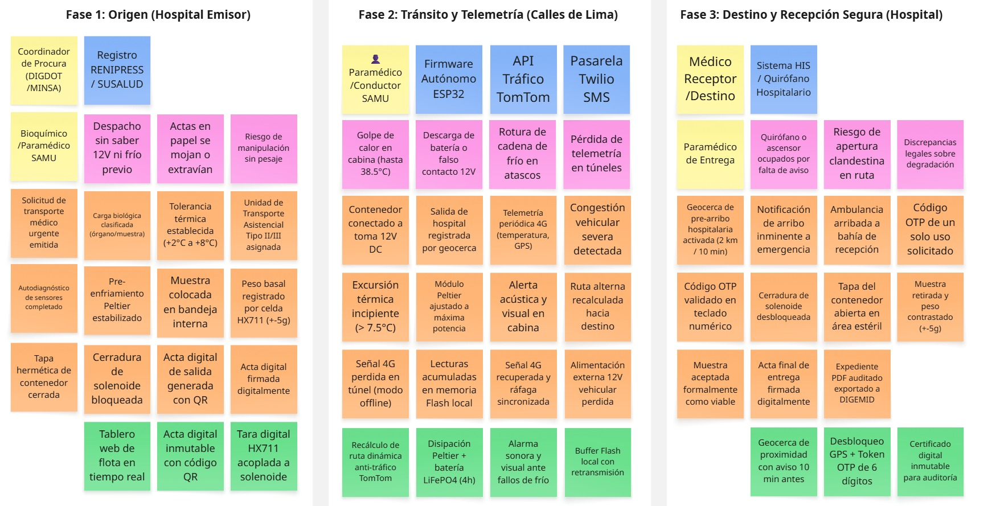

# 2.4. Big Picture EventStorming

El equipo llevó a cabo una sesión formal de **Big Picture EventStorming** con el objetivo de obtener una visión holística y compartida del dominio de negocio del **Contenedor Médico Inteligente (Smart Medical Container)** para el transporte asistencial de medicamentos termosensibles, hemoderivados, muestras biológicas y órganos en Lima Metropolitana. Bajo los principios y prácticas de *Domain-Driven Design* y la técnica de *EventStorming* propuesta por Alberto Brandolini [@brandolini2020], la dinámica integró activamente la perspectiva de los dos segmentos objetivo del negocio: **Empresas de Transporte y Operadores Logísticos de Cadena de Frío** (conductores y paramédicos de ambulancia) y **Centros de Salud y Cadenas Farmacéuticas** (coordinadores de despacho, farmacéuticos y médicos receptores), en conjunto con el equipo de ingeniería de software e IoT.

Siguiendo los principios de modelado colaborativo de Brandolini, el Big Picture EventStorming no se diseñó como un diagrama de flujo rígido de ingeniería ni como un BPMN con carriles estructurados, sino como un **lienzo colaborativo de notas adhesivas** en Miro donde el tiempo fluye de manera natural y orgánica de **izquierda a derecha**. A lo largo de la sesión, los participantes exploraron el ciclo de vida completo del transporte médico urgente: desde la solicitud inicial del traslado hasta la recepción conforme en el centro de salud receptor bajo estricta cadena de frío (2 °C a 8 °C según DIGEMID R.M. N° 833-2015/MINSA) y custodia electrónica inmutable.

El taller se desarrolló ejecutando rigurosamente los nueve (9) pasos estructurados del proceso canónico de Big Picture EventStorming documentado por Alberto Brandolini (*Step-by-Step Guide to Run Your Big Picture EventStorming*):

1. **Preparación del Espacio y Materiales (*Preparing the Room*):** Se estructuró un lienzo infinito colaborativo en Miro, eliminando barreras jerárquicas y configurando una superficie de modelado sin límites de anchura, provista de la agenda visual de la sesión y una paleta cromática estandarizada de notas adhesivas digitales.
2. **Dinámica de Activación (*Energizing the Audience*):** Se realizó una breve dinámica de desinhibición y alineación para predisponer activamente al equipo multidisciplinario, articulando la visión operativa de conductores y paramédicos de ambulancia (Segmento 1) con el criterio clínico de médicos cirujanos, químicos farmacéuticos y el equipo de ingeniería de software e IoT (Segmento 2).
3. **Presentación del Alcance, Objetivos y Reglas (*Briefing and Presenting the Plan*):** El facilitador presentó el propósito central del modelado: la preservación inviolable de la cadena de frío (+2 °C a +8 °C bajo normativa DIGEMID R.M. N° 833-2015) y la trazabilidad digital de órganos y hemoderivados frente a la congestión vehicular de Lima Metropolitana, estableciendo las reglas de interacción y respeto por el tiempo cronológico.
4. **Generación Caótica de Eventos de Dominio (*Generating Domain Events*):** Fase divergente de modelado silencioso e individual. Cada participante escribió y pegó de forma libre y masiva en notas adhesivas naranjas (`#FFA500`) todos los eventos relevantes del negocio expresados en tiempo verbal pasado (*Domain Events*), reflejando hitos significativos como `Pre-enfriamiento Peltier estabilizado`, `Excursión térmica incipiente detectada` o `Muestra aceptada formalmente como viable`.
5. **Ordenamiento Cronológico y Detección de Flujos Concurrentes (*Sorting Domain Events*):** Fase convergente de debate intenso. Los participantes organizaron cooperativamente las notas de izquierda a derecha en una línea temporal estricta de extremo a extremo, alineando verticalmente los procesos que ocurren en paralelo (por ejemplo, el control térmico autónomo Peltier ejecutándose concurrentemente mientras el vehículo avanza en el tráfico).
6. **Identificación de Actores y Sistemas Externos (*Adding Actors and External Systems*):** Se incorporaron los roles humanos responsables de gatillar o atender eventos mediante notas amarillas pequeñas (Conductor de Ambulancia, Paramédico TEM, Coordinador de Despacho, Cirujano Receptor), así como los sistemas externos interactuantes en notas azules (Firmware Autónomo ESP32 como nodo IoT Edge emisor, API de Tráfico TomTom, Pasarela SMS Twilio, Registro RENIPRESS / SUSALUD y Sistema HIS / Quirófano Hospitalario receptor).
7. **Narración Cronológica Hacia Adelante (*Storytelling*):** Un facilitador y representantes de ambos segmentos narraron oralmente la historia completa del flujo de negocio de izquierda a derecha. Esta lectura validó la consistencia global del proceso, esclareció supuestos implícitos y permitió identificar fricciones operativas y riesgos reales, señalizados de inmediato con notas magenta/rosa (*Hotspots*).
8. **Narración Inversa y Detección de Brechas (*Reverse Storytelling*):** Se ejecutó una lectura en sentido inverso, comenzando desde el evento final (`Muestra aceptada formalmente como viable` / `Acta final de entrega firmada digitalmente`) y preguntando repetidamente: *¿Qué condición previa tuvo que cumplirse para que ocurriera este hecho?* Este análisis retrospectivo descubrió eventos faltantes de bioseguridad, validaciones de pre-enfriamiento y protocolos de contingencia ante caídas de la toma vehicular de 12V.
9. **Cierre, Consenso y Síntesis de Oportunidades (*Closing and Synthesis*):** Se consolidó el entendimiento compartido del dominio, se extrajo el vocabulario fundamental para la construcción del Lenguaje Ubicuo (Sección 2.5) y se priorizaron en notas verdes las oportunidades de solución de software e IoT (tara automática con celda de carga HX711, algoritmo predictivo de desvíos de ETA y acta digital inmutable con firma QR).

***

  
*Nota: Elaboración propia en Miro según la técnica de modelado colaborativo de Alberto Brandolini para el transporte asistencial de muestras médicas y órganos en Lima Metropolitana.*

***

### **2.4.1. Análisis del Dominio y Hallazgos de la Sesión**

La sesión de Big Picture EventStorming permitió al equipo comprender la dinámica real del transporte médico en Lima Metropolitana y articular las necesidades clínicas con la arquitectura del sistema:

#### 1. Exploración Desestructurada, Línea de Tiempo y Eventos Pivote (Pivotal Events)

El mapeo de eventos evidenció que el transporte asistencial es un proceso altamente concurrente y sensible al tiempo. Mientras el vehículo se desplaza por arterias viales congestionadas de Lima Metropolitana, el hardware del contenedor inteligente ejecuta en paralelo un lazo cerrado autónomo de control térmico (manteniendo la carga entre +2.0 °C y +8.0 °C mediante celdas Peltier), registrando la estabilidad del peso y verificando el precinto de seguridad electromecánico.

Siguiendo el enfoque canónico de modelado colaborativo concebido por Alberto Brandolini, la línea de tiempo temporal se estructura a partir de tres **Eventos Pivote (*Pivotal Events*)** que demarcan formalmente los momentos críticos de quiebre y transición de responsabilidad entre las tres macrofases del sistema:

* **Pivotal Event 1 (Origen → Tránsito):** `Acta digital de salida generada y firmada digitalmente` junto con la `Conexión del contenedor a la toma 12V DC`. Marca la transferencia legal de custodia desde el hospital donante o farmacia central hacia el equipo asistencial móvil, activando el régimen de supervisión telemática en ruta.
* **Pivotal Event 2 (Tránsito → Destino):** `Geocerca de pre-arribo hospitalaria activada`. Disparo telemático automatizado al ingresar al radio de 2 km / 10 minutos del hospital receptor, habilitando la alerta temprana a la rampa de trauma shock y la preparación del equipo médico o farmacéutico receptor.
* **Pivotal Event 3 (Destino → Cierre Clínico):** `Muestra aceptada formalmente como viable`, `Acta final de entrega firmada digitalmente` y `Expediente PDF auditado exportado a DIGEMID`. Cierre definitivo de la cadena de custodia con generación del expediente digital sellado mediante hash criptográfico SHA-256 para auditoría sanitaria de DIGEMID.

#### 2. Matriz de Puntos Críticos (Hotspots) y Oportunidades de Solución

La pizarra colaborativa desarrollada en Miro articula el flujo de izquierda a derecha en tres macrofases espaciales (**1. Origen y Despacho**, **2. Tránsito y Monitoreo Asistencial**, **3. Destino, Custodia y Cierre Clínico**), integrando analíticamente sus seis (6) etapas operativas para brindar una granularidad técnica precisa.

La siguiente matriz sintetiza los problemas operativos reales identificados en la red hospitalaria de Lima y las soluciones de ingeniería de software e IoT implementadas:

| **Fase Operativa** | **Punto Crítico / Hotspot (Problema Real en Lima)** | **Severidad** | **Oportunidad de Solución (Software / IoT)** | **Subdominio DDD** |
| :------------- | :------------------------- | :----------- | :--------------------------- | :------------------- |
| **Despacho** | Asignación de ambulancias sin visibilidad del estado de su toma de 12V ni del pre-enfriamiento del contenedor. | Alta | **Tablero IoT de Estado de Flota:** Supervisión en tiempo real de batería, conexión eléctrica y temperatura previa. | *Medical Transport Planning & Dispatching* |
| **Carga y Custodia** | Riesgo de sustitución de muestras o carga de paquetes no verificados en la rampa hospitalaria. | Crítica | **Tara Automática con Celda HX711:** Registro de masa inicial (±5 g) y bloqueo automático del solenoide. | *Smart Container & Telemetry Monitoring* |
| **Carga y Custodia** | Actas en papel autocopiativo mojadas, extraviadas o ilegibles sin respaldo probatorio. | Media | **Acta Digital con Firma QR:** Comprobante electrónico inalterable consultable en plataforma web. | *Chain of Custody & Traceability* |
| **Tránsito** | **Congestión severa en Lima (TomTom: 34 min/10 km):** Retrasos críticos en Av. Javier Prado o Vía Expresa. | Crítica | **Motor de ETA Dinámico:** Recálculo de tiempos con TomTom Traffic API cada 60s y alertas de demora. | *Medical Transport Planning & Dispatching* |
| **Tránsito** | **Golpe de calor en cabina (hasta 38.5 °C):** Rompe la cadena de frío en cajas convencionales en <45 min. | Catastrófica | **Refrigeración Activa Peltier + Alarma Dual:** Control PID (2–8 °C), alarma sonora local y push a médicos. | *Critical Alerting & Incident Response* |
| **Tránsito** | **Desconexión accidental de 12V:** El enchufe del encendedor se zafa con baches o frenadas. | Alta | **Conmutación Automática a Batería LiFePO4:** Pack interno LiFePO4 (4h de autonomía) con aviso en cabina. | *Smart Container & Telemetry Monitoring* |
| **Tránsito** | **Pérdida de señal 4G en túneles (Línea Amarilla / zanjas):** Provoca vacíos de datos durante el traslado. | Alta | **Búfer Flash Offline en ESP32:** Almacenamiento local de 5,000 muestras y sincronización al reconectar. | *Smart Container & Telemetry Monitoring* |
| **Arribo** | Quirófano o personal de guardia no preparado al llegar la ambulancia por falta de preaviso. | Alta | **Geocerca de Pre-Arribo (≤ 2 km / 10 min):** Notificación automática al hospital receptor para alistar recepción. | *Medical Transport Planning & Dispatching* |
| **Entrega** | Apertura indebida en pasillos o entrega a personal no facultado sin validación de identidad. | Crítica | **Doble Factor de Desbloqueo:** Ubicación obligatoria en geocerca hospitalaria + código OTP temporal. | *Chain of Custody & Traceability* |
| **Cierre** | Rechazo de lotes o litigios por falta de auditoría continua exigida por DIGEMID (R.M. 833-2015). | Media | **Expediente Digital con Hash SHA-256:** Reporte PDF descargable con telemetría completa y firmas. | *Chain of Custody & Traceability* |

***

#### 3. Validación por Storytelling y Reverse Storytelling

La validación del recorrido de extremo a extremo confirmó la coherencia del ciclo asistencial entre ambos segmentos. Mediante la narrativa directa se verificó la transición sin fricciones de custodia entre el médico emisor, el paramédico (**Aldair Lazaro**) y el coordinador o médico receptor (**Gianfranco Timoteo**). Complementariamente, el análisis retrospectivo desde el hito `Muestra aceptada formalmente como viable` (`Acta final de entrega firmada digitalmente`) comprobó que ninguna entrega puede consumarse sin la confluencia de tres condiciones inviolables: desbloqueo por OTP dentro de la geocerca hospitalaria, preservación térmica continua (2 °C a 8 °C) garantizada por el respaldo LiFePO4, y descarga íntegra de la telemetría resguardada en el búfer flash local tras cruzar túneles.

#### 4. Delimitación de Contextos Delimitados (Bounded Contexts)

La sesión de Big Picture permitió delimitar cinco (5) Bounded Contexts de negocio, los cuales constituyen las fronteras transaccionales definitivas del sistema y se preservan en el mismo orden canónico a lo largo de toda la arquitectura y diseño de software:

1. **Identity, Access & Subscriptions (IAM):** Gestión de instituciones hospitalarias acreditadas (RENIPRESS), planes de suscripción SaaS B2B, autenticación JWT basada en roles y trazabilidad de licencias médicas.
2. **Smart Container & Telemetry Monitoring:** Ingestión de telemetría continua (temperatura, peso neto HX711, batería LiFePO4), control electromecánico de tapa y alta física de dispositivos IoT.
3. **Medical Transport Planning & Dispatching:** Gestión de solicitudes de traslado urgente, asignación de unidades asistenciales/tripulación, cálculo dinámico de rutas anti-tráfico TomTom y geocercas de pre-arribo.
4. **Critical Alerting & Incident Response:** Detección en tiempo real de excursiones térmicas, disparador de alarmas acústicas en cabina y notificación omnicanal de contingencias.
5. **Chain of Custody & Traceability:** Verificación de token OTP en geocerca hospitalaria, registro de actas de custodia y sellado inmutable con hash SHA-256 para DIGEMID (R.M. 833-2015).

***

### **2.4.2. Flujo Detallado de Comandos, Eventos y Políticas de Dominio**

Para complementar la visión macro del lienzo y facilitar la transición hacia el diseño táctico (DDD) y los contratos de software, a continuación se especifican los artefactos canónicos de la técnica:

#### Leyenda de Modelado

| Elemento | Significado | Ejemplo en el Dominio |
|---|---|---|
| **Actor** | Persona o rol que inicia una intención o toma una decisión. | Coordinador logístico, Paramédico TEM, Cirujano receptor. |
| **Comando** | Intención de acción que busca modificar el estado del sistema. | `AssignVehicleAndBoxToTrip`, `RecordTelemetrySnapshot`. |
| **Evento de Dominio** | Hecho relevante consumado e inmutable expresado en tiempo pasado. | `DispatchedTripStarted`, `ThermalExcursionDetected`. |
| **Política / Regla** | Reacción automática ante un evento (*Whenever [Event] Then [Action]*). | Si la temperatura supera 8.0 °C por >2 min, emitir alerta crítica. |
| **Read Model** | Proyección de datos optimizada para la toma de decisiones. | Tablero de telemetría en vivo, Línea de tiempo de custodia. |
| **Sistema Externo** | Plataforma de terceros fuera de la frontera transaccional. | GPS / TomTom API, Nodo IoT ESP32 (HTTPS/REST), Pasarela Twilio SMS. |
| **Hotspot** | Riesgo operacional, vacío normativo o punto de fricción técnica. | Falla de señal celular 4G en zanjas viales o túneles de Lima. |

#### Flujo Secuencial de Eventos de Extremo a Extremo

| **N.°** | **Actor / Sistema** | **Comando** | **Evento de Dominio Resultante** | **Read Model o Evidencia Generada** |
| :----: | :------------------- | :----------------------- | :------------------------ | :------------------------ |
| 1 | Institución de origen | `SolicitarTraslado` (`CreateTransportOrder`) | `TrasladoSolicitado` (`TransportOrderPlaced`) | Registro de solicitud con tipo de carga médica, origen, destino y prioridad clínica. |
| 2 | Coordinador de despacho | `ValidarSolicitud` (`ValidateTransportOrder`) | `SolicitudValidada` (`TransportOrderValidated`) | Verificación de viabilidad, disponibilidad horaria y requisito térmico (2 °C - 8 °C). |
| 3 | Coordinador de despacho | `AsignarRecursosTraslado` (`AssignVehicleAndBoxToTrip`) | `RecursosAsignados` (`TripResourcesAssigned`) | Asignación de unidad móvil, contenedor inteligente y tripulación asistencial. |
| 4 | Paramédico asistencial | `VerificarPreparacion` (`VerifyPrecoolingReadiness`) | `PreparacionVerificada` (`PrecoolingVerified`) | Lista de chequeo previa: estado de batería LiFePO4, calibración y conexión 12V. |
| 5 | Personal médico emisor | `RegistrarCargaYSellar` (`EngageSolenoidLock`) | `ContenedorSellado` (`ContainerLidLocked`) | Registro de masa inicial en celda HX711 (tara automática) y bloqueo electromecánico de solenoide. |
| 6 | Paramédico asistencial | `IniciarTraslado` (`StartDispatchedTrip`) | `TrasladoIniciado` (`DispatchedTripStarted`) | Registro de hora exacta de salida, geocerca inicial y cálculo dinámico de ETA. |
| 7 | Contenedor IoT (ESP32) | `PublicarTelemetria` (`RecordTelemetrySnapshot`) | `TelemetriaRegistrada` (`TelemetryRecorded`) | Ingesta de temperatura ambiente/interna, nivel de batería, estado de tapa y coordenadas GPS. |
| 8 | Motor de Reglas de Negocio | `EvaluarCondiciones` (`EvaluateTelemetryRules`) | `CondicionEvaluada` (`ThermalExcursionDetected`) | Validación de cumplimiento estricto del rango térmico e integridad de la ruta. |
| 9 | Coordinador de despacho | `SupervisarMonitoreo` (`UpdateDynamicEta`) | `MonitoreoConfirmado` (`DynamicEtaRecalculated`) | Tablero de control de flota en tiempo real con semaforización de riesgo. |
| 10 | Conductor de ambulancia | `RegistrarArribo` (`TriggerPreArrivalGeofence`) | `UnidadArribadaADestino` (`HospitalPreArrivalTriggered`) | Activación de geocerca hospitalaria de pre-arribo (radio ≤ 2 km / 10 min). |
| 11 | Cirujano / Farmacéutico receptor | `VerificarCarga` (`VerifyOtpAndGeofence`) | `CondicionFinalVerificada` (`ContainerLidUnlocked`) | Inspección de integridad celular, historial térmico continuo y balance de peso. |
| 12 | Cirujano / Farmacéutico receptor | `AceptarORechazarEntrega` (`CompleteCustodyHandover`) | `EntregaAceptada` (`HandoverCompletedAndSealed`) | Desbloqueo mediante token dinámico OTP en geocerca y registro de observaciones clínicas. |
| 13 | Coordinador de despacho | `CerrarTraslado` (`CompleteDispatchTrip`) | `TrasladoCerrado` (`DispatchTripCompleted`) | Sellado de la línea de tiempo inmutable de custodia. |
| 14 | Plataforma Web | `GenerarExpedienteAuditoria` (`SealDigitalManifest`) | `ExpedienteAuditoriaGenerado` (`DigitalManifestSealed`) | Exportación de reporte técnico PDF sellado con hash criptográfico SHA-256 para DIGEMID. |

#### Políticas y Rutas Alternativas de Contingencia

* **Desviación Térmica (Excursión Térmica):**
  * *Evento desencadenante:* `TemperaturaFueraDeRango` (`ThermalExcursionDetected`).
  * *Política reactiva:* Si la temperatura interna excede los 8.0 °C o desciende de 2.0 °C durante más de 120 segundos continuos, disparar de inmediato alerta acústica/visual en cabina vehicular y remitir notificación push de máxima severidad a los médicos del hospital receptor.
  * *Acción correctiva:* Paramédico verifica ventilación y suministro eléctrico del contenedor; se registra la intervención en la bitácora telemática (`ContingencyResolution`).
* **Pérdida de Conectividad Celular (Túneles y Zonas de Sombra 4G):**
  * *Evento desencadenante:* `TelemetriaInterrumpida` (`TelemetryConnectionLost`).
  * *Política reactiva:* El microcontrolador ESP32 conmuta autónomamente al búfer de memoria flash interna no volátil (almacenando hasta 5,000 muestras con marca de tiempo del RTC), marcando el read model web con advertencia de última lectura conocida. Al reconectar la red celular 4G, se gatilla `TelemetriaRestablecida` y sincronización secuencial en bloque.
* **Retraso Crítico por Congestión Vehicular:**
  * *Evento desencadenante:* `ETAExcedido` (`DynamicEtaRecalculated`).
  * *Política reactiva:* Reevaluación del tráfico en tiempo real mediante TomTom Traffic API. Si la demora supera los 15 minutos respecto a la ventana de viabilidad del órgano, notificar a la central de despacho para gestionar apoyo vial policial o advertir al equipo quirúrgico receptor.
* **Apertura No Autorizada de Escotilla:**
  * *Evento desencadenante:* `AperturaFueraDeGeocercaDetectada` (`TamperAttemptDetected`).
  * *Política reactiva:* Si el sensor magnético detecta separación de la tapa fuera del radio hospitalario autorizado, marcar `CadenaDeCustodiaComprometida`, activar sirena local de seguridad y registrar el incidente con coordenadas geográficas inmediatas.

#### Agregados y Límites del Dominio

| Agregado Raíz Canónico (`4.6` / `4.7`) | Bounded Context Asociado | Responsabilidad Principal | Eventos de Dominio Clave |
|---|---|---|---|
| **`UserAccount` / `HospitalInstitution` / `SubscriptionPlan`** | *1. Identity, Access & Subscriptions (IAM)* | Gobernar la identidad de usuarios clínicos/logísticos, instituciones IPRESS con geocerca y cuotas SaaS B2B. | `InstitutionProvisioned`, `UserAuthenticated`. |
| **`SmartContainer`** *(con `TelemetryLog`)* | *2. Smart Container & Telemetry Monitoring* | Gestionar el estado operativo del hardware IoT, precinto electromecánico, celda de carga HX711 y series temporales de telemetría. | `ContainerLidLocked`, `TelemetryRecorded`, `ExternalPowerLost`, `ContainerLidUnlocked`. |
| **`TransportOrder` / `DispatchTrip`** | *3. Medical Transport Planning & Dispatching* | Salvaguardar la orden clínica de traslado (`BiologicalPayload`, `IschemiaTimeLimit`) y orquestar el viaje, ruta, vehículo y ETA dinámico. | `TransportOrderPlaced`, `TripResourcesAssigned`, `DispatchedTripStarted`, `DynamicEtaRecalculated`. |
| **`CriticalIncident`** *(con `ContingencyResolution`)* | *4. Critical Alerting & Incident Response* | Gestionar el ciclo de vida de anomalías térmicas, ponderales y operativas, escalamiento omnicanal y registro de mitigación. | `ThermalExcursionDetected`, `HospitalPreArrivalTriggered`, `CriticalAlertTriggered`, `IncidentResolved`. |
| **`CustodyTransfer` / `DigitalAuditManifest`** | *5. Chain of Custody & Traceability* | Preservar el desbloqueo de doble factor (Geocerca + `OtpToken`) y sellar el expediente PDF inmutable con hash SHA-256 para DIGEMID. | `OtpGeneratedForArrival`, `HandoverCompletedAndSealed`, `DigitalManifestSealed`. |
