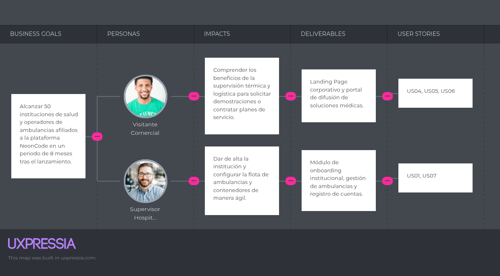
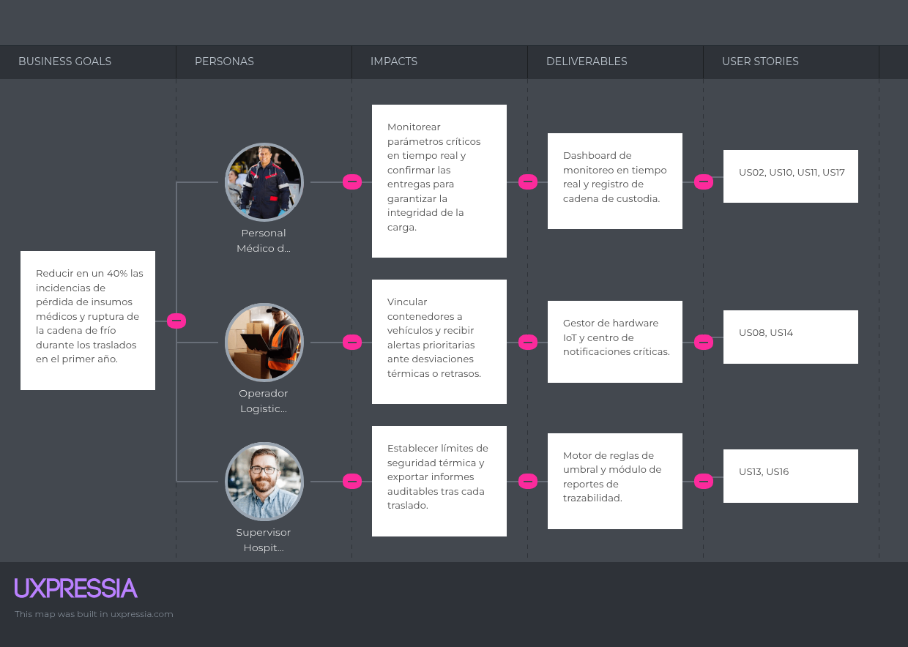

# 3.2. Impact Mapping

El **Impact Mapping** es una técnica de planificación estratégica que conecta los objetivos de negocio de la startup **NeonCode** con las entregas de software para la supervisión de contenedores médicos inteligentes (**Medical SmartBox**). Este mapa permite priorizar las funcionalidades que generan un impacto directo en el comportamiento de nuestros segmentos objetivo representados por nuestros *User Personas* del Capítulo II: **Aldair Lazaro** (Segmento 1: Personal Médico de Emergencias y Transporte Asistencial) y **Gianfranco Timoteo** (Segmento 2: Supervisores Hospitalarios, Operadores Logísticos de Salud y Visitantes Comerciales Institucionales), además del equipo técnico (**Developer**) que habilita la plataforma mediante las historias técnicas de la API REST.

### Estructura del Impact Map

El mapa de impacto se compone de cuatro niveles jerárquicos:

1. **Business Goal (Meta de Negocio):** Objetivos SMART que la startup busca alcanzar en un periodo determinado.
2. **Actor / Persona:** Los usuarios o roles (vinculados a los *User Personas* **Aldair Lazaro** y **Gianfranco Timoteo**) que nos ayudarán a alcanzar las metas.
3. **Impact:** Los cambios conductuales o beneficios esperados en los actores.
4. **Deliverables & User Stories:** Los entregables digitales y la totalidad de las 18 historias de usuario y técnicas asociadas (con su enunciado completo) que provocan dichos impactos.

::: {.impact-map-lists}

### Mapeo Completo por Objetivos de Negocio (Business Goals)

#### Goal 1: Alcanzar 50 instituciones de salud y operadores de ambulancias afiliados a la plataforma NeonCode en un periodo de 8 meses tras el lanzamiento.

* **Actor:** Visitante Comercial Institucional (*User Persona relacionado:* **Gianfranco Timoteo** — Coordinador Hospitalario que evalúa soluciones tecnológicas para su clínica o red de salud).
    * **Impact:** Comprender los beneficios de la supervisión térmica y logística en tiempo real para solicitar demostraciones corporativas o contratar planes de suscripción SaaS.
        * **Deliverable:** Landing Page corporativo y portal de difusión de soluciones médicas.
            * **US04 (Exploración de Propuesta de Valor Logística):** *Como visitante comercial institucional (Gianfranco Timoteo), deseo consultar las capacidades de los contenedores inteligentes en el Landing Page para evaluar su implementación.*
            * **US05 (Solicitud de Demostración Corporativa):** *Como visitante comercial institucional (Gianfranco Timoteo), deseo enviar un formulario de contacto para solicitar una demostración del sistema en mi centro hospitalario.*
            * **US06 (Consulta de Preguntas Frecuentes):** *Como visitante comercial institucional (Gianfranco Timoteo), deseo revisar la sección de FAQ en el Landing Page para resolver dudas sobre la integración IoT en ambulancias.*

* **Actor:** Supervisor Hospitalario / Operador Logístico (*User Persona:* **Gianfranco Timoteo** — Segmento 2: Hospitales y Clínicas).
    * **Impact:** Dar de alta la institución de salud y habilitar la flota de ambulancias de manera digitalizada y autónoma en menos de 10 minutos.
        * **Deliverable:** Módulo de onboarding institucional, gestión de flota vehicular y servicio de autenticación API.
            * **US01 (Registro de Institución de Salud):** *Como supervisor hospitalario (Gianfranco Timoteo), deseo registrar mi centro médico en la plataforma NeonCode para gestionar la flota de ambulancias y contenedores.*
            * **US07 (Alta de Unidades de Ambulancia):** *Como operador logístico de salud (Gianfranco Timoteo), deseo registrar y habilitar matrículas de vehículos de transporte en el sistema para asociarles contenedores de insumos en despachos activos.*
            * **US03 (Endpoint de Autenticación de Usuarios - API):** *Como Developer, deseo disponer de un endpoint `POST /api/v1/authentication/sign-in` para validar credenciales y emitir tokens de sesión.*

#### Goal 2: Reducir en un 40% las incidencias de pérdida de insumos médicos y ruptura de la cadena de frío durante los traslados en el primer año.

* **Actor:** Personal Médico de Emergencia (*User Persona:* **Aldair Lazaro** — Segmento 1: Personal de Transporte Asistencial y Emergencias Médicas).
    * **Impact:** Monitorear parámetros térmicos y de inventario por peso en tiempo real dentro de la cabina de la ambulancia y sellar digitalmente las entregas en el hospital receptor para garantizar la integridad de la carga biológica.
        * **Deliverable:** Dashboard de monitoreo en tiempo real, control de inventario por sensores de masa y registro de cadena de custodia.
            * **US02 (Autenticación de Personal de Emergencia):** *Como personal médico de emergencia (Aldair Lazaro), deseo autenticarme en la aplicación web para acceder al estado de la carga transportada en tiempo real.*
            * **US10 (Monitoreo Térmico y de Apertura):** *Como personal médico de emergencia (Aldair Lazaro), deseo consultar la temperatura interna y el estado de apertura del contenedor para garantizar la cadena de frío.*
            * **US11 (Control de Stock por Sensores de Peso):** *Como personal médico de emergencia (Aldair Lazaro), deseo verificar la disponibilidad de insumos mediante sensores de peso para confirmar existencias.*
            * **US17 (Confirmación de Entrega y Cadena de Custodia):** *Como personal médico de emergencia (Aldair Lazaro), deseo registrar la recepción del contenedor para cerrar la cadena de custodia del envío.*
            * **US12 (Consulta de Telemetría e Indicadores - API):** *Como Developer, deseo disponer de un endpoint `GET /api/v1/containers/{containerId}/metrics` para alimentar la vista del panel web.*

* **Actor:** Operador Logístico de Salud (*User Persona:* **Gianfranco Timoteo** — Segmento 2: Hospitales y Clínicas).
    * **Impact:** Vincular contenedores inteligentes a unidades de ambulancia en cada orden de despacho y recibir alertas prioritarias ante desviaciones térmicas, aperturas prolongadas o retrasos de ETA.
        * **Deliverable:** Gestor de aprovisionamiento IoT, ingesta de telemetría y centro de notificaciones críticas.
            * **US08 (Vinculación de Contenedor Inteligente):** *Como operador logístico de salud (Gianfranco Timoteo), deseo vincular un contenedor IoT (`SmartContainer`) a una ambulancia específica en un despacho médico (`DispatchTrip`) para iniciar la supervisión de la carga.*
            * **US14 (Visualización de Alertas en Ruta):** *Como operador logístico de salud (Gianfranco Timoteo), deseo recibir avisos de variaciones térmicas o retrasos para tomar acciones correctivas inmediatas.*
            * **US09 (Ingesta de Telemetría IoT - API):** *Como Developer, deseo contar con un endpoint `POST /api/v1/containers/{containerId}/telemetry` para registrar datos térmicos y de estado.*
            * **US15 (Servicio de Despacho de Alertas - API):** *Como Developer, deseo contar con un endpoint `POST /api/v1/alerts/dispatch` para procesar notificaciones de emergencia.*

* **Actor:** Supervisor Hospitalario (*User Persona:* **Gianfranco Timoteo** — Segmento 2: Hospitales y Clínicas).
    * **Impact:** Establecer límites de seguridad térmica según el tipo de insumo biológico y exportar informes auditables e inmutables tras cada traslado médico.
        * **Deliverable:** Motor de reglas de umbral térmico y módulo de auditoría de cadena de custodia.
            * **US13 (Configuración de Umbrales Térmicos Críticos):** *Como supervisor hospitalario (Gianfranco Timoteo), deseo establecer rangos de temperatura permitidos para recibir avisos preventivos ante desviaciones.*
            * **US16 (Generación de Reportes de Trazabilidad):** *Como supervisor hospitalario (Gianfranco Timoteo), deseo exportar el informe del traslado médico para certificar el cumplimiento de la cadena de frío.*
            * **US18 (Consulta de Historial de Traslados - API):** *Como Developer, deseo disponer de un endpoint `GET /api/v1/transfers/{transferId}/audit` para recuperar el registro de auditoría.*

:::

### Captura de los Artefactos en UXPressia

::: {.figure-block}
**Impact Map Goal 1**

:::

::: {.figure-block}
**Impact Map Goal 2**

:::
