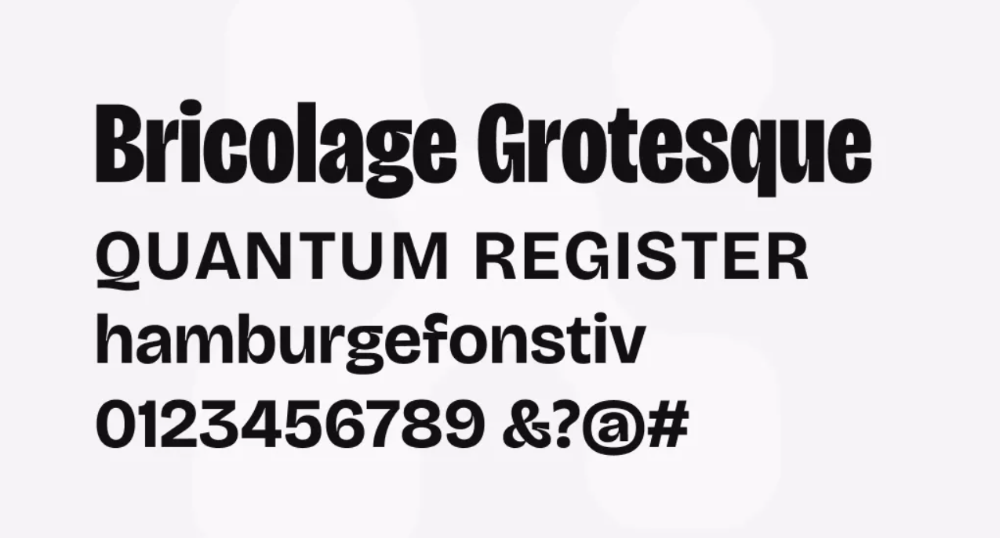
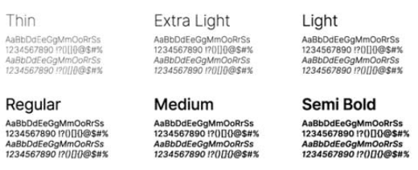

# 4.1. Style Guidelines

Un *Style Guideline* es un conjunto de directrices y normas que establecen los estándares visuales, de interacción, de tono de comunicación y de presentación que rigen el ecosistema digital de **Medical SMARTBOX**. Las especificaciones aseguran coherencia estética, usabilidad rigurosa y máxima legibilidad de datos telemétricos críticos tanto en la aplicación web de monitoreo como en el sitio web de divulgación comercial (Landing Page).

## 4.1.1. General Style Guidelines

### Branding

Para el desarrollo de la identidad de **Medical SMARTBOX**, se definió una estética limpia, clínica y altamente tecnológica que sintetiza la convergencia entre logística médica asistencial y telemetría de precisión IoT. La identidad visual simboliza el control integral y la custodia ininterrumpida de la cadena de frío para hemoderivados, órganos y medicamentos biológicos. La composición cromática —basada en Azul Marino Profundo, Verde Cerceta (Teal), Verde Menta y acentos de Alerta en Coral/Rojo— transmite confiabilidad médica, estabilidad operativa y capacidad inmediata de advertencia frente a excursiones térmicas.

*Nota: Logotipo oficial de Medical SMARTBOX, representando la custodia térmica inteligente.*

### Voice & Tone (Las 4 Dimensiones de Nielsen Norman Group [@nielsen1994] — NN/g)

De acuerdo con el marco metodológico de **Nielsen Norman Group (NN/g)** para la definición del tono de voz en productos digitales, la comunicación verbal y microcopia de **Medical SMARTBOX** se adapta a la alta presión cognitiva de nuestros *User Personas* (**Aldair Lazaro**, personal de transporte asistencial en ruta; y **Gianfranco Timoteo**, supervisor hospitalario y coordinador logístico):

| Dimensión NN/g | Posicionamiento de Medical SMARTBOX | Justificación y Aplicación en Interfaz (Microcopy) |
| :--- | :--- | :--- |
| **1. Funny vs. Serious** *(Divertido vs. Serio)* | **100% Serious (Serio)** | El transporte de órganos, sangre y biológicos de emergencia es una operación crítica para la vida humana. Se omite cualquier humor, sarcasmo o coloquialismo en estados de error o alertas térmicas. |
| **2. Formal vs. Casual** *(Formal vs. Casual)* | **Formal-Técnico (Clínico y Directo)** | Se emplea terminología médico-logística estandarizada (*Cadena de frío*, *Excursión térmica*, * Ventana de isquemia*, *Acta SHA-256*, *Cumplimiento DIGEMID*) comprensible al instante por profesionales de salud y operadores de flota. |
| **3. Respectful vs. Irreverent** *(Respetuoso vs. Irreverente)* | **Altamente Respectful (Respetuoso)** | Respeta el tiempo y la carga de estrés del paramédico (**Aldair Lazaro**) y del receptor hospitalario (**Gianfranco Timoteo**), guiando la resolución de incidentes sin culpabilizar al usuario ante errores de digitación de OTP o pérdidas de cobertura celular. |
| **4. Enthusiastic vs. Matter-of-fact** *(Entusiasta vs. Objetivo/Práctico)* | **Matter-of-fact (Objetivo y Conciso)** | Prioriza datos cuantitativos exactos sin adornos retóricos. En el Dashboard web predomina la objetividad pura (ej. *"Alerta Crítica: 9.2 °C en SB-0231 — Excede umbral máximo de 8.0 °C por 90 s"*), mientras que en el Landing Page adopta un matiz ligeramente persuasivo pero sustentado en métricas técnicas. |

### Typography

El sistema tipográfico prioriza la jerarquía visual y la decodificación instantánea de telemetría numérica en entornos de alta exigencia cognitiva (ej. cabina de ambulancia o supervisión en central de emergencias). Se implementa una escala tipográfica modular basada en las siguientes fuentes de Google Fonts:

*   **Bricolage Grotesque:** Empleada como tipografía corporativa para encabezados primarios y secundarios (`h1`, `h2`, `h3`). Su estructura geométrica contemporánea con remates técnicos otorga autoridad visual, solidez institucional y modernidad tecnológica.
*   **Inter:** Empleada para textos de párrafo, microcopia de interfaz, tablas de auditoría y visualización de telemetría numérica. Su excelente renderizado subpíxel y variantes tabulares numéricas (`font-variant-numeric: tabular-nums`) garantizan una lectura nítida de decimales de temperatura y porcentajes de batería sin oscilaciones visuales.

*Nota: Muestrarios tipográficos de Bricolage Grotesque (titulares) e Inter (cuerpo y datos numéricos).*

### Colors

La paleta cromática se seleccionó bajo criterios de contraste accesible (cumplimiento WCAG 2.1 [@w3c2018] Nivel AA) y codificación semántica para estados operativos clínicos:

*   **Azul Marino Corporativo (`#10312F` / `#1F3C77`):** Color dominante institucional que proyecta solidez, seriedad médica y rigor de ingeniería.
*   **Verde Cerceta / Teal (`#0F7A70`):** Color primario de acción y estado óptimo ("En Rango", carga refrigerada entre 2 °C y 8 °C, telemetría activa).
*   **Verde Menta (`#B9DDA0`):** Fondo suave de soporte para indicadores de éxito y tarjetas de estado estable.
*   **Coral / Rojo Alerta (`#E05A46`):** Tono semántico de alta prioridad reservado exclusivamente para situaciones críticas (temperatura fuera de umbral, desconexión de energía de 12V, batería residual < 15%, apertura no autorizada de tapa).
*   **Gris Neutro Frío (`#F4F7F6` / `#E2E8F0`):** Fondos de interfaz y delimitadores de paneles modulares para reducir la fatiga visual en turnos prolongados.

*Nota: Muestra de la paleta de colores corporativa y semántica de Medical SMARTBOX.*

### Spacing

El espaciado se fundamenta en un sistema de rejilla base modular de **8 píxeles** (8-point grid system: 4px, 8px, 16px, 24px, 32px, 48px, 64px). Este estándar asegura consistencia entre paneles modulares, tarjetas de telemetría telemática (*telemetry cards*) y botones de acción rápida, previniendo el hacinamiento de información y reduciendo la tasa de error por toques accidentales en pantallas táctiles de cabina.

***

## 4.1.2. Web Style Guidelines

Las directrices web definen la estructura adaptativa, componentes interactivos y comportamiento responsivo de la plataforma:

*   **Estrategia Responsive y Adaptabilidad Multi-dispositivo:**
    *   **Desktop / Estaciones Hospitalarias (Viewport ≥ 1280px):** Disposición de cuadrícula fluida de 12 columnas. Aprovecha el ancho panorámico para mostrar simultáneamente el mapa de flota satelital en vivo, gráficos telemétricos continuos y panel lateral de incidentes activos.
    *   **Tablet / Terminales de Cabina (Viewport 768px a 1024px):** Cuadrícula adaptativa de 6 columnas. Los paneles secundarios se condensan en pestañas (*tabs*) o cajones laterales (*drawers*) accesibles mediante gestos táctiles.
    *   **Mobile Browser / Smartphones Médicos (Viewport 360px a 414px):** Colapso a una columna única fluida (1 columna, 100% de ancho con márgenes laterales de 16px). La barra de navegación superior colapsa en un menú tipo hamburguesa/drawer lateral; los mapas de ruta alternan a pantalla completa modal; las tarjetas de métricas telemétricas se apilan verticalmente; y los botones de acción rápida (ej. "Reconocer Alerta", "Solicitar OTP") cuentan con una altura mínima de **48px** para garantizar un área táctil ergonómica (*touch target*) según directrices de Google Material Design y Apple Human Interface Guidelines.
*   **Navegación y Patrones de Interacción:**
    *   **Sticky Header:** Barra de navegación superior fija que mantiene visible el logotipo institucional, estado de conexión en tiempo real (indicador verde de latencia de red), conmutador de idioma (ES/EN) y botón de acceso rápido al perfil de usuario.
    *   **Route Rail (Navegación Vertical de Seguimiento):** En el Landing Page, un indicador lateral animado (*scrollspy*) sitúa visualmente al visitante a lo largo de las secciones informativas del producto.
    *   **Retroalimentación Inmediata de Estados:** Cada microinteracción (hover en escritorio, active state en móvil) ofrece respuestas visuales no mayores a 150ms mediante transiciones CSS fluidas (`ease-in-out`), confirmando visualmente cada comando emitido.
