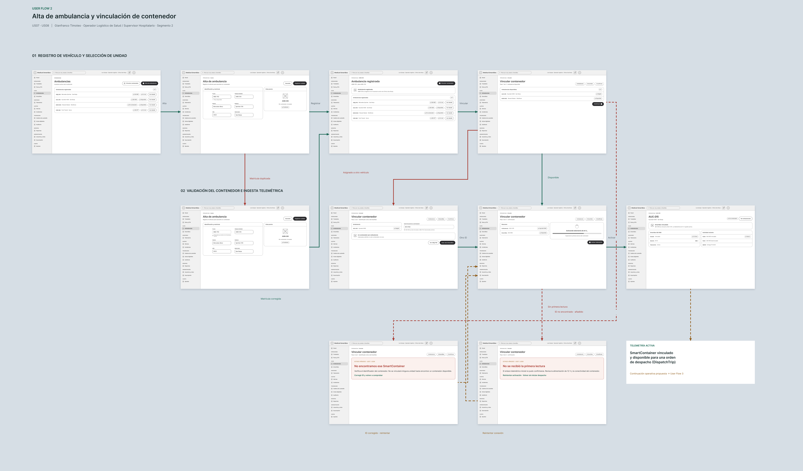

# 4.4. Web Applications UX/UI Design

La Web Application es la interfaz de operación de Medical SmartBox. El showcase interactivo reúne 64 pantallas organizadas por tareas y roles de operador, personal médico y supervisor. Esta sección documenta su estructura, las transiciones entre pantallas y las vistas que se usarán como evidencia del diseño.

### 4.4.1. Web Applications Wireframes

Las vistas comparten una estructura que permite localizar el módulo actual y operar sobre su contenido.

| Zona | Contenido |
| --- | --- |
| Barra superior | Marca, filtro global, notificaciones, usuario, rol e institución. |
| Barra lateral | Módulos agrupados por tarea, según la sección 4.2.5. |
| Ruta y área de contenido | Breadcrumbs, título de vista, KPIs, paneles, formularios o listas según el módulo. |
| Adaptación mobile (≤ 700 px) | Contenido en una columna y navegación accesible mediante menú compacto. |

| Wireframe | Vista representada | User Stories relacionadas |
| --- | --- | --- |
| W01 | Inicio de sesión y verificación de identidad | US01, US02 |
| W02 | Panel del operador y lista de traslados | US14 |
| W03 | Ambulancias e inventario de SmartBox | US07, US08 |
| W04 | Monitoreo térmico y control de stock | US10, US11 |
| W05 | Umbrales y reglas de alerta | US13 |
| W06 | Cadena de custodia y reportes | US16, US17 |

### 4.4.2. Web Applications Wireflow Diagrams

Cada wireflow conecta wireframes mediante flechas que nombran la acción o condición que produce la transición. Los recorridos incluyen su resultado esperado y las alternativas relevantes.

| Wireflow | User Goal | Persona principal | User Stories |
| --- | --- | --- | --- |
| WF1 | Acceder a la cuenta y completar la verificación de identidad | Aldair Lazaro y Gianfranco Timoteo | US01, US02 |
| WF2 | Resolver una alerta térmica durante un traslado | Gianfranco Timoteo | US14 |
| WF3 | Vincular un SmartBox disponible a una ambulancia | Gianfranco Timoteo | US07, US08 |
| WF4 | Preparar y crear un traslado médico | Gianfranco Timoteo | |
| WF5 | Confirmar la recepción y cerrar la cadena de custodia | Aldair Lazaro y Gianfranco Timoteo | US17 |
| WF6 | Configurar umbrales y generar un reporte de trazabilidad | Gianfranco Timoteo | US13, US16 |

**WF1 · Acceso e identidad.** Credenciales → validación → verificación en dos pasos → código válido → panel por rol. Las alternativas representan credenciales inválidas, código incorrecto y recuperación de contraseña.

**WF2 · Incidente térmico.** Panel → traslado activo → detalle de alerta → registro de acción correctiva → estado actualizado. La rama alternativa conserva el caso sin alertas o con pérdida de conexión.

**WF3 · Flota y SmartBox.** Inventario → alta o detalle de ambulancia → vincular contenedor → seleccionar SmartBox → confirmar asociación. Las ramas alternativas muestran matrícula duplicada o dispositivo ya vinculado.

**WF4 · Nuevo traslado.** Traslados → nuevo traslado → completar datos → revisar → confirmar. Las alternativas incluyen cancelación y una ruta que supera el límite de isquemia fría.

**WF5 · Recepción y custodia.** Detalle del traslado → confirmar recepción → verificar código → cerrar y consultar la custodia. Las ramas alternativas incluyen código incorrecto o excursión térmica activa.

**WF6 · Umbrales y trazabilidad.** Configuración de umbrales → validar regla → guardar → consultar custodia → generar reporte. La alternativa muestra un umbral inválido.

### 4.4.3. Web Applications Mock-ups

Los mock-ups se documentan mediante capturas del showcase interactivo. Las 64 pantallas se distribuyen por recorrido y área funcional:

| Grupo | Pantallas | Contenido principal |
| --- | ---: | --- |
| Acceso e identidad | 10 | Inicio de sesión, credenciales inválidas, verificación en dos pasos, recuperación de contraseña y registro de institución. |
| Recorrido 1 · Operador | 12 | Panel, traslados, ruta y ETA, alertas, incidentes, historial y estado sin alertas. |
| Recorrido 2 · Flota | 12 | Ambulancias, inventario de SmartBox, vincular o desvincular, y alta de ambulancia. |
| Recorrido 3 · Nuevo traslado | 6 | Formulario, revisión, creación, cancelación e historial. |
| Recorrido 4 · Personal médico | 8 | Monitoreo, excursión térmica, control de stock, telemetría, recepción y custodia. |
| Recorrido 5 · Supervisor | 9 | Umbrales, reglas de alerta, custodia, acta digital, reportes y auditoría. |
| Administración y cuenta | 7 | Usuarios, roles, suscripción, perfil y notificaciones. |
| **Total** | **64** | |

Las pantallas del showcase incluyen estados de carga, error con opción de reintento y estado vacío (“Sin alertas”). La interfaz de esta versión está en español.

### 4.4.4. Web Applications User Flow Diagrams

Cada User Flow presenta los mock-ups de las pantallas como pasos del recorrido, identifica la meta de la persona y separa el camino esperado de las alternativas o errores.

**UF1 · Acceso e identidad (US01, US02)**

- **User Goal:** acceder de forma segura a la cuenta.
- **Happy path:** inicio de sesión → credenciales válidas → verificación en dos pasos → código correcto → panel.
- **Unhappy paths:** credenciales inválidas; código incorrecto. Los recorridos secundarios incluyen recuperar contraseña y registrar una institución.

**UF2 · Operador: incidente en ruta (US14)**

- **User Goal:** identificar y resolver un incidente térmico durante un traslado.
- **Happy path:** panel → detalle del traslado → ruta y ETA → alerta en ruta → detalle de alerta crítica → incidente → registrar resolución → estado resuelto.
- **Unhappy paths:** no hay alertas; se pierde la conexión y se muestra “Reintentar conexión”.

**UF3 · Flota: vincular un SmartBox (US07, US08)**

- **User Goal:** habilitar una ambulancia y asociarle un SmartBox disponible.
- **Happy path:** inventario → alta o detalle de ambulancia → vincular contenedor → elegir SmartBox → confirmar asociación.
- **Unhappy paths:** placa duplicada; SmartBox ya vinculado.

**UF4 · Crear un traslado médico**

- **User Goal:** registrar un traslado con sus datos y revisar la orden antes de crearla.
- **Happy path:** Traslados → nuevo traslado → completar formulario → revisar → traslado creado.
- **Unhappy paths:** la ruta excede el límite de isquemia fría; cancelar el traslado.

**UF5 · Personal médico: recepción y custodia (US10, US11, US17)**

- **User Goal:** comprobar el estado de la carga y confirmar su recepción para cerrar la custodia.
- **Happy path:** panel del personal → monitoreo térmico → verificar insumos → confirmar recepción → validar código → custodia cerrada.
- **Unhappy paths:** excursión térmica; código incorrecto; telemetría en estado de carga.

**UF6 · Supervisor: umbrales y reportes (US13, US16)**

- **User Goal:** definir umbrales térmicos y generar un reporte de trazabilidad.
- **Happy path:** panel → configurar umbrales → guardar regla → consultar custodia → generar reporte.
- **Unhappy path:** el umbral no es válido y debe corregirse antes de guardar.

En cada composición, los mock-ups representan las pantallas del recorrido; las flechas nombran acciones o condiciones y las ramas distinguen el *happy path* de los *unhappy paths*.
