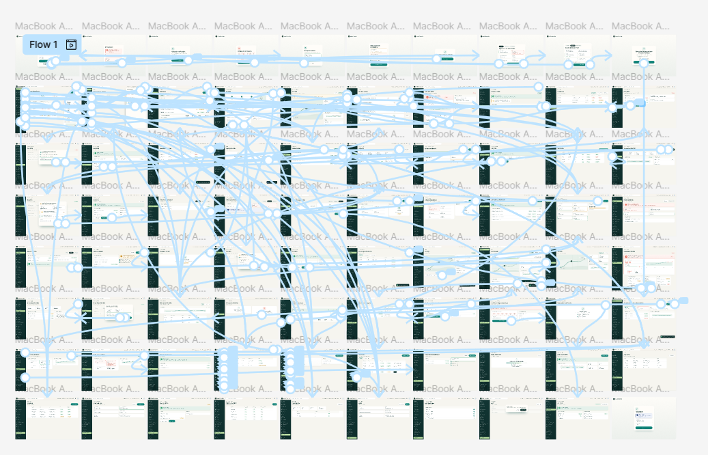

# 4.5. Web Applications Prototyping

El prototipo de la Web Application permite recorrer las pantallas y transiciones descritas en la sección 4.4. Se presenta en el showcase HTML interactivo y en un prototipo de alta fidelidad en Figma, para desktop y mobile. El showcase reúne 64 pantallas y más de 130 transiciones definidas.

Las decisiones de navegación siguen la arquitectura de información de la sección 4.2: la barra lateral agrupa los módulos, el filtro global y los chips de estado ayudan a localizar registros, y los breadcrumbs y acciones contextuales mantienen al usuario dentro del recorrido. Las confirmaciones, los estados de carga y los mensajes de error muestran el resultado de las interacciones.

| Prototipo | Plataforma | Alcance |
| --- | --- | --- |
| Alta fidelidad en Figma | Navegador desktop | Recorridos UF1–UF6 y vistas de escritorio. |
| Alta fidelidad en Figma | Navegador mobile | Recorridos UF1–UF6 y vistas adaptadas a móviles. |
| Showcase interactivo en HTML | Desktop y mobile | 64 pantallas y más de 130 transiciones. |

### Recursos de diseño y gestión

| Recurso | Propósito | Acceso |
| --- | --- | --- |
| Tablero Miro Medical SMARTBOX | Lienzo colaborativo de Big Picture y Design-Level EventStorming. | [Medical SMARTBOX - Miro Board](https://miro.com/app/board/uXjVHnHEONU=/?share_link_id=336672614310) |
| Prototipo Figma Medical SMARTBOX | Prototipo interactivo de alta fidelidad. | [Medical SMARTBOX - Figma Prototype](https://www.figma.com/design/QTb7ZzZZxSbfMghb8csfPO/NeonCode?node-id=2231-7&t=qCMM6bNK20EdUES6-1) |
| Tablero Trello Sprint 1 | Gestión y seguimiento del primer sprint. | [Trello Board - Sprint 1](https://trello.com/b/q1ePQa65/neoncode-sprint-1) |
| Tablero Trello Sprint 2 | Gestión y seguimiento del segundo sprint. | [Trello Board - Sprint 2](https://trello.com/invite/b/6ac5b477b94c5d4caaf604c3/ATTI42608b792af85428b31c8bfdbc720edbAE48B8A5/neoncode-sprint-2) |

Los recorridos cubiertos son UF1 (acceso e identidad), UF2 (incidente en ruta), UF3 (flota y SmartBox), UF4 (nuevo traslado), UF5 (recepción y custodia) y UF6 (umbrales y reportes). El objetivo UF4 mantiene la observación de trazabilidad documentada en 4.4.4.

### Navigation Demonstration

La demostración recorre UF1–UF6 en desktop y mobile y permite observar las acciones y los resultados de las transiciones.

