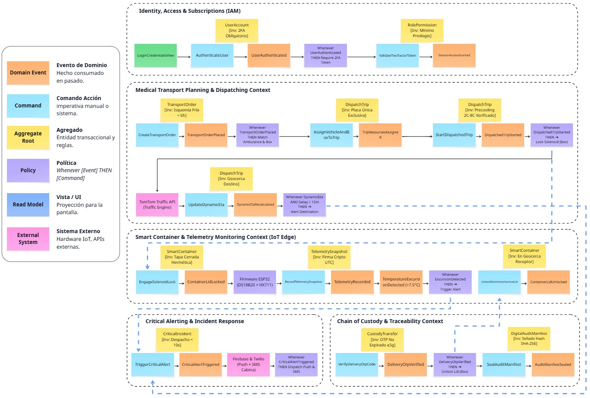
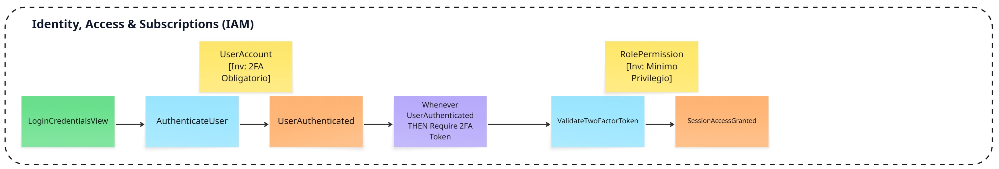
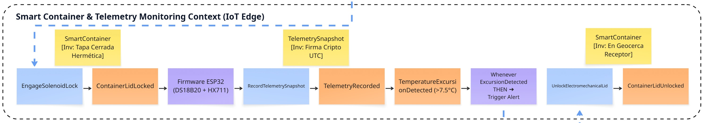
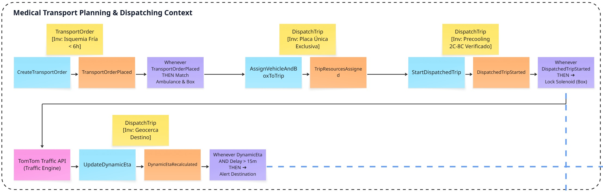
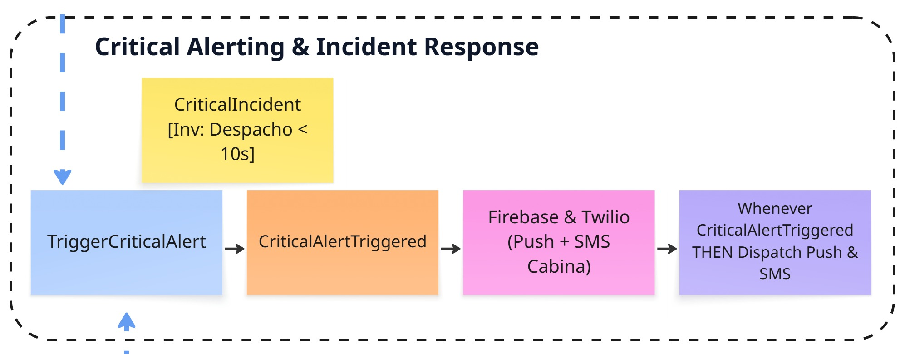
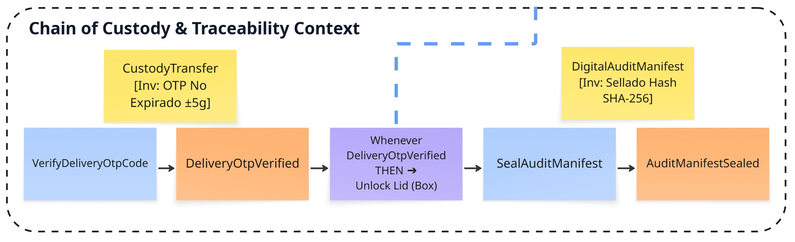
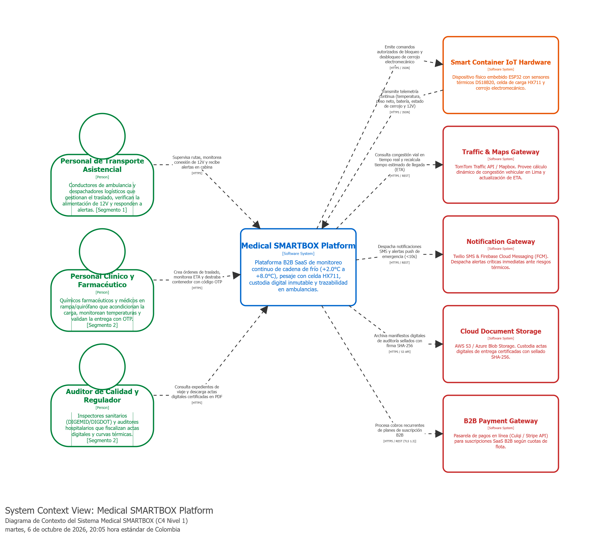
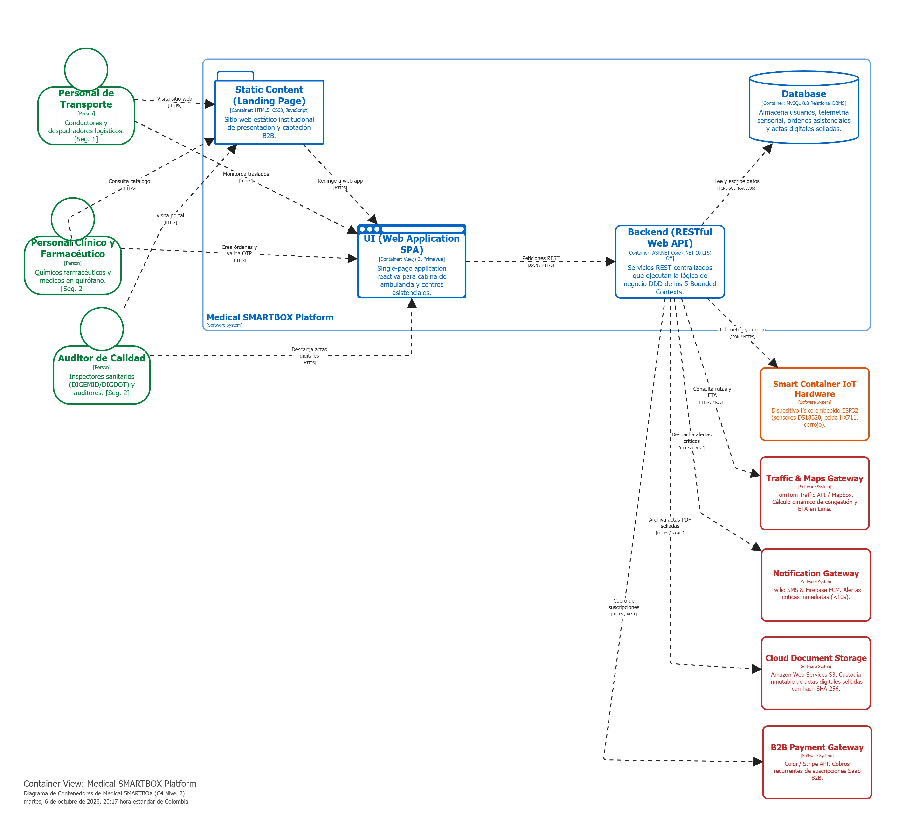
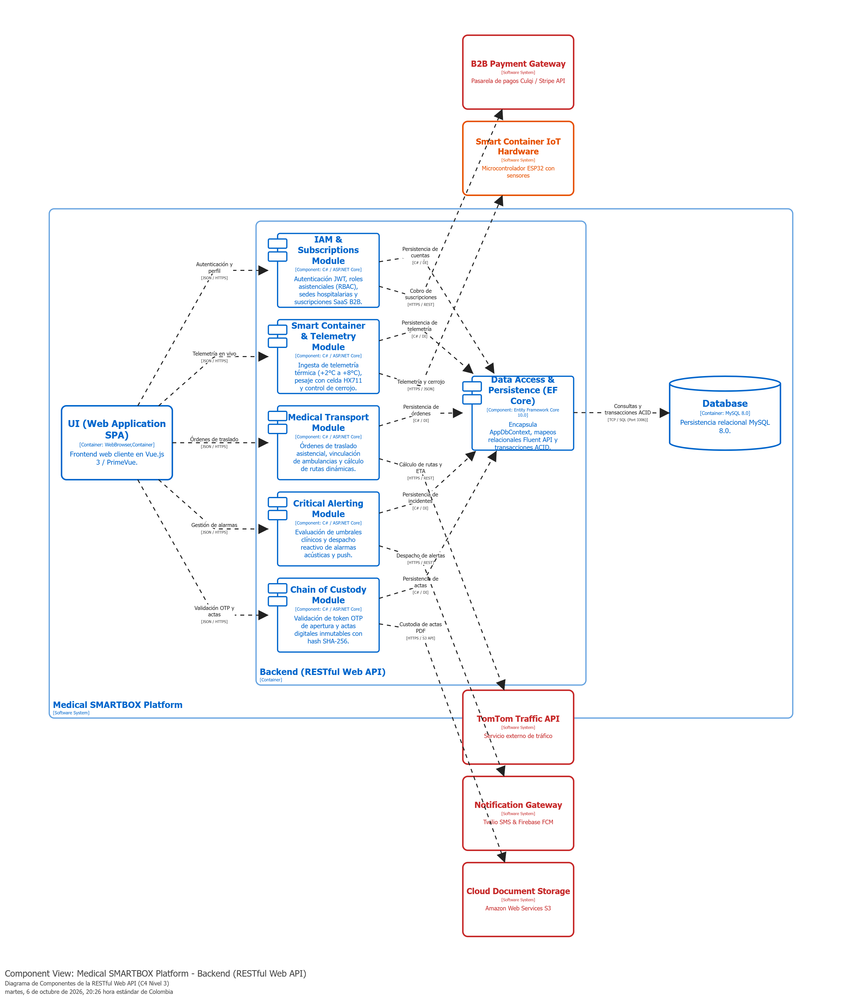

# **4.6. Domain-Driven Software Architecture**

En este capítulo se formula la propuesta integral de arquitectura de software para la plataforma **Medical SMARTBOX**, articulando los hallazgos del modelado exploratorio preliminar con los patrones tácticos y estratégicos de **Domain-Driven Design (DDD)** concebidos por Eric Evans [@evans2003] y Alberto Brandolini [@brandolini2020]. A partir de los flujos identificados en el Big Picture EventStorming (Capítulo 2.4), se profundiza en la descomposición del dominio en Bounded Contexts, Agregados, Eventos de Dominio y Comandos, estableciendo fronteras de consistencia transaccional de alta cohesión y bajo acoplamiento.

Para representar la arquitectura de forma rigurosa, comprensible y estandarizada entre perfiles clínicos, operadores logísticos y equipos de desarrollo, se adopta el **C4 Model** propuesto por Simon Brown [@brown2018]. La arquitectura se organiza y documenta progresivamente a través de las siguientes secciones:

* **4.6.1. Design-Level EventStorming:** Descomposición táctica del dominio, identificación de invariantes y delimitación formal de Bounded Contexts.
* **4.6.2. Software Architecture Context Diagram:** Delimitación perimetral del sistema frente a los actores asistenciales y sistemas externos.
* **4.6.3. Software Architecture Container Diagrams:** Descomposición en unidades ejecutables independientes y tecnologías del stack oficial conforme a la topología canónica web.
* **4.6.4. Software Architecture Components Diagrams:** Descomposición modular interna del Backend RESTful Web API por Bounded Contexts y acceso a datos.

***

## **4.6.1. Design-Level EventStorming**

### **1. Introducción y Ficha Técnica del Taller Colaborativo**

A partir de la exploración macro realizada en el **Big Picture EventStorming (Capítulo 2.4)**, se ejecutó una sesión formal de **Design-Level EventStorming (DLES)** bajo los principios canónicos de Domain-Driven Design y las pautas tácticas de Nick Tune.

El objetivo primordial del Design-Level EventStorming es **cerrar la brecha entre la visión general del negocio y el diseño detallado de software**, descomponiendo los procesos asistenciales en sus componentes transaccionales: Comandos, Agregados con invariantes protegidas, Eventos de Dominio inmutables, Políticas reactivas (*Whenever-Then*) y puntos de integración ciberfísica IoT.

#### Ficha Técnica de la Sesión Colaborativa

* **Modalidad y Alcance:** Sesión estructurada de modelado colaborativo orientada a la descomposición táctica del dominio asistencial y logístico.
* **Entorno y Herramienta:** Pizarra digital en **Miro**, organizada por carriles transaccionales de Bounded Contexts.
* **Participantes y Roles:**
  * *Facilitador DDD y Arquitecto de Software:* Moderación del flujo temporal y preservación de fronteras transaccionales.
  * *Especialista en Hardware IoT y Firmware:* Definición de interacción con microcontrolador ESP32, sensores térmicos Peltier y celda HX711.
  * *Coordinador de Logística Asistencial (Segmento 1 — User Persona: Aldair Lazaro):* Modelado de rutas críticas, contingencias en el tráfico de Lima y alimentación de 12V.
  * *Director Farmacéutico y Auditor Sanitario (Segmento 2 — User Persona: Gianfranco Timoteo):* Definición de límites de isquemia fría, actas inmutables y normativas DIGEMID (R.M. N° 833-2015).

#### Convención Cromática Oficial de Post-its (Notación DDD Estándar)

| Tipo de Artefacto DDD | Color de Post-it | Notación y Sintaxis | Descripción y Propósito en el Dominio |
|---|---|---|---|
| **Domain Event** | Naranja (`#FFA500`) | Verbo en pasado participio (Inglés) | Hecho irreversible en el sistema (`ContainerLocked`, `ExcursionDetected`). |
| **Command** | Azul (`#2196F3`) | Verbo en imperativo / presente | Acción disparada por un actor o sistema (`LockContainer`, `DispatchTrip`). |
| **Aggregate Root** | Amarillo Ocre (`#FFF59D`) | Sustantivo en singular | Frontera de consistencia transaccional (`SmartContainer`, `TransportOrder`). |
| **Business Policy / Rule** | Lila / Morado (`#BA68C8`) | *"Whenever [Event] THEN [Command]"* | Regla reactiva o de orquestación de negocio. |
| **Read Model / UI View** | Verde Claro (`#81C784`) | Nombre de la proyección / vista | Información requerida en pantalla para que el actor decida (`ActiveTransportsView`). |
| **Actor / User Role** | Amarillo Pálido (`#FFF9C4`) | Rol formal del usuario | Representa a los actores de los 2 segmentos objetivo (`Driver`, `Pharmacist`). |
| **External System / IoT** | Rosa / Fucsia (`#F48FB1`) | Nombre del sistema / hardware | Entidad ajena a la plataforma (`ESP32 Hardware`, `TomTom API`, `Twilio SMS`). |
| **Hotspot / Risk / Exception** | Rojo / Magenta (`#E53935`) | Problema o riesgo crítico | Fricción operativa en ruta (`12V Socket Disconnect`, `Severe Traffic Delay`). |

***

### **2. Matriz Estratégica de Clasificación de Bounded Contexts**

Bajo los principios de Domain-Driven Design para arquitecturas SaaS en entornos asistenciales y logísticos, el dominio de **Medical SMARTBOX** se estructura en **cinco (5) Bounded Contexts**, balanceando subdominios estratégicos (*Core Domains*) y de soporte (*Supporting Subdomains*):

| **Bounded Context** | **Clasificación Estratégica** | **Responsabilidad Primaria en el Sistema** | **Agregados Principales (Aggregate Roots)** | **Segmento Atendido** |
| :------------------- | :--------------- | :--------------------------- | :------------------- | :--------------- |
| **1. Identity, Access & Subscriptions (IAM)** | *Supporting Subdomain* | Autenticación multifactor (2FA), gestión de sesiones JWT, roles asistenciales (RBAC), registro institucional (RENIPRESS) y planes de suscripción B2B con cuotas de cajas (5L vs. 20L). | `HospitalInstitution` , `UserAccount` , `SubscriptionPlan` | Segmento 1 y Segmento 2 (Membresías B2B) |
| **2. Smart Container & Telemetry Monitoring** | *Core Domain (Diferenciador)* | Ingesta continua de telemetría IoT desde el ESP32: temperatura Peltier (+2°C a +8°C), tara/peso neto HX711, bloqueo solenoide, acelerómetro y alimentación vehicular 12V. | `SmartContainer` , `TelemetrySnapshot` (VO), `TelemetryLog` | Segmento 1 (Energía) y Segmento 2 (Cadena de frío) |
| **3. Medical Transport Planning & Dispatching** | *Core Domain* | Programación de traslados de emergencia, control de límites de isquemia fría, selección de rutas anti-congestión en Lima y cálculo dinámico de tiempos de llegada (ETA). | `TransportOrder` , `DispatchTrip` | Segmento 1 (Conducción) y Segmento 2 (Quirófano) |
| **4. Critical Alerting & Incident Response** | *Core Domain* | Evaluación de umbrales clínicos en tiempo real, disparo omnicanal de alertas (Push/SMS), acuse de recibo acústico en cabina y mitigación de contingencias. | `CriticalIncident` , `ContingencyResolution` | Segmento 1 (Cabina) y Segmento 2 (Supervisión) |
| **5. Chain of Custody & Traceability** | *Core Domain / Regulatorio* | Trazabilidad inmutable legal y sanitaria (DIGEMID R.M. 833-2015): despacho asistencial, apertura en destino mediante token OTP y generación del acta digital certificada con hash SHA-256. | `CustodyTransfer` , `DigitalAuditManifest` | Segmento 2 (Farmacia, Quirófano y DIGDOT) |

#### Mapeo a la Taxonomía SaaS del Dominio

Para corroborar la cobertura integral del modelo respecto a los requisitos de plataformas SaaS para salud y movilidad, la siguiente matriz correlaciona los subdominios estándar con la partición arquitectónica adoptada:

| **Subdominio SaaS Estándar** | **Bounded Context Asignado** | **Tipo DDD** | **Justificación de Cobertura Operativa** |
| :------------------------ | :------------------------ | :----------------- | :------------------------------- |
| **1. Autenticación y Autorización (IAM)** | Identity, Access & Subscriptions (IAM) | *Supporting* | Gobierna credenciales seguras JWT, control de acceso basado en roles (RBAC) y código RENIPRESS. |
| **2. Facturación y Suscripciones B2B** | Identity, Access & Subscriptions (IAM) | *Supporting* | Gestiona planes institucionales mensuales y cuotas de aprovisionamiento de cajas (5L y 20L). |
| **3. Monitoreo e Ingesta Telemática IoT** | Smart Container & Telemetry Monitoring | *Core* | Procesa flujos periódicos de temperatura, tara/peso y batería, y comanda el cerrojo solenoide. |
| **4. Planificación y Despacho Operativo** | Medical Transport Planning & Dispatching | *Core* | Asigna móviles sanitarios, calcula límites de isquemia y optimiza rutas ante el tráfico de Lima. |
| **5. Gestión de Contingencias y Alertas** | Critical Alerting & Incident Response | *Core* | Evalúa desviaciones térmicas en tiempo real y despacha alertas omnicanal de alta prioridad. |
| **6. Auditoría, Custodia y Cumplimiento** | Chain of Custody & Traceability | *Core* | Garantiza inviolabilidad de entrega con token OTP y emite el acta digital inmutable (DIGEMID). |

***

### **3. Diagrama Panorámico de Integración de Bounded Contexts**

El siguiente esquema general ilustra cómo interactúan los cinco contextos mediante el intercambio de eventos de dominio y comandos de orquestación, asegurando alto desacoplamiento y fronteras transaccionales autónomas:

::: {.figure-block}

*Nota: Elaboración propia en Miro según la técnica de modelado colaborativo Design-Level EventStorming para Medical SMARTBOX.*

:::

\newpage

### **4. Desglose Detallado por Bounded Contexts**

#### **4.6.1.1. Bounded Context 1: Identity, Access & Subscriptions (IAM)**

* **Clasificación:** *Supporting Subdomain*  
* **Alineación con Segmentos:** Centraliza la gobernanza de identidades, suscripciones SaaS y control de cuotas de flota para el **Segmento 1** (conductores de ambulancia, paramédicos y despachadores logísticos — *User Persona:* **Aldair Lazaro**) y el **Segmento 2** (químicos farmacéuticos, médicos directores de IPRESS y auditores de calidad hospitalaria — *User Persona:* **Gianfranco Timoteo**).

::: {.figure-block}

*Nota: Elaboración propia en Miro según la técnica Design-Level EventStorming para el Bounded Context de Identity, Access & Subscriptions (IAM).*

:::

***

#### **4.6.1.2. Bounded Context 2: Smart Container & Telemetry Monitoring**

* **Clasificación:** *Core Domain (Diferenciador Tecnológico)*  
* **Alineación con Segmentos:** Representa el corazón IoT del sistema. Para el **Segmento 1** (**Aldair Lazaro**), monitorea la integridad eléctrica en la toma de 12V y el nivel de batería interna. Para el **Segmento 2** (**Gianfranco Timoteo**), certifica la curva ininterrumpida de frío (+2.0 °C a +8.0 °C) y la estabilidad del peso neto del insumo mediante celda de carga HX711 (±5 g).

::: {.figure-block}

*Nota: Elaboración propia en Miro según la técnica Design-Level EventStorming para el Bounded Context de Smart Container & Telemetry Monitoring.*

:::

\newpage

:::: {.compact-lists}

#### **4.6.1.3. Bounded Context 3: Medical Transport Planning & Dispatching**

* **Clasificación:** *Core Domain*  
* **Alineación con Segmentos:** Articula la necesidad médica del **Segmento 2** (**Gianfranco Timoteo**: solicitud urgente de insumo con rango térmico de +2.0 °C a +8.0 °C y tiempo de isquemia fría crítico) con la respuesta operativa del **Segmento 1** (**Aldair Lazaro**: asignación de ambulancia, cálculo de ruta anti-tráfico en Lima con TomTom y estimación dinámica de ETA).

::: {.figure-block}

{.max-h-38}

*Nota: Elaboración propia en Miro según la técnica Design-Level EventStorming para el Bounded Context de Medical Transport Planning & Dispatching.*

:::

#### **4.6.1.4. Bounded Context 4: Critical Alerting & Incident Response**

* **Clasificación:** *Core Domain*  
* **Alineación con Segmentos:** Garantiza que las incidencias en ruta se detecten y resuelvan en segundos. Para el **Segmento 1** (**Aldair Lazaro**), dispara alarmas audibles y visuales de alta prioridad en la cabina asistencial. Para el **Segmento 2** (**Gianfranco Timoteo**), alerta inmediatamente a farmacia y quirófano ante riesgos térmicos o demoras viales.

::: {.figure-block}

{.max-h-32}

*Nota: Elaboración propia en Miro según la técnica Design-Level EventStorming para el Bounded Context de Critical Alerting & Incident Response.*

:::

#### **4.6.1.5. Bounded Context 5: Chain of Custody & Traceability**

* **Clasificación:** *Core Domain / Cumplimiento Normativo*  
* **Alineación con Segmentos:** Brinda la certeza sanitaria y legal que exige el **Segmento 2** (**Gianfranco Timoteo**) ante auditorías de DIGEMID (R.M. N° 833-2015/MINSA) y DIGDOT (Directiva 152/MINSA). Controla la apertura en destino mediante código OTP de un solo uso y emite el acta digital inmutable con hash SHA-256.

::: {.figure-block}

{.max-h-32}

*Nota: Elaboración propia en Miro según la técnica Design-Level EventStorming para el Bounded Context de Chain of Custody & Traceability.*

:::

::::

\newpage

## **4.6.2. Software Architecture Context Diagram**

### **1. Introducción y Fundamentos del Nivel 1 C4 Model**

Para representar la arquitectura del sistema se adoptó el **C4 Model** concebido por Simon Brown. En este nivel de abstracción inicial, el **System Context Diagram** establece las fronteras perimetrales de la plataforma mostrándola como una **caja negra central única** sin descender a detalles de frameworks o bases de datos.

### **2. Definición del Sistema Central (Subject System)**

* **Nombre Oficial:** `Medical SMARTBOX Platform` `[Software System]`
* **Descripción de Dominio:** Plataforma integral B2B SaaS de software y telemetría IoT para la monitorización activa de la cadena de frío (+2.0 °C a +8.0 °C), pesaje de alta precisión (±5 g), custodia electromecánica inmutable y trazabilidad de traslados asistenciales en ambulancias para Lima Metropolitana y el Callao.
* **Misión Operativa:** Garantizar el "Desperdicio Cero" de órganos, hemoderivados y vacunas durante el trayecto vial, asegurando el cumplimiento de la **R.M. N° 833-2015/MINSA** (Manual de BPDT - DIGEMID) y la **Directiva Sanitaria N° 152/MINSA** (DIGDOT).

### **3. Catálogo de Actores y Sistemas Externos**

Los actores y servicios conectados se consolidan formalmente en las siguientes tablas:

#### Actores del Dominio (Segmentos Objetivo)

| **Actor / Rol** | **Segmento Objetivo** | **Responsabilidad en el Dominio** | **Canal / Interfaz** |
| :------------------------ | :------------------- | :----------------------------- | :------------------------ |
| **Personal de Transporte Asistencial** *(Chofer / Paramédico / Despachador — User Persona: Aldair Lazaro)* | **Segmento 1:** Operadores de Transporte Sanitario | Conduce la ambulancia, supervisa la conexión de alimentación de 12V vehicular, asigna unidades móviles y atiende alertas acústicas en cabina. | Web App (PWA Mobile en tablet / Smartphone y Dashboard Desktop) |
| **Personal Clínico y Farmacéutico** *(Químico Farmacéutico / Médico — User Persona: Gianfranco Timoteo)* | **Segmento 2:** Centros de Salud y Hospitales | Acondiciona la carga biológica, tara insumos, autoriza el precinto, monitorea el ETA dinámico y valida la entrega en destino mediante código OTP. | Web App (Portal Web Hospitalario y Tablet de Quirófano) |
| **Auditor de Calidad y Regulador** *(Auditor Hospitalario / Inspector DIGEMID — User Persona: Gianfranco Timoteo)* | **Segmento 2:** Centros de Salud y Reguladores | Fiscaliza la preservación legal de la cadena de frío y descarga actas digitales certificadas en PDF con hash SHA-256. | Web App (Portal de Auditoría y Cumplimiento) |

#### Sistemas Externos e Interfaces Periféricas

| **Sistema Externo** | **Tipo de Entidad** | **Propósito y Función Operativa** | **Protocolo de Red** |
| :--------------------------- | :----------------- | :--------------------------------- | :------------------- |
| **Smart Container IoT Hardware** | Hardware Embebido | Microcontrolador ESP32 con sensores térmicos DS18B20, celda de pesaje HX711 y cerrojo solenoide de seguridad. | `HTTPS / JSON` |
| **Traffic & Maps Gateway** | Cloud Service API | TomTom Traffic API / Mapbox. Provee cálculo dinámico de congestión vehicular y recálculo de ETA en Lima. | `HTTPS / REST` |
| **Notification Gateway** | Cloud Messaging | Twilio SMS y Firebase Cloud Messaging (FCM). Despacha alertas críticas inmediatas ante riesgo térmico (<10s). | `HTTPS / REST` |
| **Cloud Document Storage** | Object Storage | Amazon Web Services S3. Custodia inmutable de actas digitales de entrega certificadas con sellado SHA-256. | `HTTPS / S3 API` |
| **B2B Payment Gateway** | Pasarela de Pagos | Culqi / Stripe API. Gestiona transacciones de cobro recurrente para suscripciones institucionales SaaS B2B. | `HTTPS / REST (TLS 1.3)` |

\newpage

### **4. Diagrama de Contexto del Sistema (C4 Nivel 1)**

El diagrama de contexto sitúa a la plataforma en el centro del ecosistema, delimitando sus relaciones perimétricas:

::: {.figure-block}

{.max-h-195}

*Nota: Elaboración propia en Structurizr conforme a los estándares del modelo C4 para la arquitectura de software.*

:::

\newpage

## **4.6.3. Software Architecture Container Diagrams**

### **1. Introducción y Topología Canónica Web (C4 Nivel 2)**

En el **C4 Model** de Simon Brown, un **Contenedor** representa una **unidad de software ejecutable o almacén de datos desplegable y operable de manera independiente**.

Conforme a las disposiciones rectoras de la cátedra y la rúbrica ABET, la arquitectura de la solución se estructura formalmente en torno a **cuatro (4) contenedores canónicos**:

1. **Landing Page:** Sitio web estático institucional orientado a la difusión y captación de clientes B2B.
2. **Single-Page Application (SPA):** Aplicación cliente rica e interactiva ejecutada en el navegador web del usuario.
3. **Backend RESTful Web API:** Servidor central de aplicaciones que implementa la lógica de negocio DDD y expone endpoints REST.
4. **Database:** Motor de base de datos relacional para la persistencia transaccional del sistema.

***

### **2. Catálogo de Contenedores de Software**

| **Contenedor C4** | **Tipo de Unidad** | **Tecnología Oficial** | **Responsabilidades Operativas y de Negocio** |
| :------------------- | :----------------- | :--------------------- | :--------------------------------------- |
| **1. Landing Page** | *Web Application (Static)* | HTML5, CSS3, JavaScript nativo | Portal público de captación B2B, difusión de la propuesta de valor de cadena de frío y catálogo de suscripciones por tamaño de caja (5L vs. 20L). Provee redirección directa al inicio de sesión. |
| **2. Single-Page Application (SPA)** | *Client-Side Application* | **Vue.js 3** + **PrimeVue** (Material Design) | Interfaz interactiva para usuarios de ambos segmentos: vistas de cabina para paramédicos (alertas audibles), paneles de despacho para coordinadores y portal clínico para médicos/farmacéuticos (OTP). |
| **3. Backend RESTful Web API** | *Web API Service* | **ASP.NET Core (.NET 10 LTS, C#)** | Servidor central de servicios que orquesta los 5 Bounded Contexts, gestiona autenticación JWT con 2FA, procesa la ingesta de telemetría sensorial, evalúa umbrales y gobierna transacciones. |
| **4. Database** | *Relational DBMS* | **MySQL 8.0 Server (InnoDB)** | Almacén relacional transaccional (ACID) gobernado por migraciones de Entity Framework Core 10.0. Persiste usuarios, suscripciones, flota, viajes, telemetría y actas de custodia. |

***

### **3. Matriz de Protocolos de Comunicación Inter-Contenedor**

| **Origen** | **Destino** | **Protocolo** | **Puerto** | **Propósito de la Interacción** |
| :------------------- | :------------------- | :----------------- | :----------- | :----------------------------- |
| Navegador Web | Landing Page | `HTTPS (TLS 1.3)` | TCP 443 | Descarga de contenido estático y presentación pública. |
| Landing Page | SPA (Web App) | `HTTPS (Redirect)` | TCP 443 | Redirección de llamadas a la acción (CTA) hacia la app. |
| SPA (Web App) | Backend Web API | `JSON / HTTPS` | TCP 443 | Invocación de endpoints RESTful autenticados con Bearer JWT. |
| Backend Web API | Database | `TCP / SQL` | TCP 3306 | Consultas y persistencia relacional transaccional vía EF Core. |
| Hardware ESP32 | Backend Web API | `JSON / HTTPS` | TCP 443 | Ingesta periódica de paquetes sensoriales de telemetría. |

\newpage

### **4. Diagrama de Contenedores de la Solución (C4 Nivel 2)**

El siguiente diagrama descompone la solución en sus unidades de software operativas:

::: {.figure-block}

{.max-h-185}

*Nota: Elaboración propia en Structurizr conforme a los estándares del modelo C4 para la arquitectura de software.*

:::

\newpage

## **4.6.4. Software Architecture Components Diagrams**

### **1. Introducción y Organización del Nivel 3 de C4**

Conforme a los fundamentos del C4 Model de Simon Brown, un **Componente** es una agrupación modular y cohesiva de código (controladores, servicios e interfaces) que reside dentro de un contenedor ejecutable. En esta sección se realiza el *zoom in* sobre el contenedor central de la solución: el **Backend RESTful Web API en ASP.NET Core (C#)**.

La Web API estructura su lógica interna organizando sus módulos en correspondencia directa con los **cinco (5) Bounded Contexts** delimitados en el Design-Level EventStorming, garantizando alta cohesión, bajo acoplamiento y separación de responsabilidades:

* Cada módulo agrupa sus controladores REST, servicios de aplicación y contratos de dominio.
* El componente de acceso a datos centraliza la persistencia relacional con Entity Framework Core hacia MySQL.

### **2. Catálogo Modular de Componentes de la Web API**

Los componentes internos de la API se mapean directamente con los **cinco Bounded Contexts** más el módulo de persistencia:

| **Componente C4** | **Tecnología / Tipo** | **Responsabilidades Técnicas y de Negocio** | **Dependencias Inyectadas** |
| :------------------------ | :------------------- | :---------------------------------- | :------------------- |
| **IAM & Subscriptions Module** | ASP.NET Core Controller & Service | Gestiona autenticación JWT, registro institucional con RENIPRESS, roles (RBAC) y planes de suscripción B2B. | `IUserRepository` , `IPaymentGateway` |
| **Smart Container & Telemetry Module** | ASP.NET Core Controller & Service | Procesa paquetes sensoriales de temperatura (+2°C a +8°C), pesaje con celda HX711 y control de cerrojo solenoide. | `ISmartContainerRepository` |
| **Medical Transport Module** | ASP.NET Core Controller & Service | Coordina órdenes de traslado asistencial, vinculación vehicular y cálculo de rutas dinámicas con ETA. | `ITransportRepository` , `ITrafficRoutingService` |
| **Critical Alerting Module** | ASP.NET Core Controller & Service | Evalúa umbrales clínicos en tiempo real y despacha notificaciones reactivas push y SMS de emergencia. | `IIncidentRepository` , `INotificationGateway` |
| **Chain of Custody Module** | ASP.NET Core Controller & Service | Valida token OTP de apertura y genera actas digitales de entrega inmutables selladas con hash SHA-256. | `ICustodyRepository` , `ICloudStorageService` |
| **Data Access & Persistence (EF Core)** | Entity Framework Core 10.0 | Encapsula `AppDbContext` , mapeos relacionales Fluent API y transacciones ACID hacia MySQL 8.0. | MySQL Database (Port 3306) |

\newpage

### **3. Diagrama de Componentes de la RESTful Web API (C4 Nivel 3)**

El siguiente diagrama detalla la estructura modular interna del servidor de aplicaciones:

::: {.figure-block}

{.max-h-195}

*Nota: Elaboración propia en Structurizr conforme a los estándares del modelo C4 para la arquitectura de software.*

:::
