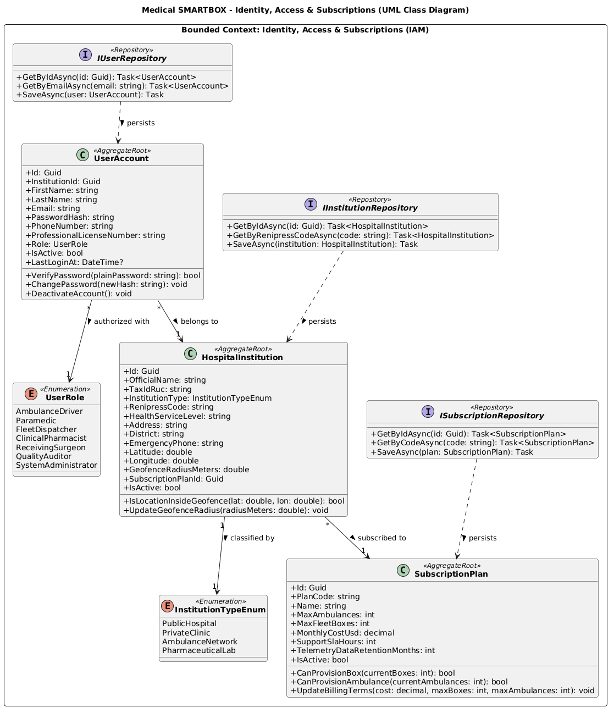
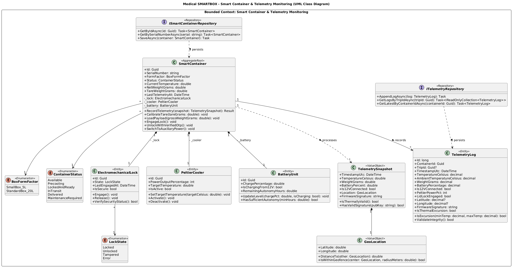
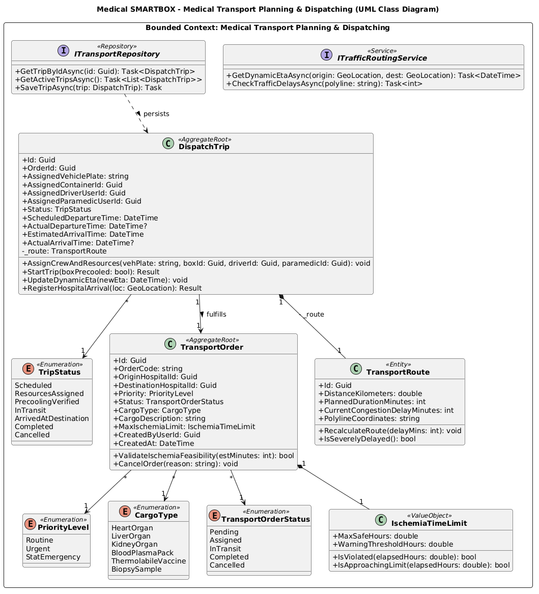
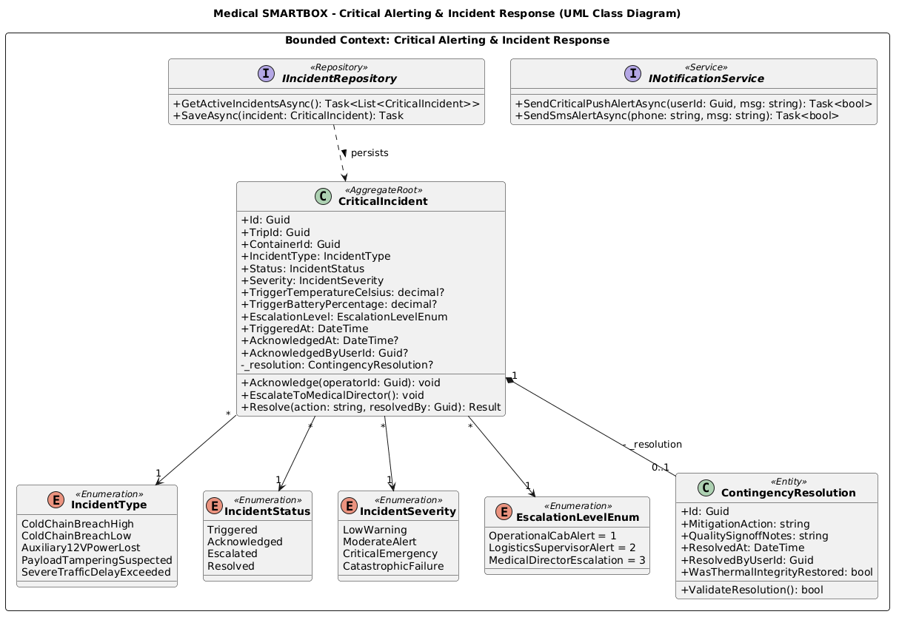
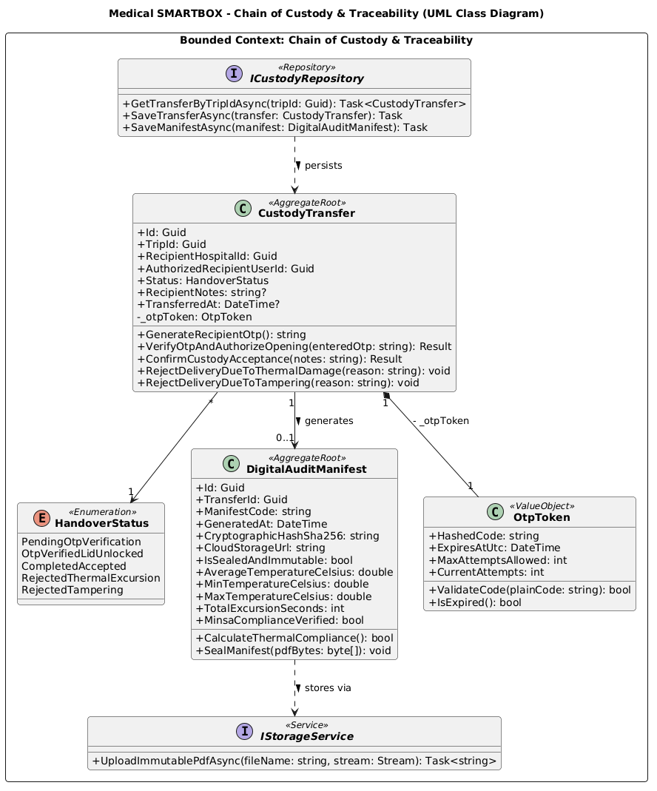

# **4.7. Software Object-Oriented Design**

## **4.7.1. Class Diagrams**

### **1. Introducción y Fundamentación Técnica del Diseño OO**

El diseño estático del sistema se fundamenta en los estándares de la especificación oficial UML 2.5 y las referencias canónicas de ingeniería de software:

* **Notación de Modelado UML 2.5:** Estándares canónicos para la construcción de diagramas de clases orientados a objetos con tipado estricto y relaciones formales.
* **Convenciones Oficiales de Microsoft C# (.NET 10 LTS) [@microsoft2024csharp]:** Tipado estricto, encapsulamiento mediante propiedades automáticas con mutabilidad controlada (`{ get; private set; }`) y diseño orientado al dominio.
* **Patrones de Arquitectura DDD (Nick Tune y Eric Evans):** Modelado de clases diferenciando estereotipos estratégicos de Domain-Driven Design (Agregados, Entidades, Objetos de Valor e Interfaces de Repositorio).

El diseño orientado a objetos del sistema **Medical SMARTBOX** trasciende la mera representación de estructuras de datos pasivas (modelos anémicos tipo CRUD) para modelar un **Dominio Rico (*Rich Domain Model*)**, donde las clases encapsulan tanto su estado como las **invariantes de negocio y reglas sanitarias** que garantizan la preservación de órganos, hemoderivados y vacunas durante el transporte de emergencia en Lima Metropolitana.

#### Estereotipos y Convenciones UML Aplicadas (Notación Formal OMG UML « »)

1. **«AggregateRoot» (Raíz de Agregado):** Entidad principal que define una frontera transaccional de consistencia. El acceso a los objetos internos del agregado se realiza exclusivamente a través de sus métodos públicos.
2. **«Entity» (Entidad):** Objeto con identidad única que perdura a través del tiempo y cuyos atributos pueden mutar.
3. **«ValueObject» (Objeto de Valor):** Objeto inmutable sin identidad conceptual, definido exclusivamente por sus atributos (`TemperatureReading`, `OtpToken`, `GeoLocation`).
4. **«Enumeration» (Enumeración):** Conjunto cerrado de constantes con significado semántico en el dominio.
5. **«Repository» (Abstracción de Persistencia DDD):** Define operaciones de persistencia de agregados desacoplando la lógica de negocio del motor de base de datos.
6. **«Service» (Abstracción de Servicio Externo / Integración):** Encapsula servicios de infraestructura externos (tráfico, notificaciones, almacenamiento).
7. **«DomainEvent» (Evento de Dominio):** Notificación inmutable de un hecho consumado relevante en el ciclo de vida del negocio.
8. **Modificadores de Acceso y Visibilidad:**  
   * `+` : Público (*public*)  
   * `-` : Privado (*private*)  
   * `#` : Protegido (*protected*)

#### Mapeo Objeto-Relacional con Entity Framework Core 10.0 y Convenciones Nominales

En estricta observancia de los patrones Domain-Driven Design (DDD), las clases del dominio adoptan nomenclatura de negocio en C# (*PascalCase*), mientras que el esquema relacional en MySQL 8.0 implementa estándares físicos de base de datos (*snake_case*). Las correspondencias específicas entre nombres de propiedades y columnas físicas se gobiernan declarativamente mediante la Fluent API de EF Core (`.HasColumnName(...)`):

* `SubscriptionPlan.PlanCode` → columna `code` (definida en tabla `subscription_plans`).
* `SubscriptionPlan.MaxFleetBoxes` → columna `max_smartboxes` (definida en tabla `subscription_plans`).
* `SubscriptionPlan.MonthlyCostUsd` → columna `monthly_price_usd` (definida en tabla `subscription_plans`).
* `HospitalInstitution.OfficialName` → columna `name` (definida en tabla `hospital_institutions`).
* `UserAccount.ProfessionalLicenseNumber` → columna `medical_license_number` (definida en tabla `users`).
* `TransportOrder.Priority` → columna `clinical_priority` (definida en tabla `transport_orders`).
* `CustodyTransfer.TransferredAt` → columna `completed_at` (definida en tabla `custody_transfers`).
* `DigitalAuditManifest.GeneratedAt` → columna `sealed_at` (definida en tabla `digital_audit_manifests`).
* `SmartContainer.CurrentTemperature` (`double`) → columna `current_temperature_celsius` (`DECIMAL(4,2)`) en tabla `smart_containers` (`HasPrecision(4, 2)`).
* `TransportRoute.DistanceKilometers` (`double`) y `CurrentCongestionDelayMinutes` (`int`) → columnas `distance_km` (`DECIMAL(6,2)`) y `current_delay_minutes` (`INT`) aplanadas en tabla `dispatch_trips`.
* `CustodyTransfer.Status` → columna `handover_status` (definida en tabla `custody_transfers`).
* `OtpToken.HashedCode`, `ExpiresAtUtc` y `CurrentAttempts` → columnas `otp_code_hash`, `otp_expires_at` y `otp_attempt_count` aplanadas (`OwnsOne`) en tabla `custody_transfers`.
* `DigitalAuditManifest.CloudStorageUrl` → columna `cloud_storage_pdf_url` (definida en tabla `digital_audit_manifests`).
Esta separación formal preserva la expresividad del lenguaje ubicuo en el código fuente de dominio sin acoplarlo rígidamente a los identificadores físicos de almacenamiento.

***

### **2. Desglose Exhaustivo de Clases por Bounded Context**

A continuación se detalla la especificación estática de clases para los cinco Bounded Contexts del sistema que articulan el **Segmento 1 (Transporte y Flota Logística)** y el **Segmento 2 (Centros de Salud y Cadenas Farmacéuticas)**:

#### **4.7.1.1. Bounded Context 1: Identity, Access & Subscriptions (IAM)**

Este contexto centraliza la autenticación mediante tokens JWT, control de acceso basado en roles (RBAC) para los dos segmentos objetivo, registro formal de sedes hospitalarias con código RENIPRESS y gestión del modelo de suscripción SaaS para flotas de contenedores médicos, garantizando consistencia transaccional inmediata en la validación de licencias, membresías activas y cuotas de aprovisionamiento de cajas inteligentes.

| **Clase / Interfaz / Enum** | **Estereotipo DDD** | **Atributos (Visibilidad y Tipo)** | **Métodos (Firma Completa y Retorno)** | **Invariantes y Reglas Protegidas** |
| :---------------- | :------------ | :---------------------------- | :----------------------- | :---------------- |
| `SubscriptionPlan` | `«AggregateRoot»` | `+ Id: Guid` `+ PlanCode: string` `+ Name: string` `+ MaxAmbulances: int` `+ MaxFleetBoxes: int` `+ MonthlyCostUsd: decimal` `+ SupportSlaHours: int` `+ TelemetryDataRetentionMonths: int` `+ IsActive: bool` | `+ CanProvisionBox(currentBoxes: int): bool` `+ CanProvisionAmbulance(currentAmbulances: int): bool` `+ UpdateBillingTerms(cost: decimal, maxBoxes: int, maxAmbulances: int): void` | • El costo mensual debe ser mayor o igual a cero. • No se permite aprovisionar boxes ni registrar ambulancias si la flota activa alcanza el límite del plan. |
| `HospitalInstitution` | `«AggregateRoot»` | `+ Id: Guid` `+ OfficialName: string` `+ TaxIdRuc: string` `+ InstitutionType: InstitutionTypeEnum` `+ RenipressCode: string` `+ HealthServiceLevel: string` `+ Address: string` `+ District: string` `+ EmergencyPhone: string` `+ Latitude: double` `+ Longitude: double` `+ GeofenceRadiusMeters: double` `+ SubscriptionPlanId: Guid` `+ IsActive: bool` | `+ IsLocationInsideGeofence(lat: double, lon: double): bool` `+ UpdateGeofenceRadius(radiusMeters: double): void` | • El RUC debe ser una cadena fiscal válida de 11 dígitos. • El código RENIPRESS es de registro sanitario obligatorio ante SUSALUD/MINSA. • El radio de geocerca no puede ser inferior a 500 metros ni superior a 5000 metros. |
| `UserAccount` | `«AggregateRoot»` | `+ Id: Guid` `+ InstitutionId: Guid` `+ FirstName: string` `+ LastName: string` `+ Email: string` `+ PasswordHash: string` `+ PhoneNumber: string` `+ ProfessionalLicenseNumber: string` `+ Role: UserRole` `+ IsActive: bool` `+ LastLoginAt: DateTime?` | `+ VerifyPassword(plainPassword: string): bool` `+ ChangePassword(newHash: string): void` `+ DeactivateAccount(): void` | • El correo electrónico debe poseer formato RFC válido y ser único en el sistema. • Los usuarios con roles clínicos (médico, farmacéutico) deben registrar número de colegiatura profesional habilitada. • Contraseñas protegidas mediante algoritmos de derivación de claves criptográficas seguras (BCrypt/Argon2). |
| `UserRole` | `«Enumeration»` | `AmbulanceDriver` `Paramedic` `FleetDispatcher` `ClinicalPharmacist` `ReceivingSurgeon` `QualityAuditor` `SystemAdministrator` | N/A (Constantes semánticas) | Restringe los privilegios de navegación y permisos de comandos en la Web Application y API. |
| `InstitutionTypeEnum` | `«Enumeration»` | `PublicHospital` `PrivateClinic` `AmbulanceNetwork` `PharmaceuticalLab` | N/A (Constantes semánticas) | Clasifica la naturaleza asistencial de la institución cliente registrada en la plataforma. |
| `IUserRepository` | `«Repository»` | N/A (Contrato abstracto) | `+ GetByIdAsync(id: Guid): Task<UserAccount>` `+ GetByEmailAsync(email: string): Task<UserAccount>` `+ SaveAsync(user: UserAccount): Task` | Desacopla la persistencia de usuarios del motor MySQL. |
| `IInstitutionRepository` | `«Repository»` | N/A (Contrato abstracto) | `+ GetByIdAsync(id: Guid): Task<HospitalInstitution>` `+ GetByRenipressCodeAsync(code: string): Task<HospitalInstitution>` `+ SaveAsync(institution: HospitalInstitution): Task` | Garantiza la inversión de dependencias para la gestión institucional. |
| `ISubscriptionRepository` | `«Repository»` | N/A (Contrato abstracto) | `+ GetByIdAsync(id: Guid): Task<SubscriptionPlan>` `+ GetByCodeAsync(code: string): Task<SubscriptionPlan>` `+ SaveAsync(plan: SubscriptionPlan): Task` | Garantiza la persistencia e inversión de dependencias para los planes de suscripción B2B. |

#### **4.7.1.2. Bounded Context 2: Smart Container & Telemetry Monitoring (IoT)**

Representa el núcleo físico y sensorial del proyecto. Modela el control activo de frío (+2.0 °C a +8.0 °C) mediante celdas Peltier, el pesaje digital con celda HX711 (&plusmn;5 g), el solenoide electromecánico de la tapa y la supervisión de la toma de 12V vehicular.

| **Clase / Interfaz / Enum** | **Estereotipo DDD** | **Atributos (Visibilidad y Tipo)** | **Métodos (Firma Completa y Retorno)** | **Invariantes y Reglas Protegidas** |
| :---------------- | :------------ | :---------------------------- | :----------------------- | :---------------- |
| `SmartContainer` | `«AggregateRoot»` | `+ Id: Guid` `+ SerialNumber: string` `+ FormFactor: BoxFormFactor` `+ Status: ContainerStatus` `+ CurrentTemperature: double` `+ NetWeightGrams: double` `+ TareWeightGrams: double` `+ LastTelemetryAt: DateTime` `- _lock: ElectromechanicalLock` `- _cooler: PeltierCooler` `- _battery: BatteryUnit` | `+ RecordTelemetry(snapshot: TelemetrySnapshot): Result` `+ CalibrateTare(tareGrams: double): void` `+ LoadPayload(grossWeightGrams: double): void` `+ EngageLock(): void` `+ UnlockWithVerifiedOtp(): void` `+ SwitchToAuxiliaryPower(): void` | • La tapa electromecánica no puede abrirse si el estado es `InTransit` salvo autorización explícita. • Variaciones de peso > 15g en ruta disparan evento de presunta adulteración de carga. • Desviación térmica fuera de [2.0 °C - 8.0 °C] dispara evento de excursión. |
| `ElectromechanicalLock` | `«Entity»` | `+ Id: Guid` `+ State: LockState` `+ LastEngagedAt: DateTime` `+ IsSecure: bool` | `+ Engage(): void` `+ Release(): void` `+ VerifySecurityStatus(): bool` | Encapsula y comanda el estado lógico de seguridad del cerrojo de la tapa del contenedor. |
| `PeltierCooler` | `«Entity»` | `+ Id: Guid` `+ PowerOutputPercentage: int` `+ TargetTemperature: double` `+ IsActive: bool` | `+ SetTargetTemperature(targetCelsius: double): void` `+ Activate(): void` `+ Deactivate(): void` | Comanda el punto de consigna térmico del sistema de enfriamiento activo para preservar el rango seguro de +4.0 °C. |
| `BatteryUnit` | `«Entity»` | `+ Id: Guid` `+ ChargePercentage: double` `+ IsChargingFrom12V: bool` `+ RemainingAutonomyHours: double` | `+ UpdateLevel(chargePct: double, isCharging: bool): void` `+ HasSufficientAutonomy(minHours: double): bool` | Supervisa la alimentación vehicular de 12V y la reserva de autonomía energética de la batería interna. |
| `TelemetrySnapshot` | `«ValueObject»` | `+ TimestampUtc: DateTime` `+ TemperatureCelsius: double` `+ WeightGrams: double` `+ BatteryPercent: double` `+ Is12VConnected: bool` `+ Location: GeoLocation` `+ FirmwareSignature: string` | `+ IsThermallyValid(): bool` `+ HasValidSignature(publicKey: string): bool` | Inmutable. Representa un paquete atómico de telemetría emitido por el microcontrolador ESP32. |
| `ISmartContainerRepository` | `«Repository»` | — | `+ GetByIdAsync(id: Guid): Task<SmartContainer>` `+ GetBySerialNumberAsync(serial: string): Task<SmartContainer>` `+ SaveAsync(container: SmartContainer): Task` | Contrato de persistencia desacoplado de Entity Framework Core. |
| `ContainerStatus` | `«Enumeration»` | `Available` , `Precooling` , `LockedAndReady` , `InTransit` , `Delivered` , `MaintenanceRequired` | — | Ciclo de vida operativo del contenedor. |
| `BoxFormFactor` | `«Enumeration»` | `SmallBox_5L` (Vacunas/Biopsias), `StandardBox_20L` (Órganos/Sangre) | — | Factor de forma asociado a la suscripción B2B. |
| `TelemetryLog` | `«Entity»` | `+ Id: long` `+ ContainerId: Guid` `+ TripId: Guid?` `+ TimestampUtc: DateTime` `+ TemperatureCelsius: decimal` `+ AmbientTemperatureCelsius: decimal` `+ WeightGrams: decimal` `+ BatteryPercentage: decimal` `+ Is12VConnected: bool` `+ PeltierPowerPct: int` `+ LidLockEngaged: bool` `+ Latitude: decimal?` `+ Longitude: decimal?` `+ FirmwareSignature: string` `+ IsThermalExcursion: bool` | `+ IsExcursion(minTemp: decimal, maxTemp: decimal): bool` `+ ValidateIntegrity(): bool` | • Registro transaccional inmutable que persiste cada lectura sensorial en MySQL ( `telemetry_logs` ) para auditoría de DIGEMID. • Permite reconstruir la curva térmica continua y verificar alertas retrospectivas. |
| `ITelemetryRepository` | `«Repository»` | — | `+ AppendLogAsync(log: TelemetryLog): Task` `+ GetLogsByTripIdAsync(tripId: Guid): Task<IReadOnlyCollection<TelemetryLog>>` `+ GetLatestByContainerIdAsync(containerId: Guid): Task<TelemetryLog>` | Contrato de persistencia de alta concurrencia para el flujo continuo de telemetría sensorial. |
| `LockState` | `«Enumeration»` | `Locked` , `Unlocked` , `Tampered` , `Error` | — | Estado mecánico del solenoide. |
| `GeoLocation` | `«ValueObject»` | `+ Latitude: double` `+ Longitude: double` | `+ DistanceTo(other: GeoLocation): double` `+ IsWithinGeofence(center: GeoLocation, radiusMeters: double): bool` | • Objeto de valor inmutable. Valida rangos de latitud [-90.0, 90.0] y longitud [-180.0, 180.0]. • Utilizado para calcular la distancia a geocercas hospitalarias de pre-arribo y el progreso de la ruta asistencial. |

***

#### **4.7.1.3. Bounded Context 3: Medical Transport Planning & Dispatching (Segmento 1)**

Modela la respuesta operativa del **Segmento 1 (Ambulancias y Despacho)** ante las emergencias: creación de órdenes, asignación de unidades móviles, control de tiempos de isquemia fría y cálculo dinámico de ETA ante el tráfico severo de Lima.

| **Clase / Interfaz / Enum** | **Estereotipo DDD** | **Atributos (Visibilidad y Tipo)** | **Métodos (Firma Completa y Retorno)** | **Invariantes y Reglas Protegidas** |
| :---------------- | :------------ | :---------------------------- | :----------------------- | :---------------- |
| `TransportOrder` | `«AggregateRoot»` | `+ Id: Guid` `+ OrderCode: string` `+ OriginHospitalId: Guid` `+ DestinationHospitalId: Guid` `+ CargoDescription: string` `+ CargoType: CargoType` `+ Priority: PriorityLevel` `+ Status: TransportOrderStatus` `+ MaxIschemiaLimit: IschemiaTimeLimit` `+ CreatedByUserId: Guid` `+ CreatedAt: DateTime` | `+ ValidateIschemiaFeasibility(estimatedMinutes: int): bool` `+ CancelOrder(reason: string): void` | • Requiere obligatoriamente un límite de isquemia fría conforme a la Directiva Sanitaria N° 152/MINSA. • El hospital de origen y destino deben ser IPRESS verificadas con RENIPRESS. |
| `DispatchTrip` | `«AggregateRoot»` | `+ Id: Guid` `+ OrderId: Guid` `+ AssignedVehiclePlate: string` `+ AssignedContainerId: Guid` `+ AssignedDriverUserId: Guid` `+ AssignedParamedicUserId: Guid` `+ Status: TripStatus` `+ ScheduledDepartureTime: DateTime` `+ ActualDepartureTime: DateTime?` `+ EstimatedArrivalTime: DateTime` `+ ActualArrivalTime: DateTime?` `- _route: TransportRoute` | `+ AssignCrewAndResources(vehiclePlate: string, boxId: Guid, driverId: Guid, paramedicId: Guid): void` `+ StartTrip(boxPrecooled: bool): Result` `+ UpdateDynamicEta(newEta: DateTime): void` `+ RegisterHospitalArrival(currentLoc: GeoLocation): Result` | • No puede iniciar el viaje si el contenedor no alcanzó pre-enfriamiento (2°C-8°C). • No puede marcar llegada si la ambulancia está fuera de la geocerca de 100m del hospital receptor. |
| `TransportRoute` | `«Entity»` | `+ Id: Guid` `+ DistanceKilometers: double` `+ PlannedDurationMinutes: int` `+ CurrentCongestionDelayMinutes: int` `+ PolylineCoordinates: string` | `+ RecalculateRoute(congestionMinutes: int): void` `+ IsSeverelyDelayed(): bool` | Gestiona los desvíos y demoras ocasionados por el tráfico en arterias viales de Lima. |
| `IschemiaTimeLimit` | `«ValueObject»` | `+ MaxSafeHours: double` `+ WarningThresholdHours: double` | `+ IsViolated(elapsedHours: double): bool` `+ IsApproachingLimit(elapsedHours: double): bool` | Inmutable. Tiempos máximos de conservación celular (<4h para corazón, <8h para hígado). |
| `ITransportRepository` | `«Repository»` | — | `+ GetTripByIdAsync(id: Guid): Task<DispatchTrip>` `+ GetActiveTripsAsync(): Task<List<DispatchTrip>>` `+ SaveTripAsync(trip: DispatchTrip): Task` | Contrato para persistencia de órdenes y viajes asistenciales. |
| `ITrafficRoutingService` | `«Service»` | — | `+ GetDynamicEtaAsync(origin: GeoLocation, dest: GeoLocation): Task<DateTime>` `+ CheckTrafficDelaysAsync(routePolyline: string): Task<int>` | Abstracción para el cliente HTTP de la API de TomTom. |
| `TripStatus` | `«Enumeration»` | `Scheduled` , `ResourcesAssigned` , `PrecoolingVerified` , `InTransit` , `ArrivedAtDestination` , `Completed` , `Cancelled` | — | Estados del viaje asistencial. |
| `CargoType` | `«Enumeration»` | `HeartOrgan` , `LiverOrgan` , `KidneyOrgan` , `BloodPlasmaPack` , `ThermolabileVaccine` , `BiopsySample` | — | Tipo biológico de la carga transportada. |
| `PriorityLevel` | `«Enumeration»` | `Routine` , `Urgent` , `StatEmergency` | — | Nivel de prioridad clínica de despacho conforme a `transport_orders.clinical_priority` en MySQL. |
| `TransportOrderStatus` | `«Enumeration»` | `Pending` , `Assigned` , `InTransit` , `Completed` , `Cancelled` | — | Ciclo de vida transaccional de la orden de traslado conforme a `transport_orders.status` en MySQL. |

***

#### **4.7.1.4. Bounded Context 4: Critical Alerting & Incident Response (Segmentos 1 y 2)**

Modela la detección de contingencias, despacho de alarmas acústicas y visuales a la cabina de ambulancia (Segmento 1) y notificaciones push/SMS a los directores médicos y receptores (Segmento 2).

| **Clase / Interfaz / Enum** | **Estereotipo DDD** | **Atributos (Visibilidad y Tipo)** | **Métodos (Firma Completa y Retorno)** | **Invariantes y Reglas Protegidas** |
| :---------------- | :------------ | :---------------------------- | :----------------------- | :---------------- |
| `CriticalIncident` | `«AggregateRoot»` | `+ Id: Guid` `+ TripId: Guid` `+ ContainerId: Guid` `+ IncidentType: IncidentType` `+ Severity: IncidentSeverity` `+ Status: IncidentStatus` `+ TriggerTemperatureCelsius: decimal?` `+ TriggerBatteryPercentage: decimal?` `+ EscalationLevel: EscalationLevelEnum` `+ TriggeredAt: DateTime` `+ AcknowledgedAt: DateTime?` `+ AcknowledgedByUserId: Guid?` `- _resolution: ContingencyResolution?` | `+ Acknowledge(operatorId: Guid): void` `+ EscalateToMedicalDirector(): void` `+ Resolve(actionDescription: string, resolvedBy: Guid): Result` | • Alertas críticas deben despacharse en menos de 10 segundos. • Un incidente no puede cerrarse como resuelto sin registrar obligatoriamente una acción de mitigación. • Registra los valores sensoriales de disparo (temperatura y batería) conforme a `critical_incidents` en MySQL. |
| `ContingencyResolution` | `«Entity»` | `+ Id: Guid` `+ MitigationAction: string` `+ QualitySignoffNotes: string` `+ ResolvedAt: DateTime` `+ ResolvedByUserId: Guid` `+ WasThermalIntegrityRestored: bool` | `+ ValidateResolution(): bool` | Registra la intervención física en ruta (ej. reconexión de toma 12V, cambio de ruta) y el visto bueno de control de calidad. |
| `IIncidentRepository` | `«Repository»` | — | `+ GetActiveIncidentsAsync(): Task<List<CriticalIncident>>` `+ SaveAsync(incident: CriticalIncident): Task` | Contrato de persistencia de alertas e incidentes. |
| `INotificationService` | `«Service»` | — | `+ SendCriticalPushAlertAsync(userId: Guid, msg: string): Task<bool>` `+ SendSmsAlertAsync(phone: string, msg: string): Task<bool>` | Abstracción hacia Firebase Cloud Messaging y Twilio SMS. |
| `IncidentSeverity` | `«Enumeration»` | `LowWarning` , `ModerateAlert` , `CriticalEmergency` , `CatastrophicFailure` | — | Nivel de severidad de la anomalía. |
| `IncidentType` | `«Enumeration»` | `ColdChainBreachHigh` , `ColdChainBreachLow` , `Auxiliary12VPowerLost` , `PayloadTamperingSuspected` , `SevereTrafficDelayExceeded` | — | Tipo de falla operativa detectada. |
| `EscalationLevelEnum` | `«Enumeration»` | `OperationalCabAlert = 1` , `LogisticsSupervisorAlert = 2` , `MedicalDirectorEscalation = 3` | — | Nivel de escalamiento jerárquico asistencial conforme a `critical_incidents.escalation_level` en MySQL (valores base 1 requeridos por la restricción CHECK 1..3). |
| `IncidentStatus` | `«Enumeration»` | `Triggered` , `Acknowledged` , `Escalated` , `Resolved` | — | Ciclo de vida operativo de la contingencia conforme a `critical_incidents.status` en MySQL. |

***

#### **4.7.1.5. Bounded Context 5: Chain of Custody & Traceability (Segmento 2 - Clínico y Legal)**

Modela la seguridad de custodia en el hospital receptor (**Segmento 2**): validación del **código OTP de un solo uso**, desbloqueo seguro de la tapa y generación inmutable del acta digital con hash criptográfico SHA-256 para auditorías de DIGEMID y DIGDOT.

| **Clase / Interfaz / Enum** | **Estereotipo DDD** | **Atributos (Visibilidad y Tipo)** | **Métodos (Firma Completa y Retorno)** | **Invariantes y Reglas Protegidas** |
| :---------------- | :------------ | :---------------------------- | :----------------------- | :---------------- |
| `CustodyTransfer` | `«AggregateRoot»` | `+ Id: Guid` `+ TripId: Guid` `+ RecipientHospitalId: Guid` `+ AuthorizedRecipientUserId: Guid` `+ Status: HandoverStatus` `+ RecipientNotes: string?` `+ TransferredAt: DateTime?` `- _otpToken: OtpToken` | `+ GenerateRecipientOtp(): string` `+ VerifyOtpAndAuthorizeOpening(enteredOtp: string): Result` `+ ConfirmCustodyAcceptance(inspectorNotes: string): Result` `+ RejectDeliveryDueToThermalDamage(reason: string): void` `+ RejectDeliveryDueToTampering(reason: string): void` | • El contenedor solo se destraba si el código OTP coincide exactamente y no ha expirado (<15 min). • Si se detectó excursión térmica irreparable o alteración de peso > 15g, no se puede confirmar entrega conforme. • Genera de forma asociada el `DigitalAuditManifest` como raíz de agregado inmutable. • Registra notas de recepción conforme a `custody_transfers.recipient_notes` en MySQL. |
| `DigitalAuditManifest` | `«AggregateRoot»` | `+ Id: Guid` `+ TransferId: Guid` `+ ManifestCode: string` `+ GeneratedAt: DateTime` `+ CryptographicHashSha256: string` `+ CloudStorageUrl: string` `+ IsSealedAndImmutable: bool` `+ AverageTemperatureCelsius: double` `+ MinTemperatureCelsius: double` `+ MaxTemperatureCelsius: double` `+ TotalExcursionSeconds: int` `+ MinsaComplianceVerified: bool` | `+ CalculateThermalCompliance(): bool` `+ SealManifest(pdfBytes: byte[]): void` | • El acta es estrictamente inmutable una vez sellada con hash SHA-256. • Contiene la curva térmica minuto a minuto, acumulación de segundos de excursión y verificación explícita de directivas sanitarias del MINSA para sustento legal ante DIGEMID. |
| `OtpToken` | `«ValueObject»` | `+ HashedCode: string` `+ ExpiresAtUtc: DateTime` `+ MaxAttemptsAllowed: int` `+ CurrentAttempts: int` | `+ ValidateCode(plainCode: string): bool` `+ IsExpired(): bool` | Inmutable. Token temporal de un solo uso despachado al teléfono del médico receptor. |
| `ICustodyRepository` | `«Repository»` | — | `+ GetTransferByTripIdAsync(tripId: Guid): Task<CustodyTransfer>` `+ SaveTransferAsync(transfer: CustodyTransfer): Task` `+ SaveManifestAsync(manifest: DigitalAuditManifest): Task` | Contrato de persistencia de transferencias de custodia y actas auditables. |
| `IStorageService` | `«Service»` | — | `+ UploadImmutablePdfAsync(fileName: string, stream: Stream): Task<string>` | Abstracción hacia AWS S3 para almacenamiento WORM. |
| `HandoverStatus` | `«Enumeration»` | `PendingOtpVerification` , `OtpVerifiedLidUnlocked` , `CompletedAccepted` , `RejectedThermalExcursion` , `RejectedTampering` | — | Estados de la entrega física y legal. |

***

#### **4.7.1.6. Domain Events y Clases Transversales (Shared Kernel)**

Permiten propagar asíncronamente cambios de estado críticos entre los Bounded Contexts sin generar acoplamiento directo entre Agregados Raíz:

| **Clase / Estructura** | **Estereotipo DDD** | **Atributos / Propiedades Tipadas C#** | **Métodos / Comportamiento** | **Descripción y Propósito de Negocio** |
| :---------------- | :------------ | :---------------------------- | :----------------------- | :---------------- |
| `IDomainEvent` | `«Interface»` | `+ EventId: Guid` `+ OccurredOn: DateTime` | — | Contrato base inmutable para todos los eventos emitidos por Agregados. |
| `ThermalExcursionDetectedEvent` | `«DomainEvent»` | `+ ContainerId: Guid` `+ CurrentTemperature: double` `+ OccurredOn: DateTime` | — | Emitido por `SmartContainer` al rebasar la franja térmica de 2°C a 8°C. Desencadena la creación del incidente crítico. |
| `ExternalPowerLostEvent` | `«DomainEvent»` | `+ ContainerId: Guid` `+ BatteryPercentage: decimal` `+ OccurredOn: DateTime` | — | Emitido al desconectarse el arnés vehicular de 12V de la ambulancia. Conmuta a respaldo LiFePO4 y alerta a cabina. |
| `HospitalPreArrivalTriggeredEvent` | `«DomainEvent»` | `+ TripId: Guid` `+ DestinationHospitalId: Guid` `+ EstimatedArrival: DateTime` `+ OccurredOn: DateTime` | — | Emitido por `DispatchTrip` al cruzar el radio de geocerca de 2 km. Despacha el token OTP hacia el médico receptor. |
| `CustodyAcceptedEvent` | `«DomainEvent»` | `+ TransferId: Guid` `+ RecipientUserId: Guid` `+ OccurredOn: DateTime` | — | Emitido por `CustodyTransfer` tras validar el OTP y desbloquear la tapa. Dispara la generación del manifiesto digital SHA-256. |
| `Result` | `«ValueObject»` | `+ IsSuccess: bool` `+ ErrorMessage: string` `+ IsFailure: bool` | `+ Ok(): Result` `+ Fail(error: string): Result` | Objeto de valor inmutable del Shared Kernel que encapsula el resultado exitoso o fallido de operaciones de negocio sin requerir excepciones no controladas. |

***

### **3. Matriz de Relaciones y Cardinalidades del Modelo de Clases**

Para asegurar total rigurosidad en la implementación del diagrama UML, la siguiente tabla define todas las relaciones del ecosistema:

| **Clase Origen** | **Multiplicidad** | **Tipo de Relación UML** | **Multiplicidad** | **Clase Destino** | **Rol / Calificación de la Relación** |
| :------------------- | :--------- | :--------------- | :--------- | :------------------- | :----------------------- |
| `SmartContainer` | `1` | Composición ( `*--` ) | `1` | `ElectromechanicalLock` | `- _lock` (perno de seguridad) |
| `SmartContainer` | `1` | Composición ( `*--` ) | `1` | `PeltierCooler` | `- _cooler` (celda de refrigeración) |
| `SmartContainer` | `1` | Composición ( `*--` ) | `1` | `BatteryUnit` | `- _battery` (batería interna Li-Ion) |
| `SmartContainer` | `1` | Dependencia ( `..>` ) | `*` | `TelemetrySnapshot` | `processes >` (lecturas periódicas) |
| `SmartContainer` | `1` | Asociación ( `-->` ) | `*` | `TelemetryLog` | `records >` (histórico sensorial continuo persistido en MySQL) |
| `ITelemetryRepository` | `1` | Dependencia ( `..>` ) | `*` | `TelemetryLog` | `persists >` (contrato de persistencia de series temporales) |
| `DispatchTrip` | `1` | Asociación ( `-->` ) | `1` | `SmartContainer` | `transports >` (contenedor asignado) |
| `DispatchTrip` | `1` | Asociación ( `-->` ) | `1` | `TransportOrder` | `fulfills >` (orden médica urgente) |
| `DispatchTrip` | `1` | Composición ( `*--` ) | `1` | `TransportRoute` | `- _route` (ruta y tráfico) |
| `DispatchTrip` | `1` | Asociación ( `-->` ) | `1` | `CustodyTransfer` | `culminates in >` (entrega hospitalaria) |
| `SmartContainer` | `1` | Asociación ( `-->` ) | `0..*` | `CriticalIncident` | `triggers >` (alertas operativas) |
| `CriticalIncident` | `1` | Composición ( `*--` ) | `0..1` | `ContingencyResolution` | `- _resolution` (mitigación registrada) |
| `CustodyTransfer` | `1` | Composición ( `*--` ) | `1` | `OtpToken` | `- _otpToken` (código seguro de apertura) |
| `CustodyTransfer` | `1` | Asociación ( `-->` ) | `0..1` | `DigitalAuditManifest` | `generates >` (acta legal inmutable, generada y sellada al validar OTP) |
| `HospitalInstitution` | `*` | Asociación ( `-->` ) | `1` | `SubscriptionPlan` | `subscribed to >` (plan SaaS contratado) |
| `UserAccount` | `*` | Asociación ( `-->` ) | `1` | `HospitalInstitution` | `belongs to >` (entidad empleadora) |
| `TransportOrder` | `*` | Asociación ( `-->` ) | `1` | `HospitalInstitution` | `origin > / destination >` (sedes remitente y receptora) |
| `DispatchTrip` | `*` | Asociación ( `-->` ) | `1` | `UserAccount` | `assigned crew >` (chofer y paramédico asignados) |
| `CustodyTransfer` | `*` | Asociación ( `-->` ) | `1` | `UserAccount` | `recipient >` (médico o farmacéutico que recibe con OTP) |

\newpage

### **4. Diagramas de Clases por Bounded Context**

A continuación, se presentan las especificaciones visuales del diseño orientado a objetos para cada uno de los Bounded Contexts de la plataforma, elaboradas bajo la notación formal de UML 2.5 y los patrones tácticos de Domain-Driven Design:

::: {.figure-block}

#### **4.1. Bounded Context: Identity, Access & Subscriptions (IAM)**

{.max-h-185}

*Nota: Elaboración propia en PlantUML conforme a los estándares de UML 2.5 y Domain-Driven Design para el Bounded Context de IAM y Suscripciones.*

:::

\newpage

::: {.figure-block}

#### **4.2. Bounded Context: Smart Container & Telemetry Monitoring**

*Nota: Elaboración propia en PlantUML conforme a los estándares de UML 2.5 y Domain-Driven Design para el Bounded Context de Contenedores Inteligentes y Telemetría.*

:::

\newpage

::: {.figure-block}

#### **4.3. Bounded Context: Medical Transport Planning & Dispatching**

*Nota: Elaboración propia en PlantUML conforme a los estándares de UML 2.5 y Domain-Driven Design para el Bounded Context de Transporte y Despacho.*

:::

\newpage

::: {.figure-block}

#### **4.4. Bounded Context: Critical Alerting & Incident Response**

*Nota: Elaboración propia en PlantUML conforme a los estándares de UML 2.5 y Domain-Driven Design para el Bounded Context de Alertas Críticas e Incidentes.*

:::

\newpage

::: {.figure-block}

#### **4.5. Bounded Context: Chain of Custody & Traceability**

*Nota: Elaboración propia en PlantUML conforme a los estándares de UML 2.5 y Domain-Driven Design para el Bounded Context de Cadena de Custodia y Trazabilidad.*

:::
