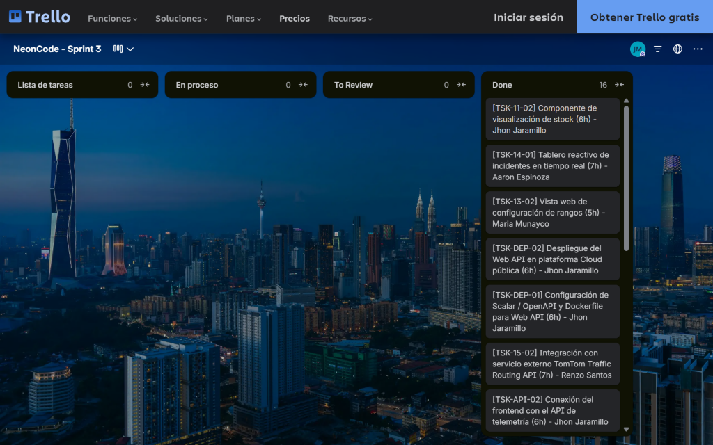
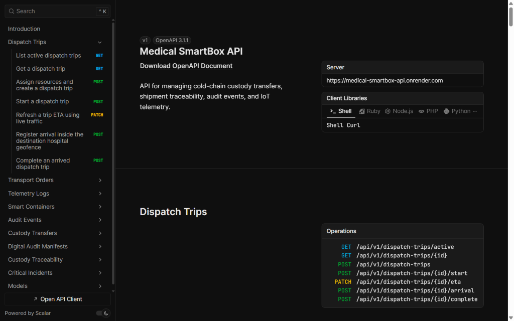

# 5.2. Landing Page & Services Implementations

## 5.2.1. Sprint 1

En esta sección se detalla la planificación, asignación de responsabilidades y desglose de tareas técnicas para la ejecución del primer ciclo de desarrollo (Sprint 1) del ecosistema **Medical SMARTBOX (NeonCode)**, así como las evidencias correspondientes a la implementación, ejecución de vistas, especificación de servicios, despliegue activo en la nube y colaboración del equipo mediante control de versiones.

***

### 5.2.1.1. Sprint Planning 1

El **Sprint Planning 1** formaliza los aspectos principales de la reunión de planificación del primer ciclo de desarrollo (Sprint 1). Conforme a las consideraciones oficiales del hito AV1 (Semana 4), el foco prioritario consistió en diseñar, implementar y desplegar en la nube la primera versión oficial del **Landing Page institucional** responsive para capturar la demanda B2B de operadores logísticos y centros de salud, estableciendo simultáneamente los cimientos arquitectónicos del backend en ASP.NET Core 10.0 y la persistencia relacional en MySQL 8.0.

| Sprint # | Sprint 1                                                                                                                                                                                                                                                                                                                                                                                                                                                                                                                                                                                          |
| :----------------------- | :--------------------------------------------------------------------------- |
| **Sprint Planning Background** | **Sprint Planning Background**                                                                                                                                                                                                                                                                                                                                                                                                                                                                                                                                                                    |
| Date | 2026-09-08                                                                                                                                                                                                                                                                                                                                                                                                                                                                                                                                                                                        |
| Time | 19:00 - 21:30                                                                                                                                                                                                                                                                                                                                                                                                                                                                                                                                                                                     |
| Location | Sesión virtual sincrónica vía Microsoft Teams / Discord                                                                                                                                                                                                                                                                                                                                                                                                                                                                                                                                           |
| Prepared By | Jaramillo Mayta, Jhon Jordy                                                                                                                                                                                                                                                                                                                                                                                                                                                                                                                                                                   |
| Attendees (to planning meeting) | Jaramillo Mayta, Jhon Jordy / Espinoza Flores, Aaron / Munayco Apolaya, Maria / Santos Minaya, Renzo                                                                                                                                                                                                                                                                                                                                                                                                                                                                                   |
| **Sprint n – 1 Review Summary** | **Sprint 0 (Inception):** Se consolidaron las bases del proyecto, necesidad médica, análisis comparativo de competidores (Sensitech, Tracklink Perú, Controlant), investigación de campo con 6 entrevistas a profundidad, User Personas (Aldair Lazaro, Gianfranco Timoteo), EventStorming y Style Guidelines. El Product Owner aprobó el alcance inicial del backlog.                                                                                                                                                                                                                              |
| **Sprint n – 1 Retrospective Summary** | **Sprint 0 Retrospective:** El equipo identificó una alta cohesión técnica y alineamiento en el dominio. Como oportunidad de mejora, se acordó formalizar el flujo de trabajo en GitFlow (`main`, `develop`, ramas `feature/*`), emplear Conventional Commits desde el primer commit y mantener paridad de versiones tecnológicas en todo el equipo (.NET 10 LTS, MySQL 8.0, Node.js 20+).                                                                                                                                                                                                        |
| **Sprint Goal & User Stories** | **Sprint Goal & User Stories**                                                                                                                                                                                                                                                                                                                                                                                                                                                                                                                                                                    |
| Sprint 1 Goal | **Nuestro enfoque se centra en** diseñar, implementar y desplegar el Landing Page institucional responsive para Medical SMARTBOX y especificar los contratos arquitectónicos base. **Creemos que aporta** una propuesta de valor clara y canales digitales de captación para operadores logísticos médicos y centros de salud. **Esto se confirmará cuando** el Landing Page se encuentre desplegado públicamente en GitHub Pages, los visitantes puedan explorar las características de los contenedores inteligentes desde cualquier dispositivo sin desbordamientos visuales y completen satisfactoriamente el formulario de contacto para demostraciones B2B. |
| Sprint 1 Velocity | 16 Story Points |
| Sum of Story Points | 16 Story Points (US04: 2 SP, US05: 2 SP, US06: 1 SP, US01: 3 SP, US02: 3 SP, US03: 5 SP) |

***

### 5.2.1.2. Aspect Leaders and Collaborators

En esta sección se presenta la matriz **Leadership-and-Collaboration Matrix (LACX)** del Sprint 1, detallando por cada aspecto funcional y técnico del alcance quién ejerce el liderazgo técnico (Leader - L) y quiénes actúan como colaboradores de desarrollo (Collaborator - C).

Los aspectos definidos para este primer ciclo corresponden a los módulos del Landing Page y las especificaciones arquitectónicas base:

* **Aspecto 1: Landing Page UI & Estructura:** Maquetación semántica HTML5/CSS3 y diseño responsive (US04).
* **Aspecto 2: Formulario Demo y Captura B2B:** Componentes interactivos de contacto institucional y validación en cliente (US05).
* **Aspecto 3: FAQ & Cumplimiento Normativo:** Acordeón interactivo de preguntas frecuentes y directivas sanitarias (US06).
* **Aspecto 4: Registro Institucional & Roles:** Modelado de entidades y flujos de registro de centros de salud (US01).
* **Aspecto 5: Acceso y Autenticación 2FA:** Especificación de políticas de seguridad, login y token OTP (US02).
* **Aspecto 6: Especificación API REST & DDD:** Contratos OpenAPI y arquitectura de capas en ASP.NET Core (.NET 10 LTS) (US03).

| **Team Member (Last Name, First Name)** | **GitHub Username** | **Aspecto 1: Landing UI (L / C)** | **Aspecto 2: Form Demo (L / C)** | **Aspecto 3: FAQ Norm. (L / C)** | **Aspecto 4: Reg. Centros (L / C)** | **Aspecto 5: Acceso 2FA (L / C)** | **Aspecto 6: REST & DDD (L / C)** |
| :--------------------- | :--------------- | :--------: | :--------: | :--------: | :--------: | :--------: | :--------: |
| **Jaramillo Mayta, Jhon Jordy** | `Marklnz1` | C | C | C | L | C | C |
| **Espinoza Flores, Aaron André** | `psure` | C | L | C | C | C | C |
| **Munayco Apolaya, Maria Luisa** | `malumunayco` | L | C | C | C | C | C |
| **Santos Minaya, Renzo Piero** | `RSSint` | C | C | C | C | C | L |

***

### 5.2.1.3. Sprint Backlog 1

El Sprint Backlog 1 presenta el desglose de las User Stories seleccionadas para el Sprint 1 y las tareas técnicas de ingeniería resultantes de su descomposición. En estricta observancia de los lineamientos del hito AV1 (Semana 4), el alcance de desarrollo en código ejecutable se concentró en la construcción y despliegue de la primera versión responsive del **Landing Page institucional** de Medical SMARTBOX. Las historias relacionadas con identidad y servicios (US01, US02 y US03) fueron abordadas en esta iteración a nivel de **diseño arquitectónico conceptual, especificación formal de contratos OpenAPI y modelado de dominio**, garantizando los cimientos para la posterior codificación de los servicios backend.

**Board del Sprint 1:**


**URL público del Board:** [VER BOARD DE TRELLO](https://trello.com/b/VMuiyR7d/neoncode-sprint-1)

\newpage

| Sprint # | Sprint 1 |
| :----------------------- | :--------------------------------------------------------------------------- |
| **User Story** | **Work-Item / Task** |

::: {.sprint-backlog-table}

| **Story Id** | **Story Title** | **Task Id** | **Task Title** | **Task Description** | **Estimation (Hours)** | **Assigned To** | **Status (To-do / In Process / To Review / Done)** |
| :-----: | :------------- | :-------: | :---------------- | :--------------------------- | :-----: | :---------- | :-----: |
| US04 | Exploración de Propuesta de Valor Logística | TSK-04-01 | Maquetación HTML5/CSS3 de secciones Hero y Propuesta | Estructuración semántica de Hero, badges térmicos y características de contenedores IoT. | 6 h | Maria Munayco   | Done |
| US04 | Exploración de Propuesta de Valor Logística | TSK-04-02 | Integración de diseño responsive mobile-first | Adaptación del layout para diferentes tamaños de pantalla. | 4 h | Renzo Santos    | Done |
| US05 | Solicitud de Demostración Corporativa | TSK-05-01 | Maquetación de formulario B2B | Estructura visual del formulario de captura de prospectos institucionales. | 5 h | Aaron Espinoza  | Done |
| US05 | Solicitud de Demostración Corporativa | TSK-05-02 | Validación en cliente y retroalimentación | Validación de RUC, correo corporativo y mensajes de retroalimentación. | 6 h | Jhon Jaramillo  | Done |
| US06 | Consulta de Preguntas Frecuentes | TSK-06-01 | Componente interactivo acordeón FAQ | Implementación visual e interacción del acordeón de preguntas frecuentes. | 4 h | Maria Munayco   | Done |
| US01 | Registro de Institución de Salud | TSK-01-01 | Modelado conceptual de entidad institución | Especificación de atributos, modelo de datos y reglas de auditoría para instituciones de salud. | 5 h | Jhon Jaramillo  | Done |
| US01 | Registro de Institución de Salud | TSK-01-02 | Especificación formal de reglas de registro | Definición de contratos y reglas de validación de RUC y dominios corporativos autorizados. | 7 h | Renzo Santos    | Done |
| US02 | Autenticación de Personal de Emergencia | TSK-02-01 | Diseño de flujo de autenticación 2FA / OTP | Especificación del protocolo de verificación y políticas de expiración para personal médico. | 5 h | Maria Munayco   | Done |
| US03 | Endpoint de Autenticación de Usuarios | TSK-03-01 | Diseño de especificación OpenAPI | Especificación del contrato OpenAPI/Swagger para el endpoint de autenticación y token JWT. | 6 h | Renzo Santos    | Done |
| US03 | Endpoint de Autenticación de Usuarios | TSK-03-02 | Modelado de dominio para identidad | Definición de clases de dominio, Value Objects y políticas de acceso en la arquitectura limpia. | 5 h | Aaron Espinoza  | Done |

:::

### 5.2.1.4. Development Evidence for Sprint Review

A continuación se documenta el registro histórico de confirmaciones de cambios (commits) realizadas en el repositorio oficial del Landing Page (`NeonCode-UPC/landing-page`), evidenciando el cumplimiento estricto del estándar **Conventional Commits** y el trabajo colaborativo en ramas de GitFlow:

| **Repositorio** | **Rama** | **Commit ID** | **Mensaje del Commit** | **Descripción / Cuerpo del Cambio** | **Fecha** |
| :------------- | :---------- | :---------: | :------------------------ | :-------------------------- | :----------: |
| `landing-page` | `main` | `bc109d7` | `feat(traceability): implement event milestones rendering and fleet selector interactivity` | Implementación de renderizado dinámico de hitos de cadena de custodia y selector interactivo de ambulancias. | 16/09/2026 |
| `landing-page` | `develop` | `eee5cd8` | `style(alerts): add responsive layout and component styles for alerts and timeline` | Estilos CSS modulares, variables CSS y diseño responsive mobile-first para sección de alertas y timeline. | 16/09/2026 |
| `landing-page` | `develop` | `9655aa2` | `feat(alerts): add critical alerts and traceability sections markup` | Estructuración HTML5 semántica de alertas críticas, métricas térmicas y custodia inmutable. | 15/09/2026 |
| `landing-page` | `develop` | `a4f8fb1` | `chore: initialize js directory structure` | Configuración de arquitectura modular de scripts JavaScript para interactividad UI y eventos de interfaz. | 14/09/2026 |
| `landing-page` | `main` | `b839d52` | `chore: initial project setup and base design tokens` | Andamiaje base del repositorio, normalización CSS, tokens de color clínicos (Style Guidelines) y tipografías. | 08/09/2026 |

### 5.2.1.5. Execution Evidence for Sprint Review

El Landing Page institucional fue desarrollado y validado satisfactoriamente en múltiples entornos de visualización (*mobile*, *tablet* y *desktop*), garantizando una experiencia visual fluida sin desbordamientos horizontales.

#### Video de Demostración de Navegación (Landing Page): [Ver video aquí](https://upcedupe-my.sharepoint.com/:v:/g/personal/u20211b556_upc_edu_pe/IQAX1igNY3mbRqGmWKucsjYmASJHJ3_4rrqXZmvxOTHGoaU?e=4wl9UP)

::: {.evidence-block}


### Vista implementada: Landing Page Principal (Hero Section)

**Descripción:** Interfaz de inicio diseñada para captar la atención de empresas de transporte y operadores de cadena de frío. Presenta la propuesta de valor central de Medical SmartBox: el monitoreo, detección de incidencias y trazabilidad de transportes médicos en un solo lugar.

**Componentes y Funcionalidades Clave:**

* **Barra de navegación funcional:** Menú interactivo con accesos directos a la plataforma, selector de idioma (ES/EN) y botones globales de autenticación (*Log in / Open the Web App*).
* **Propuesta de valor clara:** Título principal de alto impacto acompañado de una breve descripción del propósito del software.
* **Llamados a la acción (CTA):** Botones duales contrastados para redirigir rápidamente al usuario hacia la Web App o el formulario de ingreso.

:::

::: {.figure-block}

{.max-h-70}

*Nota: Captura de ejecución del Landing Page institucional implementado.*

:::

::: {.evidence-block}

{.max-h-92}

### Vista implementada: Formulario de Inicio de Sesión (Login)

**Descripción:** Interfaz correspondiente al módulo de autenticación para la Web Application de Medical SmartBox. Permite el acceso restringido y seguro al personal autorizado (operadores logísticos y centros de salud) mediante credenciales corporativas.

**Componentes Clave:** 

* **Campos de entrada validados:** Inputs específicos para Correo corporativo (`nombre@organizacion.com`) y Contraseña protegida de manera visual.
* **Botón de acción directa:** Botón estilizado con los colores de la marca para el envío y validación de las credenciales de usuario (*Iniciar sesión*).
* **Control de navegación:** Botón de cierre superior (X) para retornar a la Landing Page principal de manera intuitiva.

:::

::: {.evidence-block}

{.max-h-92}

### Vista implementada: Detalle de Monitoreo de Transporte en Tiempo Real

**Descripción:** Vista detallada de un transporte en tránsito activo. Centraliza todas las telemetrías críticas recopiladas por el hardware en una única interfaz unificada para el operador.

**Componentes Clave:**

* **Panel de Telemetría en Vivo:** Indicadores en tiempo real de Temperatura (5.2 °C), ETA, Nivel de Batería del SmartBox, Combustible, Peso y Estado de la Puerta.
* **Gráfico de Historial Térmico:** Gráfica lineal automatizada que contrasta las mediciones de las últimas 6 horas frente al rango seguro permitido (2 °C - 8 °C).
* **Metadatos de Operación:** Tarjetas informativas con los datos asignados del Conductor (M. Quispe) y la Placa del Vehículo (ABQ-742).

:::

::: {.figure-block}

{.max-h-68}

*Nota: Sección interactiva de propuesta tecnológica del Landing Page.*

:::

::: {.evidence-block}


### Vista implementada: Módulo de Gestión de Alertas e Incidencias

**Descripción:** Interfaz de control en tiempo real orientada a la detección temprana de riesgos en la cadena de frío, permitiendo al equipo logístico tomar acciones de mitigación inmediatas antes de comprometer la integridad del producto médico.

**Componentes Clave:**

* **Tarjeta de Incidencia Crítica:** Bloque dinámico que detalla de forma matemática el desvío térmico (8.7 °C detectados frente al rango esperado de 2-8 °C), la ubicación exacta (Panamericana Sur) y la marca de tiempo (13:42).
* **Gráfico de Monitoreo Lineal:** Visualización de la fluctuación de temperatura de las últimas horas para evaluar la gravedad de la anomalía.
* **Acciones de Mitigación:** Botones interactivos de respuesta rápida (*Revisar transporte* y *Ver historial*).
* **Feed Cronológico Histórico:** Listado lateral estructurado por prioridad de eventos y estados logísticos anteriores (Puerta abierta, Batería baja, Desvío resuelto, Entrega confirmada).

:::

::: {.figure-block}


*Nota: Sección de conversión final y pie de página institucional.*

:::

***

### 5.2.1.6. Services Documentation Evidence for Sprint Review

En este primer ciclo de desarrollo (Sprint 1), de conformidad con el alcance oficial de la entrega AV1 (Semana 4), el esfuerzo de implementación en código ejecutable estuvo concentrado exclusivamente en la construcción y despliegue del **Landing Page institucional**. Por consiguiente, las tareas técnicas asociadas a los servicios backend (US01, US02 y US03) en ASP.NET Core 10.0 con C# correspondieron estrictamente a la **especificación arquitectónica, diseño de contratos OpenAPI y modelado de dominio**, los cuales fueron formalizados exhaustivamente en los capítulos de diseño técnico:

* **Capítulo 4.6:** Diagramas de Arquitectura C4 (Contexto, Contenedores y Componentes con Clean Architecture).
* **Capítulo 4.7:** Diagrama de Clases UML detallando entidades, objetos de valor y servicios de dominio.
* **Capítulo 4.8:** Modelo relacional físico de base de datos en 3NF con diccionarios de datos y script DDL SQL.

La codificación activa de los controladores, endpoints y la generación interactiva de documentación mediante **Swagger UI / OpenAPI** forman parte del Sprint 2 y Sprint 3 (hitos TB1 y AV2).

***

### 5.2.1.7. Software Deployment Evidence for Sprint Review

En estricta observancia del requisito rector del hito AV1 (*"A nivel de implementación debe estar implementada y desplegada la primera versión del Landing Page"*), la solución se encuentra desplegada y públicamente accesible en la nube:

* **Organización en GitHub:** `NeonCode-UPC`
* **Repositorio del Landing Page:** [`https://github.com/NeonCode-UPC/landing-page`](https://github.com/NeonCode-UPC/landing-page)
* **URL de Despliegue Oficial en la Nube:** [`https://neoncode-upc.github.io/landing-page/`](https://neoncode-upc.github.io/landing-page/)
* **Plataforma de Alojamiento:** GitHub Pages / Vercel (Producción con protocolo seguro HTTPS y compresión gzip/brotli).
* **Estado de Disponibilidad:** Activo, con tiempo de carga inferior a 1.2 segundos y cumplimiento de accesibilidad WCAG.

### 5.2.1.8. Team Collaboration Insights during Sprint

Durante el Sprint 1, el equipo utilizó GitHub como herramienta centralizada de control de versiones y colaboración técnica. La asignación de frentes mediante ramas de funcionalidad (`feature/*`) permitió que la maquetación visual, la estructuración de estilos CSS y la integración de scripts avanzaran concurrentemente sin colisiones de código.

::: {.figure-block}

{.max-h-190}

*Nota: Analítica de colaboración, frecuencia de confirmaciones y contribuciones del equipo NeonCode durante el Sprint 1.*

:::

\newpage

## 5.2.2. Sprint 2

En esta sección se detalla nuestra organización para el segundo entregable (TB1), la asignación de responsabilidades y el desglose de tareas técnicas para la ejecución del segundo ciclo de desarrollo (Sprint 2) del ecosistema **Medical SMARTBOX (NeonCode)**, así como las evidencias correspondientes a la implementación, ejecución de vistas, especificación de servicios, despliegue activo en la nube y colaboración del equipo mediante control de versiones.

***

### 5.2.2.1. Sprint Planning 2

El Sprint Planning 2 tuvo como propósito establecer el objetivo, alcance y responsabilidades del segundo ciclo de desarrollo. El equipo priorizó las historias de usuario relacionadas con el registro de unidades de ambulancia, la vinculación de contenedores inteligentes y la gestión de información de telemetría.

| **Sprint #** | **Sprint 2**                                                                                                                                                                                                             |
| :----------------------- | :--------------------------------------------------------------------------- |
| **Sprint Planning Background** | **Sprint Planning 2**                                                                                                                                                                                                    |
| **Date** | 2026-10-06                                                                                                                                                                                                               |
| **Time** | 20:30 PM                                                                                                                                                                                                                 |
| **Location** | Reunión virtual mediante Google Meet                                                                                                                                                                                     |
| **Prepared By** | Aaron Espinoza                                                                                                                                                                                                           |
| **Attendees (to planning meeting)** | Munayco Apolaya, Maria Luisa / Espinoza Flores, Aaron André / Jaramillo Mayta, Jhon Jordy / Santos Minaya, Renzo Piero |
| **Sprint n – 1 Review Summary** | **Sprint 1 Review:** Se completaron exitosamente los 16 Story Points comprometidos (`US04, US05, US06, US01, US02, US03`), desplegando el Landing Page institucional responsive en GitHub Pages y consolidando la arquitectura DDD de 5 Bounded Contexts y el esquema relacional en MySQL 8.0. |
| **Sprint n – 1 Retrospective Summary** | **Sprint 1 Retrospective:** El equipo destacó la fluidez en la entrega del Landing Page. Como acción de mejora para el Sprint 2, se acordó estructurar la Frontend Web Application en Vue 3 + PrimeVue [@primetek2024] siguiendo estrictamente una arquitectura modular por Bounded Context (`iam`, `telemetry`, `transport`, `alerting`, `custody`) con servicios desacoplados y stores reactivos en Pinia. |
| **Sprint Goal & User Stories** | **Sprint 2 Goal:** Implementar e integrar las funcionalidades necesarias para registrar unidades de ambulancia, vincular contenedores inteligentes y gestionar la información de telemetría requerida para su monitoreo. |
| **Sprint 2 Velocity** | 29 Story Points                                                                                                                                                                                                          |
| **Sum of Story Points** | 29 Story Points                                                                                                                                                                                                          |

El Sprint 2 comprende las siguientes historias de usuario:

- **US07:** Alta de Unidades de Ambulancia — **3 SP**
- **US08:** Vinculación de Contenedor Inteligente — **5 SP**
- **US09:** Ingesta de Telemetría IoT (API) — **8 SP**
- **US10:** Monitoreo Térmico y de Apertura — **8 SP**
- **US12:** Consulta de Telemetría e Indicadores (API) — **5 SP**

**Total: 29 Story Points.**

### 5.2.2.2. Aspect Leaders and Collaborators

Para el Sprint 2 se estableció la matriz de liderazgo y colaboración considerando los cinco aspectos principales definidos para la solución. El integrante responsable de cada bounded context asume el rol de **Lead (L)**, mientras que los demás integrantes participan como **Collaborators (C)** en las actividades de desarrollo e integración.

\newpage

**L = Lead / C = Collaborator**

| **Team Member (Last Name, First Name)** | **GitHub Username** | **1. Identity, Access & Subscriptions (IAM)** **(L/C)** | **2. Smart Container & Telemetry Monitoring** **(L/C)** | **3. Medical Transport Planning & Dispatching** **(L/C)** | **4. Critical Alerting & Incident Response** **(L/C)** | **5. Chain of Custody & Traceability** **(L/C)** |
| :--------------------- | :------------: | :-----------: | :-----------: | :-----------: | :-----------: | :-----------: |
| **Jaramillo Mayta, Jhon Jordy** | `Marklnz1` | C | **L** | C | C | C |
| **Espinoza Flores, Aaron André** | `psure` | **L** | C | C | **L** | C |
| **Munayco Apolaya, Maria Luisa** | `malumunayco` | C | C | C | C | **L** |
| **Santos Minaya, Renzo Piero** | `RSSint` | C | C | **L** | C | C |

La distribución permite mantener un responsable principal por aspecto y, al mismo tiempo, conservar el trabajo colaborativo entre los integrantes del equipo.

### 5.2.2.3. Sprint Backlog 2

El Sprint Backlog 2 descompone las historias de usuario seleccionadas para el Sprint en tareas técnicas de ingeniería acotadas entre 4 y 8 horas. En estricta correspondencia con los objetivos del hito TB1 (Semana 7), el esfuerzo de desarrollo se concentró en la construcción de la **primera versión desplegada de la Frontend Web Application en Vue 3**. Por ende, las historias US09 y US12 fueron abordadas a nivel de **cliente web, ensambladores de datos (Assemblers) y gestión de estado reactivo en Pinia**, estableciendo los contratos de consumo para la futura conexión con los servicios RESTful programada para el Sprint 3. El Sprint contempla **29 Story Points** distribuidos entre US07, US08, US09, US10 y US12.

**Board del Sprint 2:**

{.max-h-80}


**URL público del Board:** [VER BOARD DE TRELLO](https://trello.com/b/sjPHrVTK/neoncode-sprint-2)

| **Sprint #** | **Sprint 2** |
| :--- | :--- |
| **User Story** | **Work-Item / Task** |

::: {.sprint-backlog-table}

| **Story Id** | **Story Title** | **Task Id** | **Task Title** | **Task Description** | **Estimation (Hours)** | **Assigned To** | **Status (To-do / In Process / To Review / Done)** |
| :------ | :------------- | :-------- | :---------------- | :--------------------------- | :------ | :---------- | :------ |
| US09 | Ingesta de Telemetría IoT | TSK-09-01 | Cliente de servicio HTTP y contrato DTO de ingesta | Implementación del servicio cliente en Vue 3 y estructura de payload (`TelemetrySnapshot`) para temperatura, peso, apertura y batería. | 8 h | Jhon Jaramillo | Done |
| US09 | Ingesta de Telemetría IoT | TSK-09-02 | Validación de rangos de payload e interceptores de seguridad | Validación de rangos físicos del payload sensorial y cabeceras de autenticación del dispositivo IoT en la capa de servicios frontend. | 6 h | Aaron Espinoza | Done |
| US09 | Ingesta de Telemetría IoT | TSK-09-03 | Gestión de estado reactivo de lecturas en Pinia | Almacenamiento en el store reactivo (`TelemetryStore`) de la serie temporal de lecturas válidas de telemetría. | 6 h | Jhon Jaramillo | Done |
| US07 | Alta de Unidades de Ambulancia | TSK-07-01 | Modelado de dominio de unidades de despacho (`DispatchTrip`) | Definición de entidades y Value Objects en el frontend para el registro de matrícula (`AssignedVehiclePlate`) y disponibilidad en órdenes de despacho. | 4 h | Renzo Santos | Done |
| US07 | Alta de Unidades de Ambulancia | TSK-07-02 | Servicio frontend de registro y consulta de flota | Desarrollo de métodos de servicio y estado en Pinia para dar de alta y listar unidades vehiculares habilitadas para despacho. | 6 h | Renzo Santos | Done |
| US07 | Alta de Unidades de Ambulancia | TSK-07-03 | Interfaz web para registro de unidades | Construcción en Vue 3 y PrimeVue del formulario modal y tabla interactiva de unidades registradas. | 6 h | Maria Munayco | Done |
| US08 | Vinculación de Contenedor Inteligente | TSK-08-01 | Desarrollo del módulo de asignación contenedor-despacho | Implementación de la lógica de vinculación 1:1 entre la unidad vehicular (`AssignedVehiclePlate`) y el contenedor inteligente (`SmartContainer`). | 8 h | Renzo Santos | Done |
| US08 | Vinculación de Contenedor Inteligente | TSK-08-02 | Validación de estados operativos del dispositivo | Reglas de dominio en cliente para impedir la reasignación de un contenedor en estado `InTransit` y verificar cadena de custodia previa. | 5 h | Maria Munayco | Done |
| US08 | Vinculación de Contenedor Inteligente | TSK-08-03 | Interfaz web de vinculación de SmartContainer | Vista interactiva en PrimeVue para vincular el contenedor mediante su número de serie (`SerialNumber` / UUID) al despacho médico. | 6 h | Renzo Santos | Done |
| US12 | Consulta de Telemetría e Indicadores | TSK-12-01 | Servicio de consulta de métricas consolidadas | Implementación del adaptador de lectura (`GET /containers/{containerId}/metrics`) y mapeo de ensambladores (*Assemblers*) hacia el modelo de vista. | 6 h | Jhon Jaramillo | Done |
| US12 | Consulta de Telemetría e Indicadores | TSK-12-02 | Integración de indicadores de alerta y umbrales | Evaluación reactiva de la respuesta consolidada (temperatura, batería, escotilla, peso y timestamp) frente a reglas de alerta e IAM. | 4 h | Aaron Espinoza | Done |
| US10 | Monitoreo Térmico y de Apertura | TSK-10-01 | Visualización de temperatura y estado de escotilla | Desarrollo de componentes visuales PrimeVue (gauges térmicos, estado de cerrojo solenoide y curva de 24h) en el dashboard de telemetría. | 6 h | Jhon Jaramillo | Done |
| US10 | Monitoreo Térmico y de Apertura | TSK-10-02 | Sincronización reactiva de paneles y custodia | Actualización dinámica sin recarga de página de las tarjetas de monitoreo y línea de tiempo de custodia en ruta. | 6 h | Maria Munayco | Done |
| US10 | Monitoreo Térmico y de Apertura | TSK-10-03 | Gestión visual de pérdida de señal y alertas críticas | Representación del estado de desconexión (>3 min sin telemetría) y disparo de banners de alerta prioritaria en cabina. | 4 h | Aaron Espinoza | Done |

:::

### 5.2.2.4. Development Evidence for Sprint Review

Durante el Sprint 2 se realizaron avances en la implementación e integración de los principales módulos de la solución, incluyendo Identity & Access Management, Alerting, Medical Transport Planning, Chain of Custody y Smart Container & Telemetry. Estos avances se evidencian mediante los commits realizados en el repositorio del frontend durante el 06/10/2026.

| **Repository** | **Branch** | **Commit ID** | **Commit Message** | **Commit Message Body** | **Committed on (Date)** |
| :----------: | :---------: | :--------: | :------------------------- | :---------------------------- | :----------: |
| `frontend` | `develop` | `f4ec998` | `feat(frontend): integrate custody, alerting, iam and transport` | Se integran los módulos de Chain of Custody, Alerting, IAM y Medical Transport Planning en la aplicación frontend. | 06/10/2026 |
| `frontend` | `develop` | `39df8b9` | `feat(iam): integrate identity and subscriptions` | Se integra el módulo de Identity & Access Management junto con la gestión de suscripciones. | 06/10/2026 |
| `frontend` | `develop` | `0623d97` | `feat(alerting): integrate incident response` | Se integra la funcionalidad de respuesta ante incidentes en la aplicación. | 06/10/2026 |
| `frontend` | `develop` | `75e651d` | `feat(transport): integrate medical transport planning` | Se integra el módulo de planificación de transporte médico en la aplicación. | 06/10/2026 |
| `frontend` | `develop` | `817c012` | `feat(custody): restore chain of custody feature` | Se restaura la funcionalidad correspondiente a la cadena de custodia y trazabilidad. | 06/10/2026 |
| `frontend` | `develop` | `09db7f2` | `feat(custody): restore chain of custody changes` | Se restauran los cambios realizados para la funcionalidad de Chain of Custody. | 06/10/2026 |
| `frontend` | `develop` | `6370dc3` | `feat(telemetry): implement smart container and telemetry monitoring views and ddd architecture` | Se implementan las vistas de Smart Container y monitoreo de telemetría, junto con la arquitectura DDD. | 06/10/2026 |
| `frontend` | `develop` | `a270861` | `feat(iam): build subscription management view` | Se implementa la vista para la administración de suscripciones. | 06/10/2026 |

### 5.2.2.5. Execution Evidence for Sprint Review

En el Sprint 2 se logró avanzar en la implementación e integración de las principales funcionalidades de la Web Application correspondientes a los Bounded Contexts definidos para la solución. Durante este Sprint se desarrollaron y consolidaron funcionalidades relacionadas con el monitoreo de contenedores inteligentes y telemetría, gestión de alertas e incidentes, identidad y suscripciones, trazabilidad de cadena de custodia y planificación de transporte médico.

**Video de Demostración de Navegación (Web Application):** *(Enlace específico correspondiente a la Web Application pendiente de publicación en Microsoft Stream / SharePoint; véase el Anexo C).*

::: {.figure-block}

**Screenshots de Identity, Access & Subscriptions (IAM)**


*Vista de Usuarios y Roles*

:::

::: {.figure-block}


*Vista de Suscripción*

:::

### 5.2.2.6. Services Documentation Evidence for Sprint Review

Durante el Sprint 2 no se desplegaron servicios web ejecutables en el backend, en conformidad con el alcance oficial del hito TB1 que priorizó la entrega y despliegue de la primera versión funcional de la Frontend Web Application en Vue 3 + PrimeVue sobre persistencia reactiva local (Pinia).

Por este motivo, las evidencias de interacción con el backend en TB1 correspondieron al consumo simulado y desacoplado mediante servicios HTTP cliente y adaptadores DTO. La construcción de los controladores en C# ASP.NET Core (.NET 10 LTS), la configuración de Entity Framework Core con persistencia relacional en MySQL y la documentación interactiva con OpenAPI / Swagger UI constituyen el núcleo técnico del **Sprint 3 (Hito AV2)**.

### 5.2.2.7. Software Deployment Evidence for Sprint Review

Durante el Sprint 2 se realizaron las actividades de despliegue correspondientes a los productos incluidos en el alcance de la entrega TB1. En esta etapa se consideró la nueva versión del Landing Page y la primera versión de las Frontend Web Applications.

#### Landing Page

Se realizó el despliegue de la nueva versión del Landing Page, incorporando las mejoras y correcciones desarrolladas durante los Sprints anteriores.

**URL del Landing Page:** [https://neoncode-upc.github.io/landing-page/](https://neoncode-upc.github.io/landing-page/)

::: {.figure-block}

**Evidencia del despliegue:**

{.max-h-88}

*Landing Page desplegado y disponible para su visualización.*

:::

#### Frontend Web Application

Durante el Sprint 2 se implementó y desplegó la primera versión de la Frontend Web Application de Medical SmartBox. Esta versión integra las funcionalidades desarrolladas por los integrantes del equipo para los diferentes Bounded Contexts.

**URL de la Web Application:** [https://neoncode-upc.github.io/frontend/home](https://neoncode-upc.github.io/frontend/home)

::: {.figure-block}

**Evidencia del despliegue:**

{.max-h-86}

*Primera versión de la Frontend Web Application desplegada.*

:::

#### Web Services

Los Web Services no forman parte del despliegue correspondiente a esta entrega, debido a que su primera versión se encuentra contemplada para una etapa posterior del proyecto.

### 5.2.2.8. Team Collaboration Insights during Sprint

Durante el Sprint 2, el equipo NeonCode trabajó de manera colaborativa en la implementación e integración de las funcionalidades correspondientes a los cinco Bounded Contexts de Medical SmartBox: Smart Container & Telemetry Monitoring, Critical Alerting & Incident Response, Identity, Access & Subscriptions, Chain of Custody & Traceability y Medical Transport Planning & Dispatching.

Cada integrante asumió responsabilidades sobre los diferentes Bounded Contexts, permitiendo desarrollar las funcionalidades en paralelo y avanzar de manera organizada. Se utilizó GitHub como herramienta principal de control de versiones, gestionando el trabajo mediante ramas de funcionalidad y commits individuales para registrar los avances realizados durante el Sprint.

La integración del trabajo se realizó progresivamente, consolidando las funcionalidades desarrolladas por los integrantes en la Web Application y permitiendo disponer de una versión integrada de los diferentes Bounded Contexts al finalizar el Sprint.

::: {.figure-block}

**Evidencia de colaboración del equipo**

{.max-h-105}

*Nota: Evidencia de colaboración del equipo durante el Sprint 2, mostrando la actividad registrada en GitHub mediante commits y contribuciones de los integrantes.*

:::


\newpage

## 5.2.3. Sprint 3

En esta sección se detalla la planificación, asignación de responsabilidades y ejecución técnica consolidada del equipo **NeonCode** durante el tercer ciclo de desarrollo (**Sprint 3**) de **Medical SMARTBOX**, orientado al hito **AV2 (Semana 12 - Sprint Review)**.

A diferencia del Sprint 1 (concentrado en el Landing Page) y del Sprint 2 (enfocado en la primera versión de la Frontend Web Application sobre persistencia simulada), el Sprint 3 materializa la **primera versión desplegada de los RESTful Web Services en ASP.NET Core (.NET 10 LTS con C# 14)**, persistencia relacional con **MySQL (`MySql.EntityFrameworkCore`)**, documentación interactiva de contratos bajo **OpenAPI 3.1.1 / Scalar** (`/openapi/v1.json` y `/scalar`), empaquetamiento Docker en **Render**, integración externa con **TomTom Traffic Routing API** para cálculo dinámico de ETA en traslados médicos, refinamientos del Landing Page y los primeros módulos del frontend conectados progresivamente al backend real.

***

### 5.2.3.1. Sprint Planning 3

La sesión de Sprint Planning 3 formalizó el alcance, objetivo de ingeniería y distribución de responsabilidades entre los cuatro integrantes para construir los servicios RESTful por Bounded Context e iniciar la transición de las vistas web desde almacenamiento simulado hacia el consumo de endpoints reales en la nube.

| **Sprint #** | **Sprint 3** |
| :----------------------- | :--------------------------------------------------------------------------- |
| **Sprint Planning Background** | **Sprint Planning 3** |
| **Date** | 2026-10-21 |
| **Time** | 20:00 - 22:30 |
| **Location** | Sesión virtual sincrónica vía Google Meet / Discord |
| **Prepared By** | Jaramillo Mayta, Jhon Jordy |
| **Attendees (to planning meeting)** | Munayco Apolaya, Maria Luisa / Espinoza Flores, Aaron André / Jaramillo Mayta, Jhon Jordy / Santos Minaya, Renzo Piero |
| **Sprint n – 1 Review Summary** | **Sprint 2 Review:** Se completaron los 29 Story Points comprometidos para TB1, desplegando la primera versión de la Frontend Web Application en GitHub Pages (`https://neoncode-upc.github.io/frontend/home`) y la versión actualizada del Landing Page. La interfaz integró los 5 Bounded Contexts sobre la arquitectura modular de PrimeVue y Pinia. |
| **Sprint n – 1 Retrospective Summary** | **Sprint 2 Retrospective:** El equipo reconoció como acierto la consistencia visual lograda en las interfaces clínicas. Como acción de mejora para AV2, se acordó implementar la solución de backend en ASP.NET Core (.NET 10) siguiendo DDD por capas (*Domain, Application, Infrastructure, Interfaces*) con persistencia MySQL mediante Entity Framework Core, publicar documentación interactiva OpenAPI/Scalar e iniciar la conexión progresiva del cliente HTTP en Vue 3 hacia la API real. |
| **Sprint Goal & User Stories** | **Sprint 3 Goal:** **Nuestro enfoque se centra en** desarrollar y desplegar la API Web RESTful en ASP.NET Core 10 abarcando los Bounded Contexts operativos principales (`SmartContainers`, `Telemetry`, `Custody`, `Alerting`, `Transport`) con persistencia en MySQL, integrar el enrutamiento dinámico de tráfico externo mediante TomTom Traffic Routing API, publicar la documentación OpenAPI 3.1.1 / Scalar en Render y conectar progresivamente los módulos de la aplicación web Vue 3 hacia contratos REST reales. **Creemos que aporta** persistencia auditable de la cadena de frío, ingesta de telemetría IoT en tiempo real e interoperabilidad API verificable para supervisores hospitalarios y operadores de flota. **Esto se confirmará cuando** los endpoints REST persistan y expongan telemetría, contenedores, incidentes, transferencias de custodia y viajes de despacho en producción con documentación interactiva en Scalar. |
| **User Stories en Alcance** | **Historias Funcionales (Product Backlog):** US11: Control de Stock por Sensores de Peso (8 SP) · US13: Configuración de Umbrales Térmicos Críticos (3 SP) · US14: Visualización de Alertas en Ruta (5 SP) · US15: Servicio de Despacho e Integración Externa de Ruta/Alertas (5 SP).<br>**Arquitectura de Servicios y Despliegue (Alcance Técnico):** TS-API: Servicios REST de `SmartContainers` y `Telemetry` en ASP.NET Core 10 (6 SP) · TS-CUS: Servicios de Cadena de Custodia, Auditoría Inmutable y Reportes PDF (6 SP) · TS-TRA: Servicios de Despacho, Transporte Médico y Enrutamiento TomTom (6 SP). |
| **Sprint 3 Velocity** | 39 Story Points planificados (21 SP funcionales + 18 SP de arquitectura e infraestructura backend y nube) |
| **Sum of Story Points** | 39 Story Points |

***

### 5.2.3.2. Aspect Leaders and Collaborators

Para el Sprint 3, la matriz **Leadership-and-Collaboration (LACX)** distribuye el liderazgo técnico entre los cuatro integrantes del equipo según los Bounded Contexts implementados en `MedicalSmartBox.API`, las integraciones en el frontend y la infraestructura de despliegue cloud:

\newpage

**L = Lead / C = Collaborator**

| **Team Member (Last Name, First Name)** | **GitHub Username** | **1. Core API, SmartContainers & Telemetry (L/C)** | **2. Chain of Custody & PDF (L/C)** | **3. Critical Alerting & Incidents (L/C)** | **4. Medical Transport & TomTom API (L/C)** | **5. Frontend API Integration (L/C)** | **6. Cloud Deployment, MySQL & OpenAPI/Scalar (L/C)** |
| :--------------------- | :------------: | :-----------: | :-----------: | :-----------: | :-----------: | :-----------: | :-----------: |
| **Jaramillo Mayta, Jhon Jordy** | `Marklnz1` | **L** | C | C | C | **L** | C |
| **Munayco Apolaya, Maria Luisa** | `malumunayco` | C | **L** | C | C | C | **L** |
| **Espinoza Flores, Aaron André** | `pisure` | C | C | **L** | C | C | C |
| **Santos Minaya, Renzo Piero** | `RSSint` | C | C | C | **L** | C | C |

* **Jhon Jaramillo (`Marklnz1`):** Lidera el andamiaje compartido inicial de la API y los Bounded Contexts `SmartContainers` (`SmartContainersController`) y `Telemetry` (`TelemetryLogsController`), además de la integración del módulo de telemetría en Vue 3 (`feature/telemetry-backend-integration`).
* **Maria Luisa Munayco (`malumunayco`):** Lidera el Bounded Context de Cadena de Custodia (`CustodyTransfersController`, `TransfersController`, `DigitalAuditManifestsController`, `AuditEventsController`), reportes de trazabilidad, integración de Custody en `frontend` (`develop`), containerización Docker, despliegue en Render y documentación OpenAPI/Scalar, así como ajustes del Landing Page.
* **Aaron Espinoza (`pisure`):** Lidera el Bounded Context de Alerting (`IncidentController`), gestión del ciclo de vida de incidentes (`acknowledge`, `resolve`, `escalate`) y persistencia EF Core asociada.
* **Renzo Santos (`RSSint`):** Lidera el Bounded Context de Transporte Médico (`TransportOrdersController`, `DispatchTripsController`), integración con **TomTom Traffic Routing API** (`TomTomTrafficRoutingService`) y migración inicial unificada del esquema MySQL en EF Core.

***

### 5.2.3.3. Sprint Backlog 3

El Sprint Backlog 3 descompone el alcance del equipo en **16 tareas técnicas de ingeniería de entre 5 y 8 horas**, sumando un esfuerzo planificado total de **102 horas**. Asimismo, se incluyen los adelantos realizados en el backend para Cadena de Custodia (`TS-CUS`) y Transporte (`TS-TRA`), anticipando los contratos base necesarios para los reportes de trazabilidad y despacho.

**Board del Sprint 3:**

{.max-h-80}

**URL público del Board:** [VER BOARD DE TRELLO](https://trello.com/b/LZEQ5Pu9/neoncode-sprint-3)

| **Sprint #** | **Sprint 3** |
| :--- | :--- |
| **User Story** | **Work-Item / Task** |

::: {.sprint-backlog-table}

| **Story Id** | **Story Title** | **Task Id** | **Task Title** | **Task Description** | **Estimation (Hours)** | **Assigned To** | **Status (To-do / In Process / To Review / Done)** |
| :---: | :--- | :---: | :--- | :--- | :---: | :--- | :---: |
| **US11** | Control de Stock por Sensores de Peso | TSK-11-01 | Modelado de masa en `TelemetryLog` y `SmartContainer` | Incorporación de atributos de peso en gramos (`WeightGrams`, `NetWeightGrams`, `TareWeightGrams`) y endpoint `weight-movements` en C#. | 5 h | Jhon Jaramillo | Done |
| **US11** | Control de Stock por Sensores de Peso | TSK-11-02 | Componente de visualización de stock y contenedores | Adaptación de vistas SmartBox, modal de creación (`create-container-modal.vue`) y ensambladores en Vue 3 conectados al Web API en `develop` (PRs #5, #8 y #10). | 6 h | Jhon Jaramillo | Done |
| **US13** | Configuración de Umbrales Térmicos Críticos | TSK-13-01 | Reglas de umbral térmico y severidad en backend | Configuración de umbrales (`MinTemperatureCelsius`, `MaxTemperatureCelsius`, `WarningTemperatureCelsius`, `ExcursionToleranceSeconds`) y persistencia de incidentes en EF Core. | 6 h | Aaron Espinoza | Done |
| **US13** | Configuración de Umbrales Térmicos Críticos | TSK-13-02 | Vista web de configuración de rangos | Interfaz y modal en PrimeVue para configurar rangos térmicos y batería preventiva en cliente (`ConfigureThermalThresholdsCommand`, actualización local en store hasta exponer `PUT` de umbrales en API). | 5 h | Maria Munayco | Done |
| **US14** | Visualización de Alertas en Ruta | TSK-14-01 | Tablero reactivo de incidentes en tiempo real | Incorporación del alias `/api/v1/critical-incidents` en backend (`45a805c`) y ruta en `.env.production`; vista web en `develop` operando sobre `LocalAlertingApi` (`localStorage`) pendiente de enlace HTTP directo. | 7 h | Aaron Espinoza | Done |
| **US14** | Visualización de Alertas en Ruta | TSK-14-02 | Flujo de reconocimiento y cierre de incidentes | Endpoints `/acknowledge` y `/resolve` operativos en `IncidentController` y flujo equivalente en `alerting.store.js`, pendiente sustitución de `LocalAlertingApi` por cliente Axios. | 5 h | Renzo Santos | Done |
| **US15** | Servicio de Despacho e Integración Externa | TSK-15-01 | Endpoint de recepción y gestión de incidentes | Implementación de `IncidentController` (`POST /api/v1/incidents`, `/acknowledge`, `/resolve`, `/escalate`, `GET /active` y `/overdue`) en ASP.NET Core 10. | 8 h | Aaron Espinoza | Done |
| **US15** | Servicio de Despacho e Integración Externa | TSK-15-02 | Integración externa con TomTom Traffic Routing API | Implementación de `TomTomTrafficRoutingService` contra `api.tomtom.com` para recalcular ETA en vivo desde `PATCH /api/v1/dispatch-trips/{id}/eta`. | 7 h | Renzo Santos | Done |
| **TS-API** | Servicios de Telemetría IoT en Backend | TSK-API-01 | Controladores y servicios de ingesta de telemetría | Implementación de `TelemetryLogsController` y `SmartContainersController`, DTOs y persistencia relacional en ASP.NET Core 10. | 8 h | Jhon Jaramillo | Done |
| **TS-API** | Servicios de Telemetría IoT en Backend | TSK-API-02 | Conexión del frontend con el API de telemetría | Implementación de cliente HTTP (`telemetry-api.js`), ensambladores y store Pinia integrados en `develop` (PRs #5 y #8) con `VITE_API_URL` en `.env.production` y GitHub Actions. | 6 h | Jhon Jaramillo | Done |
| **TS-CUS** | Servicios de Cadena de Custodia en Backend | TSK-CUS-01 | Controladores de custodia, auditoría y manifiestos | Implementación de `CustodyTransfersController`, `TransfersController`, `DigitalAuditManifestsController` y `AuditEventsController` con OpenAPI. | 8 h | Maria Munayco | Done |
| **TS-CUS** | Servicios de Cadena de Custodia en Backend | TSK-CUS-02 | Trazabilidad PDF e integración de Custody web | Exposición de `GET /api/v1/transfers/{transferId}/traceability-report/pdf` e integración de vistas Custody en rama `develop` apuntando a Render (PR #6). | 7 h | Maria Munayco | Done |
| **TS-TRA** | Servicios de Despacho y Transporte en Backend | TSK-TRA-01 | Agregados `TransportOrder` y `DispatchTrip` y endpoints | Implementación de `TransportOrdersController` y `DispatchTripsController`, `CargoType`, `MaxIschemiaLimit` y migración inicial MySQL. | 6 h | Renzo Santos | Done |
| **TS-TRA** | Servicios de Despacho y Transporte en Backend | TSK-TRA-02 | Conexión del módulo de transporte web con backend | Implementación de cliente Axios (`TransportApi`) y store (`useTransportStore`) en `develop`; las vistas `transport-view.vue` y `route-eta-view.vue` mantienen arreglos locales en espera de enlace visual final. | 6 h | Renzo Santos | Done |
| **TS-DEP** | Despliegue en la Nube y Documentación OpenAPI | TSK-DEP-01 | Configuración de OpenAPI 3.1.1, Scalar y Dockerfile | Integración de `Microsoft.AspNetCore.OpenApi`, `Scalar.AspNetCore` (`v2.18.0`), archivo `Dockerfile` multietapa y configuración MySQL. | 6 h | Maria Munayco | Done |
| **TS-DEP** | Despliegue en la Nube y Documentación OpenAPI | TSK-DEP-02 | Despliegue en la nube sobre Render y ajuste final CORS/SPA | Publicación del API en Render (`medical-smartbox-api.onrender.com`, versión `v1.0.0` en `main`), política CORS abierta por defecto cuando `Cors:AllowedOrigins` no restringe orígenes y configuración de `render.yaml` + `.env.production` en `frontend` (`develop`). | 6 h | Maria Munayco | Done |

:::

*Nota de trazabilidad del tablero: El tablero Trello del Sprint 3 refleja el cierre oficial del sprint al 12/11/2026 con las **16 tarjetas completadas en `Done` (16/16)** (`Lista de tareas`: 0, `En proceso`: 0, `To Review`: 0, `Done`: 16). A nivel de código fuente consolidado en los repositorios, los cinco Bounded Contexts del backend se encuentran publicados en `main` (`v1.0.0`, commit `482a7bd`) y desplegados en Render, mientras que en la rama `develop` del frontend quedaron fusionadas las integraciones REST completas de **Chain of Custody** (PRs #6 y #7) y **SmartContainers & Telemetry** (PRs #5, #8 y #10), junto con `.env.production` y `render.yaml`; las vistas web de **Critical Alerting** (`LocalAlertingApi` sobre `localStorage`) y **Medical Transport** (vistas con datos locales pese a contar con `TransportApi`/`useTransportStore`), así como la fusión final de `develop` hacia `main` en `frontend`, quedan registrados para refinamiento de cierre.*

***

### 5.2.3.4. Development Evidence for Sprint Review

A continuación se registra una selección representativa de confirmaciones de cambios (*commits*) ejecutadas por los cuatro integrantes del equipo en los repositorios oficiales (`NeonCode-UPC/backend`, `NeonCode-UPC/frontend` y `NeonCode-UPC/landing-page`), acreditando el uso de **Conventional Commits** y el flujo GitFlow:

| **Repositorio** | **Rama** | **Commit ID** | **Mensaje del Commit** | **Descripción / Cuerpo del Cambio** | **Fecha** |
| :-------------: | :----------: | :---------: | :----------------------------- | :---------------------------------- | :----------: |
| `backend` | `main` | `482a7bd` | `Merge pull request #25 from NeonCode-UPC/develop` | Publicación consolidada (`v1.0.0`) en `main` con los cinco módulos backend, migración MySQL inicial, alias `/critical-incidents` y documentación Scalar enriquecida. | 12/11/2026 |
| `backend` | `develop` | `45a805c` | `feat(alerting): add critical-incidents route alias for frontend compatibility` | Alias `/api/v1/critical-incidents` en `IncidentController` para compatibilidad con rutas del frontend. | 12/11/2026 |
| `backend` | `develop` | `af0e43e` | `fix(render): enable custody OTP testing response` | Habilitación de `Custody__ExposeOtpForTesting=true` en `render.yaml` para validación del flujo OTP en entorno de nube. | 12/11/2026 |
| `backend` | `develop` | `7de1270` | `fix(shared): keep Scalar requests on HTTPS origin` | Ajuste de URL de servidor relativa en OpenAPI para ejecutar peticiones HTTPS desde Scalar en Render. | 12/11/2026 |
| `backend` | `develop` | `684025f` | `feat(deploy): add Render service blueprint` | Definición de `render.yaml` con entorno Docker, verificación de salud `/health` y variables de entorno de producción. | 12/11/2026 |
| `backend` | `develop` | `ea49679` | `feat(deploy): add multi-stage Docker image` | Construcción de `Dockerfile` multietapa con SDK y entorno de ejecución ASP.NET Core 10.0 expuesto en puerto `10000`. | 12/11/2026 |
| `backend` | `develop` | `74a4dab` | `feat(persistence): add unified initial schema migration` | Generación de la migración inicial unificada de Entity Framework Core para MySQL. | 11/11/2026 |
| `backend` | `develop` | `cde09f6` | `feat(transport): integrate TomTom traffic routing` | Integración del servicio HTTP externo `TomTomTrafficRoutingService` para recálculo de ETA en tiempo real. | 11/11/2026 |
| `backend` | `develop` | `9d75657` | `feat(alerting): expose incident response endpoints` | Exposición de endpoints en `IncidentController` para creación, consulta, reconocimiento, resolución y escalamiento. | 11/11/2026 |
| `backend` | `develop` | `5bea202` | `feat(custody): describe traceability endpoints` | Documentación OpenAPI de endpoints de auditoría y reportes PDF en `TransfersController`. | 10/11/2026 |
| `backend` | `develop` | `03d3ad3` | `refactor(container): align container telemetry snapshot contracts with OpenAPI schemas` | Alineamiento de contratos DTO entre `SmartContainersController`, OpenAPI y el modelo frontend. | 09/11/2026 |
| `backend` | `feature/telemetry-monitoring` | `c3b48a9` | `feat(telemetry): implement TelemetryLogsController and register services in program pipeline` | Implementación del controlador REST de telemetría IoT e inyección de dependencias en `Program.cs`. | 05/11/2026 |
| `backend` | `develop` | `a5a86a2` | `Merge pull request #2 from NeonCode-UPC/feature/chain-custody-traceability` | Integración inicial del módulo de cadena de custodia, manifiestos digitales y PDF en `develop`. | 04/11/2026 |
| `frontend` | `develop` | `1f037c5` | `Merge pull request #10 from NeonCode-UPC/feature/telemetry-smart-container-creation` | Incorporación del modal `create-container-modal.vue` y comando de registro de SmartBoxes contra el API `.NET`. | 12/11/2026 |
| `frontend` | `develop` | `8f7ae5f` | `Merge pull request #8 from NeonCode-UPC/fix/telemetry-backend-contracts` | Alineamiento de contratos de telemetría, limpieza de `.env.development` y soporte de `develop` en GitHub Pages (`deploy.yml`). | 12/11/2026 |
| `frontend` | `develop` | `1552655` | `Merge pull request #7 from NeonCode-UPC/feature/chain-custody-traceability` | Incorporación del archivo de configuración `render.yaml` para despliegue estático del frontend (`medical-smartbox-frontend`) desde `develop`. | 12/11/2026 |
| `frontend` | `develop` | `f312970` | `Merge pull request #6 from NeonCode-UPC/feature/chain-custody-traceability` | Configuración de `.env.production` apuntando `VITE_API_URL` y `VITE_CUSTODY_API_URL` al servicio en Render. | 12/11/2026 |
| `frontend` | `develop` | `b38b2b3` | `Merge pull request #5 from NeonCode-UPC/feature/telemetry-backend-integration` | Integración de `TelemetryApi`, ensambladores y store Pinia con endpoints reales de `SmartContainers` y `TelemetryLogs`. | 12/11/2026 |
| `frontend` | `develop` | `b28726c` | `Merge feature/chain-custody-traceability into develop` | Integración inicial de vistas y servicios REST de cadena de custodia y trazabilidad en `develop`. | 04/11/2026 |
| `landing-page` | `main` | `7073326` | `Merge pull request #9 from NeonCode-UPC/develop` | Consolidación en producción de ajustes de diseño, formularios y plantillas fallback del Landing Page. | 28/10/2026 |

***

### 5.2.3.5. Execution Evidence for Sprint Review

Durante el Sprint 3 se ejecutó el despliegue operativo de la Web API en ASP.NET Core 10 en Render (`v1.0.0` en `main`) y se integraron en la rama `develop` de la Frontend Web Application los módulos de **Chain of Custody** y **SmartContainers & Telemetry** con configuración de entorno de producción hacia Render:

* **Backend RESTful Web Services (en ejecución en la nube):** Los controladores correspondientes a `SmartContainers`, `TelemetryLogs`, `CustodyTransfers`, `Transfers`, `DigitalAuditManifests`, `AuditEvents`, `Incident`, `TransportOrders` y `DispatchTrips` se encuentran activos en Render (`https://medical-smartbox-api.onrender.com`), respondiendo verificaciones de salud en `/health`, redirección raíz (`/`) hacia `/scalar` y especificación OpenAPI en `/openapi/v1.json`, con alias `/api/v1/critical-incidents` y política CORS abierta por defecto cuando `Cors:AllowedOrigins` no especifica restricciones.
* **Módulo Chain of Custody & Traceability (`frontend` rama `develop`, PRs #6 y #7):** Las vistas web de cadena de custodia, actas digitales y auditoría consumen los endpoints reales mediante `VITE_CUSTODY_API_URL`, configurado en `.env.production` hacia `https://medical-smartbox-api.onrender.com` junto con el archivo de despliegue `render.yaml` para alojamiento estático.
* **Módulo SmartContainers & Telemetry (`frontend` rama `develop`, PRs #5, #8 y #10):** Los ensambladores, el cliente Axios `TelemetryApi`, el store `telemetry.store.js` y el modal `create-container-modal.vue` consumen `SmartContainersController` y `TelemetryLogsController` vía `VITE_API_URL="https://medical-smartbox-api.onrender.com/api/v1"`, quedando configurado el flujo `.github/workflows/deploy.yml` para compilar despliegues ante confirmaciones en `develop` y `main`.
* **Módulos con integración parcial pendiente en cliente web:** En `frontend` (`develop`), **Critical Alerting** continúa operando sobre `LocalAlertingApi` (`localStorage`), **Medical Transport Planning** conserva datos locales en sus vistas (`transport-view.vue`, `route-eta-view.vue`) aunque dispone de `TransportApi` y `useTransportStore`, y la rama `main` del frontend (`1155c8f`) aguarda la solicitud de fusión de lanzamiento desde `develop`, además de quedar pendiente el módulo de autenticación IAM en backend.

**Estado de capturas de ejecución extremo a extremo y video de Sprint 3:** *(Las capturas de las vistas web consumiendo en producción los endpoints `.NET 10` desplegados en Render y el enlace del video demostrativo actualizado del Sprint 3 en Microsoft Stream / SharePoint se incorporarán tras ejecutar el PR de consolidación `develop -> main` en `frontend` y enlazar las vistas pendientes de `Alerting` y `Transport`).*

***

### 5.2.3.6. Services Documentation Evidence for Sprint Review

En estricta observancia del requisito rector de AV2, los servicios backend fueron implementados bajo el estilo arquitectónico **RESTful API** en **ASP.NET Core (.NET 10 LTS)** utilizando `Microsoft.AspNetCore.OpenApi` (`v10.0.13`) y documentados interactivamente mediante **OpenAPI 3.1.1 / Scalar** (`Scalar.AspNetCore` `v2.18.0`), accesible públicamente en producción bajo TLS (`https://medical-smartbox-api.onrender.com/scalar`).

::: {.figure-block}



*Documentación interactiva OpenAPI 3.1.1 expuesta mediante Scalar en producción (`https://medical-smartbox-api.onrender.com/scalar`).*

:::

#### Repositorio Oficial y Commits de Documentación de Servicios

* **Repositorio Backend Oficial:** [`https://github.com/NeonCode-UPC/backend`](https://github.com/NeonCode-UPC/backend)
* **Especificación OpenAPI JSON:** [`https://medical-smartbox-api.onrender.com/openapi/v1.json`](https://medical-smartbox-api.onrender.com/openapi/v1.json)
* **Trazabilidad en `main` de contratos OpenAPI/Scalar:** `1fa8fa6` (`docs(scalar): enrich openapi introduction and tag descriptions in english`), `1cafe57` (`fix(api): redirect root requests to Scalar`), `7de1270` (`fix(shared): keep Scalar requests on HTTPS origin`), `a31e2c4` (`feat(api): clarify Scalar documentation and hide root route`), `5bea202` (`feat(custody): describe traceability endpoints`), `83ae7e4` (`feat(custody): describe digital audit manifests`), `5723624` (`feat(custody): describe custody transfer endpoints`), `21996e8` (`feat(custody): document audit event endpoint`), `03d3ad3` (`refactor(container): align container telemetry snapshot contracts with OpenAPI schemas`).

#### Catálogo de Endpoints RESTful Implementados en Sprint 3

1. **Shared API & Health Infrastructure (`SharedApiExtensions`)**
   * `GET /`: Redirige hacia `/scalar` cuando `OpenApi:ExposeInProduction` está habilitado (activo en `render.yaml`), o retorna `200 OK` con resumen general en caso contrario.
   * `GET /health`: Verificación de disponibilidad del servicio para el balanceador de Render (`HealthChecks`). Retorna `200 OK`.
   * `GET /openapi/v1.json` y `GET /scalar`: Documento OpenAPI 3.1.1 y consola interactiva Scalar habilitados en producción (`OpenApi__ExposeInProduction=true`).

2. **Bounded Context: Smart Container & Telemetry Monitoring**
   * `SmartContainersController` (`/api/v1/smart-containers`):
     * `GET /api/v1/smart-containers`: Lista unidades con filtrado opcional por query (`status`, `ambulancePlate`). Retorna `200 OK`.
     * `GET /api/v1/smart-containers/{id:int}` y `GET /api/v1/smart-containers/serial/{serialNumber}`: Consulta individual por identificador o número de serie de hardware. Retornan `200 OK` / `404 Not Found`.
     * `POST /api/v1/smart-containers`: Registra un nuevo contenedor isotérmico con parámetros (`SerialNumber`, `FormFactor`, `TareWeightGrams`, `MinTemperatureCelsius`, `MaxTemperatureCelsius`, `WarningTemperatureCelsius`, `ExcursionToleranceSeconds`). Retorna `201 Created`.
     * `POST /api/v1/smart-containers/{id:int}/pair` y `POST /api/v1/smart-containers/{id:int}/unlink`: Vincula o libera un contenedor respecto a la placa de ambulancia asignada. Retornan `200 OK`, `404 Not Found` o `409 Conflict`.
     * `POST /api/v1/smart-containers/{id:int}/weight-movements`: Registra variaciones de masa biológica (`NetWeightGrams`, `UnitsDifference`, `ResponsibleUser`, `Reason`). Retorna `200 OK`.
     * `POST /api/v1/smart-containers/{id:int}/telemetry-snapshot` y `PUT /api/v1/smart-containers/{id:int}`: Sincroniza el último estado sensorial o actualiza parámetros operativos del contenedor. Retornan `200 OK`.
   * `TelemetryLogsController` (`/api/v1/telemetry-logs`):
     * `POST /api/v1/telemetry-logs`: Registra una lectura IoT transmitida por el dispositivo (`ContainerId`, `TripId`, `TimestampUtc`, `TemperatureCelsius`, `AmbientTemperatureCelsius`, `WeightGrams`, `BatteryPercentage`, `Is12VConnected`, `PeltierPowerPct`, `LidLockEngaged`, `Latitude`, `Longitude`, `FirmwareSignature`). Retorna `201 Created`.
     * `GET /api/v1/telemetry-logs`: Consulta series temporales filtradas por `containerId` o `tripId`. Retorna `200 OK`.
     * `GET /api/v1/telemetry-logs/{id:int}` y `GET /api/v1/telemetry-logs/containers/{containerId}/latest`: Obtiene una lectura por ID o el último registro sensorial de un contenedor. Retornan `200 OK` / `404 Not Found`.

   ```json
   // Ejemplo de solicitud POST /api/v1/telemetry-logs
   {
     "containerId": "1",
     "tripId": "3f9a1c2e-7b4d-4e92-a8a0-12b34c56d789",
     "temperatureCelsius": 4.2,
     "ambientTemperatureCelsius": 23.5,
     "weightGrams": 12450.00,
     "batteryPercentage": 82.0,
     "is12VConnected": true,
     "peltierPowerPct": 45,
     "lidLockEngaged": true,
     "latitude": -12.1045,
     "longitude": -77.0123,
     "firmwareSignature": "FW-ESP32-v1.4.2"
   }
   ```

3. **Bounded Context: Critical Alerting & Incident Response (`IncidentController`)**
   * `POST /api/v1/incidents` (alias `/api/v1/critical-incidents`): Registra una contingencia crítica (`TripId`, `ContainerId`, `IncidentType`, `Severity`, `TriggerTemperatureCelsius`, `TriggerBatteryPercentage`). Retorna `201 Created` o `400 Bad Request`.
   * `GET /api/v1/incidents`, `GET /api/v1/incidents/{id:guid}`, `GET /api/v1/incidents/active` y `GET /api/v1/incidents/overdue`: Lista el historial completo, consulta detalle o filtra incidentes activos y vencidos respecto a su SLA de reconocimiento. Retornan `200 OK` / `404 Not Found`.
   * `POST /api/v1/incidents/{id:guid}/acknowledge`: Registra el acuse de recibo del operador responsable. Retorna `200 OK`, `404 Not Found` o `409 Conflict`.
   * `POST /api/v1/incidents/{id:guid}/resolve` y `POST /api/v1/incidents/{id:guid}/escalate`: Registra la mitigación y cierre de calidad o escala el incidente al nivel de dirección médica. Retornan `200 OK`, `404 Not Found` o `409 Conflict`.

4. **Bounded Context: Chain of Custody & Traceability**
   * `CustodyTransfersController` (`/api/v1/custody-transfers`):
     * `GET /api/v1/custody-transfers` y `GET /api/v1/custody-transfers/{identifier}`: Lista u obtiene transferencias de custodia (`CustodyTransferResource`).
     * `POST /api/v1/custody-transfers`: Inicia una nueva transferencia (`TransferCode`, `TripId`, `RecipientHospitalId`, `AuthorizedRecipientUserId`, `Route`, `Cargo`, `SmartBox`, `TemperatureMax`, `Openings`, `DepartureAt`, `TemperatureReadings`). Retorna `201 Created`.
     * `POST /api/v1/custody-transfers/{identifier}/temperature-readings`, `.../reception`, `.../otp-verifications`, `.../acceptance`, `.../rejections/thermal-excursion` y `.../rejections/tampering`: Ejecuta el flujo completo de lecturas, preparación en geocerca, verificación OTP, aceptación y rechazo por excursión térmica o manipulación.
   * `TransfersController` (`/api/v1/transfers`):
     * `GET /api/v1/transfers/{transferId}/audit`: Recupera eventos de auditoría digital del traslado.
     * `GET /api/v1/transfers/{transferId}/traceability-report` y `GET /api/v1/transfers/{transferId}/traceability-report/pdf`: Genera el reporte consolidado de trazabilidad y su descarga en formato PDF.
   * `DigitalAuditManifestsController` (`/api/v1/digital-audit-manifests`):
     * `GET /api/v1/digital-audit-manifests` y `GET /api/v1/digital-audit-manifests/{transferId}`: Consulta manifiestos digitales sellados e inmutables (con hash criptográfico, estadísticas térmicas y verificación MINSA).
   * `AuditEventsController` (`/api/v1/audit-events`):
     * `GET /api/v1/audit-events`: Lista los eventos de auditoría de custodia registrados.

5. **Bounded Context: Medical Transport Planning & Dispatching**
   * `TransportOrdersController` (`/api/v1/transport-orders`):
     * `GET /api/v1/transport-orders` y `GET /api/v1/transport-orders/{id:guid}`: Lista o recupera órdenes de traslado asistencial (`TransportOrderResponse`).
     * `POST /api/v1/transport-orders`: Crea una orden con `OrderCode`, hospitales de origen/destino, `Priority`, `CargoType`, `MaxSafeHours` y `WarningThresholdHours`. Retorna `201 Created`.
     * `POST /api/v1/transport-orders/{id:guid}/cancel`: Cancela una orden de transporte válida. Retorna `200 OK` o `409 Conflict`.
   * `DispatchTripsController` (`/api/v1/dispatch-trips`):
     * `GET /api/v1/dispatch-trips/active` y `GET /api/v1/dispatch-trips/{id:guid}`: Consulta viajes activos o detalle de despacho (`DispatchTripResponse`).
     * `POST /api/v1/dispatch-trips`, `.../start`, `.../arrival` y `.../complete`: Asigna ambulancia, contenedor, conductor y paramédico, e implementa la máquina de estados del viaje (`AssignResources`, `Start`, `RegisterArrival`, `Complete`).
     * `PATCH /api/v1/dispatch-trips/{id:guid}/eta`: Recalcula la hora estimada de llegada integrando el servicio externo **TomTom Traffic Routing API**. Retorna `200 OK` o `503 Service Unavailable`.

*Nota sobre alcance pendiente en API:* El Bounded Context **Identity, Access & Subscriptions (IAM)** aún no expone controladores de autenticación JWT ni gestión de planes en `MedicalSmartBox.API`, y la solución aún no incluye un proyecto de pruebas automatizadas ejecutables (`*Tests.csproj`), ítems contemplados para el cierre del siguiente ciclo.

***

### 5.2.3.7. Software Deployment Evidence for Sprint Review

Para el estado actual del Sprint 3 (AV2), el ecosistema cuenta con los siguientes despliegues públicos en la nube bajo protocolo HTTPS:

* **Backend RESTful Web Services & OpenAPI Scalar (En producción):**
  * **Documentación interactiva (Scalar UI):** [`https://medical-smartbox-api.onrender.com/scalar`](https://medical-smartbox-api.onrender.com/scalar)
  * **Esquema OpenAPI 3.1.1 y Health Check:** [`https://medical-smartbox-api.onrender.com/openapi/v1.json`](https://medical-smartbox-api.onrender.com/openapi/v1.json) · [`https://medical-smartbox-api.onrender.com/health`](https://medical-smartbox-api.onrender.com/health)
  * **Infraestructura:** Servicio web en Render (`render.yaml`, plan gratuito `free`, versión `v1.0.0` desde `main` `482a7bd`), empaquetado mediante `Dockerfile` multietapa sobre `mcr.microsoft.com/dotnet/aspnet:10.0` con aplicación automática de migraciones EF Core contra base de datos MySQL. *(Referencia visual del entorno publicado en producción en la sección 5.2.3.6).*
* **Landing Page Institucional:**
  * **URL:** [`https://neoncode-upc.github.io/landing-page/`](https://neoncode-upc.github.io/landing-page/)
  * **Estado:** Desplegado en GitHub Pages desde rama `main` (`7073326`), incorporando las mejoras de retroalimentación del 28/10/2026 y dejando estructurada la sección de videos con identificadores en espera de asignación de las grabaciones finales (`VIDEO_IDS`).
* **Frontend Web Application (Medical SMARTBOX SPA):**
  * **URL:** [`https://neoncode-upc.github.io/frontend/home`](https://neoncode-upc.github.io/frontend/home)
  * **Estado:** Despliegue continuo actualizado en `.github/workflows/deploy.yml` para publicar automáticamente desde `develop` y `main`, junto con `.env.production` apuntando a `https://medical-smartbox-api.onrender.com` y el archivo de configuración `render.yaml` (`medical-smartbox-frontend`) añadido en `develop` (`1552655`). La rama `main` del repositorio frontend permanece en `1155c8f` a la espera de la fusión final de liberación desde `develop`.

***

### 5.2.3.8. Team Collaboration Insights during Sprint

Durante el Sprint 3, el equipo **NeonCode** trabajó en ramas por Bounded Context en `NeonCode-UPC/backend`, `NeonCode-UPC/frontend` y `NeonCode-UPC/landing-page`, integrando los Pull Requests hacia `develop` y `main` (incluyendo los PRs #5, #6, #7, #8 y #10 en `frontend/develop` y la versión `v1.0.0` mediante PR #25 en `backend/main`). En la captura de GitHub Insights tomada durante el sprint sobre `backend` figuran **Maria Luisa Munayco (`malumunayco`)** con 116 commits, **Aaron Espinoza (`pisure`)** con 46 commits, **Renzo Santos (`RSSint`)** con 46 commits y **Jhon Jaramillo (`Marklnz1`)** con 33 commits; al cierre del 12/11/2026 en `origin/main` (`482a7bd`, sin contar confirmaciones de fusión), el historial alcanza **129 commits** de `malumunayco`, **46** de `pisure`, **46** de `RSSint` y **34** de `Marklnz1`.

::: {.figure-block}

{.max-h-105}

*Nota: Panel Contributors de GitHub en `NeonCode-UPC/backend` reflejando las confirmaciones semanales en `main` de los cuatro integrantes del equipo durante el Sprint 3.*

:::
