# 5.2. Landing Page & Services Implementations

## 5.2.1. Sprint 1

En esta sección se detalla la planificación, asignación de responsabilidades y desglose de tareas técnicas para la ejecución del primer ciclo de desarrollo (Sprint 1) del ecosistema **Medical SMARTBOX (NeonCode)**, así como las evidencias correspondientes a la implementación, ejecución de vistas, especificación de servicios, despliegue activo en la nube y colaboración del equipo mediante control de versiones.

***

### 5.2.1.1. Sprint Planning 1

El **Sprint Planning 1** formaliza los aspectos principales de la reunión de planificación del primer ciclo de desarrollo (Sprint 1). Conforme a las consideraciones oficiales del hito AV1 (Semana 4), el foco prioritario consistió en diseñar, implementar y desplegar en la nube la primera versión oficial del **Landing Page institucional** responsive para capturar la demanda B2B de operadores logísticos y centros de salud, estableciendo simultáneamente los cimientos arquitectónicos del backend en ASP.NET Core 10.0 y la persistencia relacional en MySQL 8.0.

| Sprint # | Sprint 1                                                                                                                                                                                                                                                                                                                                                                                                                                                                                                                                                                                          |
| :----------------------- | :--------------------------------------------------------------------------- |
| **Sprint Planning Background** | **Sprint Planning Background**                                                                                                                                                                                                                                                                                                                                                                                                                                                                                                                                                                    |
| Date | 2026-09-08                                                                                                                                                                                                                                                                                                                                                                                                                                                                                                                                                                                        |
| Time | 19:00 - 21:30                                                                                                                                                                                                                                                                                                                                                                                                                                                                                                                                                                                     |
| Location | Sesión virtual sincrónica vía Microsoft Teams / Discord                                                                                                                                                                                                                                                                                                                                                                                                                                                                                                                                           |
| Prepared By | Jaramillo Mayta, Jhon Jordy                                                                                                                                                                                                                                                                                                                                                                                                                                                                                                                                                                   |
| Attendees (to planning meeting) | Jaramillo Mayta, Jhon Jordy / Espinoza Flores, Aaron / Munayco Apolaya, Maria / Santos Minaya, Renzo                                                                                                                                                                                                                                                                                                                                                                                                                                                                                   |
| **Sprint n – 1 Review Summary** | **Sprint 0 (Inception):** Se consolidaron las bases del proyecto, necesidad médica, análisis comparativo de competidores (Sensitech, Tracklink Perú, Controlant), investigación de campo con 6 entrevistas a profundidad, User Personas (Aldair Lazaro, Gianfranco Timoteo), EventStorming y Style Guidelines. El Product Owner aprobó el alcance inicial del backlog.                                                                                                                                                                                                                              |
| **Sprint n – 1 Retrospective Summary** | **Sprint 0 Retrospective:** El equipo identificó una alta cohesión técnica y alineamiento en el dominio. Como oportunidad de mejora, se acordó formalizar el flujo de trabajo en GitFlow (`main`, `develop`, ramas `feature/*`), emplear Conventional Commits desde el primer commit y mantener paridad de versiones tecnológicas en todo el equipo (.NET 10 LTS, MySQL 8.0, Node.js 20+).                                                                                                                                                                                                        |
| **Sprint Goal & User Stories** | **Sprint Goal & User Stories**                                                                                                                                                                                                                                                                                                                                                                                                                                                                                                                                                                    |
| Sprint 1 Goal | **Our focus is on** designing, implementing, and deploying the responsive institutional Landing Page for Medical SMARTBOX and specifying the core architectural contracts. **We believe it delivers** clear value proposition awareness and digital acquisition channels for medical logistics transport operators and healthcare centers. **This will be confirmed when** the Landing Page is publicly deployed on GitHub Pages, visitors can explore smart container features across devices without visual overflow, and submit the B2B demonstration contact form successfully. |
| Sprint 1 Velocity | 16 Story Points |
| Sum of Story Points | 16 Story Points (US04: 2 SP, US05: 2 SP, US06: 1 SP, US01: 3 SP, US02: 3 SP, US03: 5 SP) |

***

### 5.2.1.2. Aspect Leaders and Collaborators

En esta sección se presenta la matriz **Leadership-and-Collaboration Matrix (LACX)** del Sprint 1, detallando por cada aspecto funcional y técnico del alcance quién ejerce el liderazgo técnico (Leader - L) y quiénes actúan como colaboradores de desarrollo (Collaborator - C).

Los aspectos definidos para este primer ciclo corresponden a los módulos del Landing Page y las especificaciones arquitectónicas base:

* **Aspecto 1: Landing Page UI & Estructura:** Maquetación semántica HTML5/CSS3 y diseño responsive (US04).
* **Aspecto 2: Formulario Demo y Captura B2B:** Componentes interactivos de contacto institucional y validación en cliente (US05).
* **Aspecto 3: FAQ & Cumplimiento Normativo:** Acordeón interactivo de preguntas frecuentes y directivas sanitarias (US06).
* **Aspecto 4: Registro Institucional & Roles:** Modelado de entidades y flujos de registro de centros de salud (US01).
* **Aspecto 5: Acceso y Autenticación 2FA:** Especificación de políticas de seguridad, login y token OTP (US02).
* **Aspecto 6: Especificación API REST & DDD:** Contratos OpenAPI y arquitectura de capas en ASP.NET Core (.NET 10 LTS) (US03).

| **Team Member (Last Name, First Name)** | **GitHub Username** | **Aspecto 1: Landing UI (L / C)** | **Aspecto 2: Form Demo (L / C)** | **Aspecto 3: FAQ Norm. (L / C)** | **Aspecto 4: Reg. Centros (L / C)** | **Aspecto 5: Acceso 2FA (L / C)** | **Aspecto 6: REST & DDD (L / C)** |
| :--------------------- | :--------------- | :--------: | :--------: | :--------: | :--------: | :--------: | :--------: |
| **Jaramillo Mayta, Jhon Jordy** | `Marklnz1` | C | C | C | L | C | C |
| **Espinoza Flores, Aaron André** | `psure` | C | L | C | C | C | C |
| **Munayco Apolaya, Maria Luisa** | `malumunayco` | L | C | C | C | C | C |
| **Santos Minaya, Renzo Piero** | `RSSint` | C | C | C | C | C | L |

***

### 5.2.1.3. Sprint Backlog 1

El Sprint Backlog 1 presenta el desglose de las User Stories seleccionadas para el Sprint 1 y las tareas técnicas resultantes de su descomposición. El objetivo principal del Sprint fue desarrollar y desplegar la primera versión responsive del Landing Page institucional de Medical SMARTBOX, complementando este trabajo con la especificación de los componentes arquitectónicos correspondientes a identidad, registro institucional y servicios.

**Board del Sprint 1:**

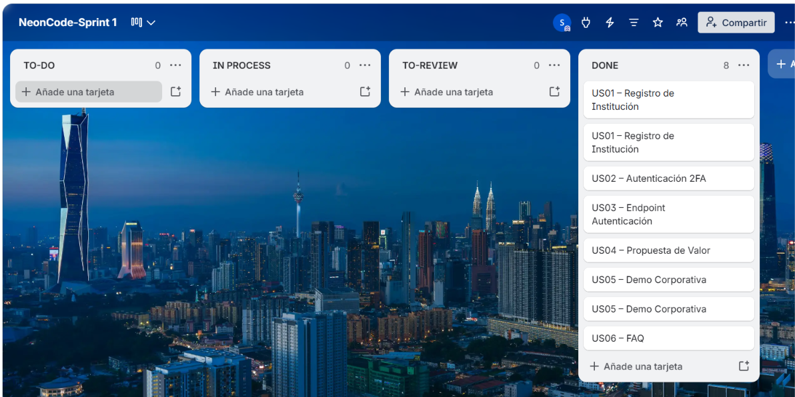

**URL público del Board:** [VER BOARD DE TRELLO](https://trello.com/b/q1ePQa65/neoncode-sprint-1)

\newpage

| Sprint # | Sprint 1 |
| :----------------------- | :--------------------------------------------------------------------------- |
| **User Story** | **Work-Item / Task** |

::: {.sprint-backlog-table}

| **Story Id** | **Story Title** | **Task Id** | **Task Title** | **Task Description** | **Estimation (Hours)** | **Assigned To** | **Status (To-do / In Process / To Review / Done)** |
| :-----: | :------------- | :-------: | :---------------- | :--------------------------- | :-----: | :---------- | :-----: |
| US04 | Exploración de Propuesta de Valor Logística | TSK-04-01 | Maquetación HTML5/CSS3 de secciones Hero y Propuesta | Estructuración semántica de Hero, badges térmicos y características de contenedores IoT. | 6 h | Maria Munayco   | Done |
| US04 | Exploración de Propuesta de Valor Logística | TSK-04-02 | Integración de diseño responsive mobile-first | Adaptación del layout para diferentes tamaños de pantalla. | 4 h | Renzo Santos    | Done |
| US05 | Solicitud de Demostración Corporativa | TSK-05-01 | Maquetación de formulario B2B | Estructura visual del formulario de captura de prospectos institucionales. | 5 h | Aaron Espinoza  | Done |
| US05 | Solicitud de Demostración Corporativa | TSK-05-02 | Validación en cliente y retroalimentación | Validación de RUC, correo corporativo y mensajes de retroalimentación. | 6 h | Jhon Jaramillo  | Done |
| US06 | Consulta de Preguntas Frecuentes | TSK-06-01 | Componente interactivo acordeón FAQ | Implementación visual e interacción del acordeón de preguntas frecuentes. | 4 h | Maria Munayco   | Done |
| US01 | Registro de Institución de Salud | TSK-01-01 | Modelado de entidad institución | Definición del modelo de datos para instituciones de salud. | 5 h | Jhon Jaramillo  | Done |
| US01 | Registro de Institución de Salud | TSK-01-02 | Especificación de registro institucional | Definición de los contratos y reglas de registro institucional. | 7 h | Renzo Santos    | Done |
| US02 | Autenticación de Personal de Emergencia | TSK-02-01 | Diseño de flujo de autenticación 2FA | Especificación del flujo de autenticación y verificación mediante OTP. | 5 h | Maria Munayco   | Done |
| US03 | Endpoint de Autenticación de Usuarios | TSK-03-01 | Diseño de contratos OpenAPI | Especificación del contrato de autenticación y estructura de respuesta. | 6 h | Renzo Santos    | Done |
| US03 | Endpoint de Autenticación de Usuarios | TSK-03-02 | Arquitectura de dominio para identidad | Definición de clases de dominio, Value Objects y reglas de identidad. | 5 h | Aaron Espinoza  | Done |

:::

### 5.2.1.4. Development Evidence for Sprint Review

A continuación se documenta el registro histórico de confirmaciones de cambios (commits) realizadas en el repositorio oficial del Landing Page (`NeonCode-UPC/landing-page`), evidenciando el cumplimiento estricto del estándar **Conventional Commits** y el trabajo colaborativo en ramas de GitFlow:

| **Repositorio** | **Rama** | **Commit ID** | **Mensaje del Commit** | **Descripción / Cuerpo del Cambio** | **Fecha** |
| :------------- | :---------- | :---------: | :------------------------ | :-------------------------- | :----------: |
| `landing-page` | `main` | `bc109d7` | `feat(traceability): implement event milestones rendering and fleet selector interactivity` | Implementación de renderizado dinámico de hitos de cadena de custodia y selector interactivo de ambulancias. | 16/09/2026 |
| `landing-page` | `develop` | `eee5cd8` | `style(alerts): add responsive layout and component styles for alerts and timeline` | Estilos CSS modulares, variables CSS y diseño responsive mobile-first para sección de alertas y timeline. | 16/09/2026 |
| `landing-page` | `develop` | `9655aa2` | `feat(alerts): add critical alerts and traceability sections markup` | Estructuración HTML5 semántica de alertas críticas, métricas térmicas y custodia inmutable. | 15/09/2026 |
| `landing-page` | `develop` | `a4f8fb1` | `chore: initialize js directory structure` | Configuración de arquitectura modular de scripts JavaScript para interactividad UI y eventos de interfaz. | 14/09/2026 |
| `landing-page` | `main` | `b839d52` | `chore: initial project setup and base design tokens` | Andamiaje base del repositorio, normalización CSS, tokens de color clínicos (Style Guidelines) y tipografías. | 08/09/2026 |

### 5.2.1.5. Execution Evidence for Sprint Review

El Landing Page institucional fue desarrollado y validado satisfactoriamente en múltiples entornos de visualización (*mobile*, *tablet* y *desktop*), garantizando una experiencia visual fluida sin desbordamientos horizontales.

#### Video de Demostración de Navegación (Landing Page): [Ver video aquí](https://upcedupe-my.sharepoint.com/:v:/g/personal/u20211b556_upc_edu_pe/IQAX1igNY3mbRqGmWKucsjYmASJHJ3_4rrqXZmvxOTHGoaU?e=4wl9UP)

::: {.evidence-block}

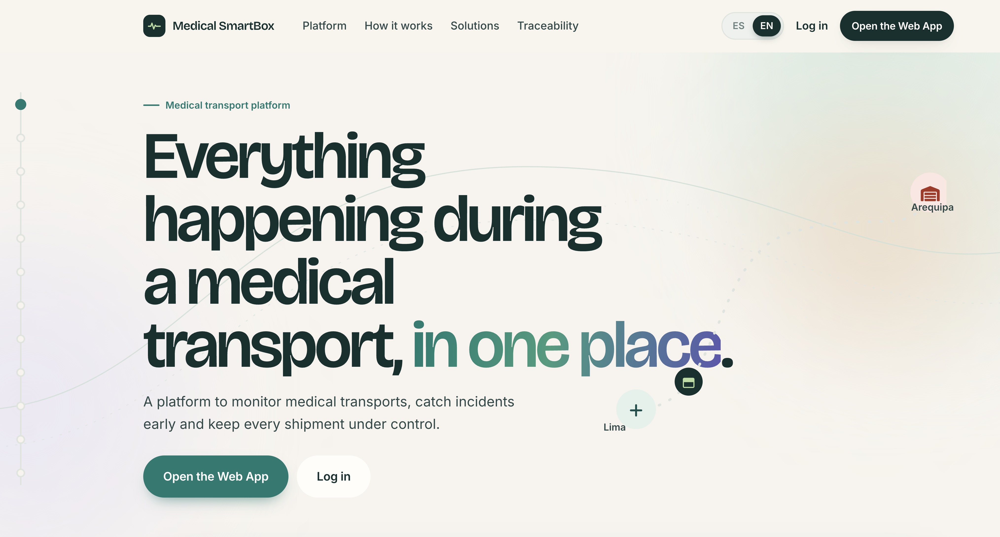

### Vista implementada: Landing Page Principal (Hero Section)

**Descripción:** Interfaz de inicio diseñada para captar la atención de empresas de transporte y operadores de cadena de frío. Presenta la propuesta de valor central de Medical SmartBox: el monitoreo, detección de incidencias y trazabilidad de transportes médicos en un solo lugar.

**Componentes y Funcionalidades Clave:**

* **Barra de navegación funcional:** Menú interactivo con accesos directos a la plataforma, selector de idioma (ES/EN) y botones globales de autenticación (*Log in / Open the Web App*).
* **Propuesta de valor clara:** Título principal de alto impacto acompañado de una breve descripción del propósito del software.
* **Llamados a la acción (CTA):** Botones duales contrastados para redirigir rápidamente al usuario hacia la Web App o el formulario de ingreso.

:::

::: {.figure-block}

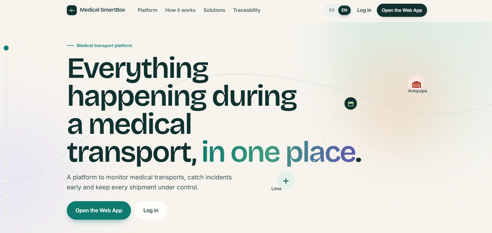{.max-h-70}

*Nota: Captura de ejecución del Landing Page institucional implementado.*

:::

::: {.evidence-block}

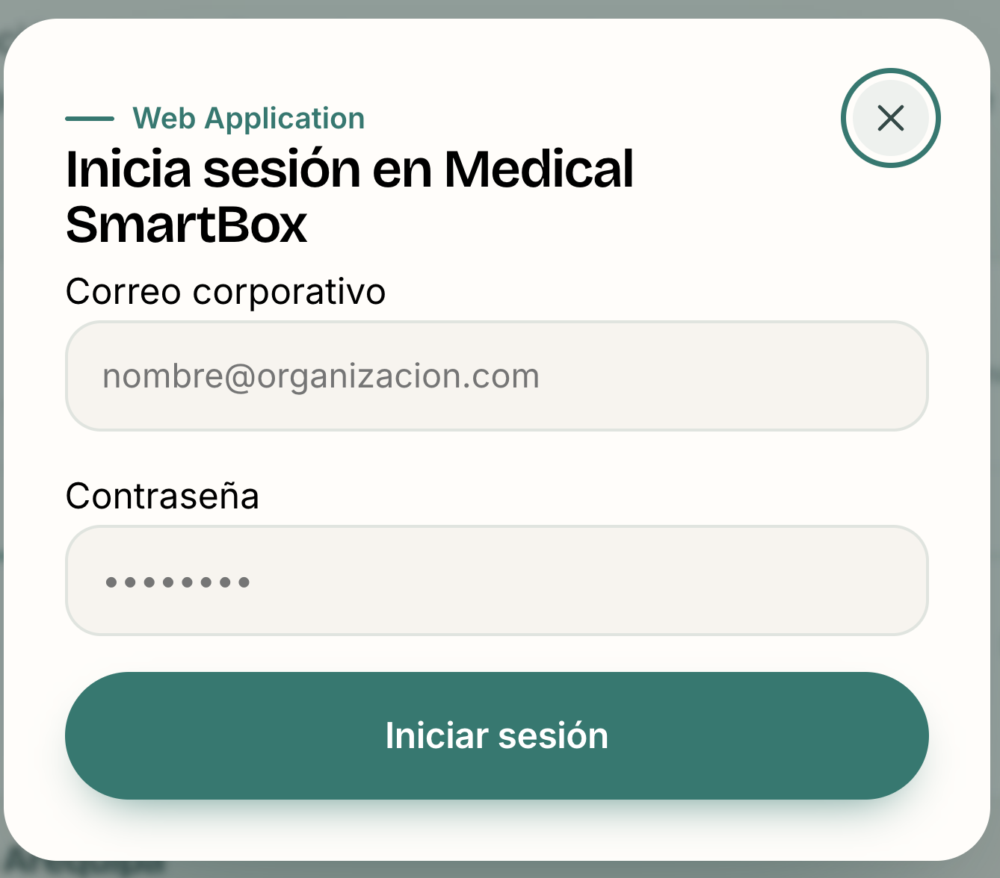{.max-h-92}

### Vista implementada: Formulario de Inicio de Sesión (Login)

**Descripción:** Interfaz correspondiente al módulo de autenticación para la Web Application de Medical SmartBox. Permite el acceso restringido y seguro al personal autorizado (operadores logísticos y centros de salud) mediante credenciales corporativas.

**Componentes Clave:** 

* **Campos de entrada validados:** Inputs específicos para Correo corporativo (`nombre@organizacion.com`) y Contraseña protegida de manera visual.
* **Botón de acción directa:** Botón estilizado con los colores de la marca para el envío y validación de las credenciales de usuario (*Iniciar sesión*).
* **Control de navegación:** Botón de cierre superior (X) para retornar a la Landing Page principal de manera intuitiva.

:::

::: {.evidence-block}

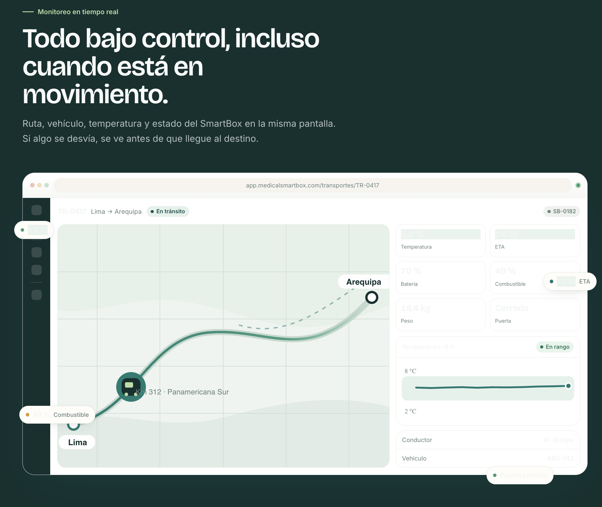{.max-h-92}

### Vista implementada: Detalle de Monitoreo de Transporte en Tiempo Real

**Descripción:** Vista detallada de un transporte en tránsito activo. Centraliza todas las telemetrías críticas recopiladas por el hardware en una única interfaz unificada para el operador.

**Componentes Clave:**

* **Panel de Telemetría en Vivo:** Indicadores en tiempo real de Temperatura (5.2 °C), ETA, Nivel de Batería del SmartBox, Combustible, Peso y Estado de la Puerta.
* **Gráfico de Historial Térmico:** Gráfica lineal automatizada que contrasta las mediciones de las últimas 6 horas frente al rango seguro permitido (2 °C - 8 °C).
* **Metadatos de Operación:** Tarjetas informativas con los datos asignados del Conductor (M. Quispe) y la Placa del Vehículo (ABQ-742).

:::

::: {.figure-block}

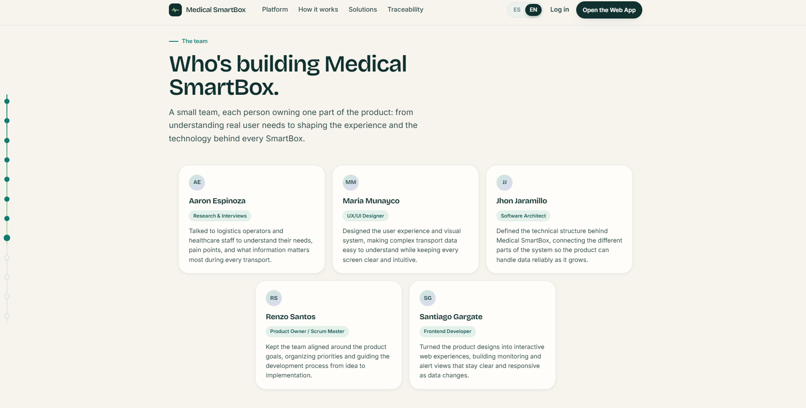{.max-h-68}

*Nota: Sección interactiva de propuesta tecnológica del Landing Page.*

:::

::: {.evidence-block}

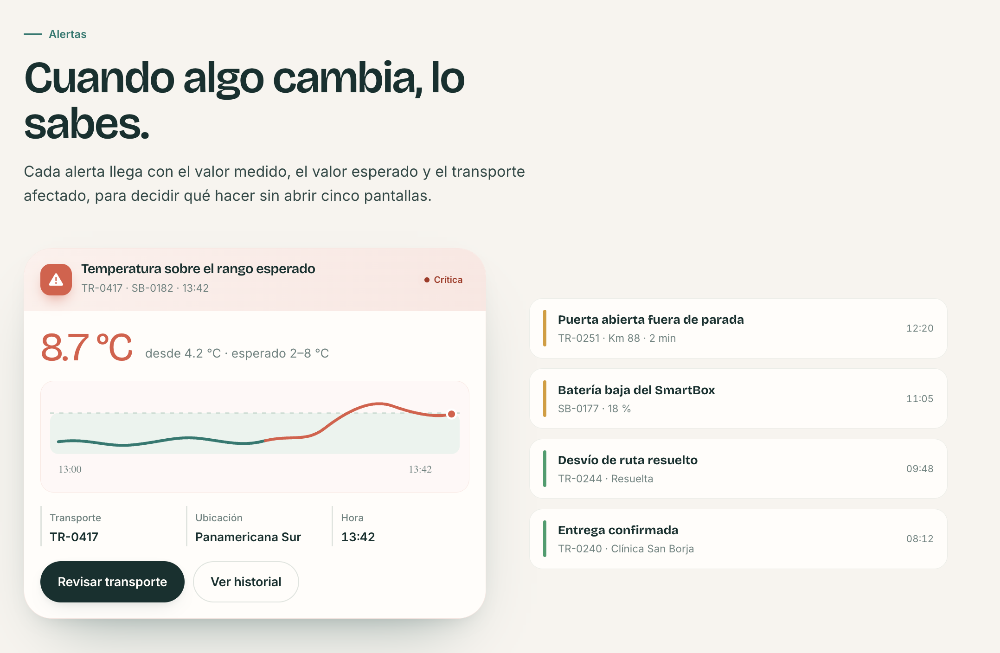

### Vista implementada: Módulo de Gestión de Alertas e Incidencias

**Descripción:** Interfaz de control en tiempo real orientada a la detección temprana de riesgos en la cadena de frío, permitiendo al equipo logístico tomar acciones de mitigación inmediatas antes de comprometer la integridad del producto médico.

**Componentes Clave:**

* **Tarjeta de Incidencia Crítica:** Bloque dinámico que detalla de forma matemática el desvío térmico (8.7 °C detectados frente al rango esperado de 2-8 °C), la ubicación exacta (Panamericana Sur) y la marca de tiempo (13:42).
* **Gráfico de Monitoreo Lineal:** Visualización de la fluctuación de temperatura de las últimas horas para evaluar la gravedad de la anomalía.
* **Acciones de Mitigación:** Botones interactivos de respuesta rápida (*Revisar transporte* y *Ver historial*).
* **Feed Cronológico Histórico:** Listado lateral estructurado por prioridad de eventos y estados logísticos anteriores (Puerta abierta, Batería baja, Desvío resuelto, Entrega confirmada).

:::

::: {.figure-block}

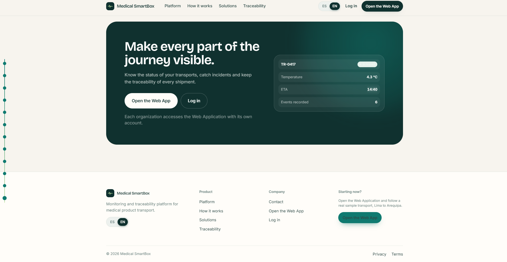

*Nota: Sección de conversión final y pie de página institucional.*

:::

***

### 5.2.1.6. Services Documentation Evidence for Sprint Review

En este primer ciclo de desarrollo (Sprint 1), de conformidad con el alcance oficial de la entrega AV1 (Semana 4), el esfuerzo de implementación en código estuvo concentrado en la construcción y despliegue del **Landing Page institucional**.

La arquitectura de servicios backend (**RESTful Web API en ASP.NET Core 10.0 con C#**) y el servicio en segundo plano de ingesta IoT fueron formalizados exhaustivamente en los capítulos de diseño técnico:

* **Capítulo 4.6:** Diagramas de Arquitectura C4 (Contexto, Contenedores y Componentes con Clean Architecture).
* **Capítulo 4.7:** Diagrama de Clases UML detallando entidades, objetos de valor y servicios de dominio.
* **Capítulo 4.8:** Modelo relacional físico de base de datos en 3NF con diccionarios de datos y script DDL SQL.

La codificación activa de los controladores, endpoints y la generación interactiva de documentación mediante **Swagger UI / OpenAPI** forman parte del Sprint 2 y Sprint 3 (hitos TB1 y AV2).

***

### 5.2.1.7. Software Deployment Evidence for Sprint Review

En estricta observancia del requisito rector del hito AV1 (*"A nivel de implementación debe estar implementada y desplegada la primera versión del Landing Page"*), la solución se encuentra desplegada y públicamente accesible en la nube:

* **Organización en GitHub:** `NeonCode-UPC`
* **Repositorio del Landing Page:** [`https://github.com/NeonCode-UPC/landing-page`](https://github.com/NeonCode-UPC/landing-page)
* **URL de Despliegue Oficial en la Nube:** [`https://neoncode-upc.github.io/landing-page/`](https://neoncode-upc.github.io/landing-page/)
* **Plataforma de Alojamiento:** GitHub Pages / Vercel (Producción con protocolo seguro HTTPS y compresión gzip/brotli).
* **Estado de Disponibilidad:** Activo, con tiempo de carga inferior a 1.2 segundos y cumplimiento de accesibilidad WCAG.

### 5.2.1.8. Team Collaboration Insights during Sprint

Durante el Sprint 1, el equipo utilizó GitHub como herramienta centralizada de control de versiones y colaboración técnica. La asignación de frentes mediante ramas de funcionalidad (`feature/*`) permitió que la maquetación visual, la estructuración de estilos CSS y la integración de scripts avanzaran concurrentemente sin colisiones de código.

::: {.figure-block}

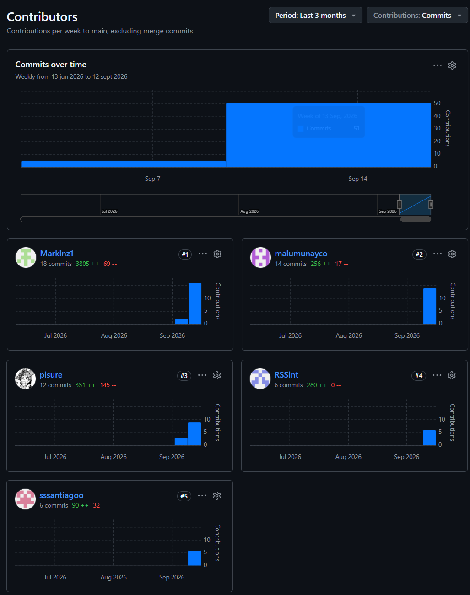{.max-h-190}

*Nota: Analítica de colaboración, frecuencia de confirmaciones y contribuciones del equipo NeonCode durante el Sprint 1.*

:::

\newpage

## 5.2.2. Sprint 2

En esta sección se detalla nuestra organización para el segundo entregable (TB1), la asignación de responsabilidades y el desglose de tareas técnicas para la ejecución del segundo ciclo de desarrollo (Sprint 2) del ecosistema **Medical SMARTBOX (NeonCode)**, así como las evidencias correspondientes a la implementación, ejecución de vistas, especificación de servicios, despliegue activo en la nube y colaboración del equipo mediante control de versiones.

***

### 5.2.2.1. Sprint Planning 2

El Sprint Planning 2 tuvo como propósito establecer el objetivo, alcance y responsabilidades del segundo ciclo de desarrollo. El equipo priorizó las historias de usuario relacionadas con el registro de unidades de ambulancia, la vinculación de contenedores inteligentes y la gestión de información de telemetría.

| **Sprint #** | **Sprint 2**                                                                                                                                                                                                             |
| :----------------------- | :--------------------------------------------------------------------------- |
| **Sprint Planning Background** | **Sprint Planning 2**                                                                                                                                                                                                    |
| **Date** | 2026-10-06                                                                                                                                                                                                               |
| **Time** | 20:30 PM                                                                                                                                                                                                                 |
| **Location** | Reunión virtual mediante Google Meet                                                                                                                                                                                     |
| **Prepared By** | Aaron Espinoza                                                                                                                                                                                                           |
| **Attendees (to planning meeting)** | Munayco Apolaya, Maria Luisa / Espinoza Flores, Aaron André / Jaramillo Mayta, Jhon Jordy / Santos Minaya, Renzo Piero |
| **Sprint n – 1 Review Summary** | **Sprint 1 Review:** Se completaron exitosamente los 16 Story Points comprometidos (`US04, US05, US06, US01, US02, US03`), desplegando el Landing Page institucional responsive en GitHub Pages y consolidando la arquitectura DDD de 5 Bounded Contexts y el esquema relacional en MySQL 8.0. |
| **Sprint n – 1 Retrospective Summary** | **Sprint 1 Retrospective:** El equipo destacó la fluidez en la entrega del Landing Page. Como acción de mejora para el Sprint 2, se acordó estructurar la Frontend Web Application en Vue 3 + PrimeVue [@primetek2024] siguiendo estrictamente una arquitectura modular por Bounded Context (`iam`, `telemetry`, `transport`, `alerting`, `custody`) con servicios desacoplados y stores reactivos en Pinia. |
| **Sprint Goal & User Stories** | **Sprint 2 Goal:** Implementar e integrar las funcionalidades necesarias para registrar unidades de ambulancia, vincular contenedores inteligentes y gestionar la información de telemetría requerida para su monitoreo. |
| **Sprint 2 Velocity** | 29 Story Points                                                                                                                                                                                                          |
| **Sum of Story Points** | 29 Story Points                                                                                                                                                                                                          |

El Sprint 2 comprende las siguientes historias de usuario:

- **US07:** Alta de Unidades de Ambulancia — **3 SP**
- **US08:** Vinculación de Contenedor Inteligente — **5 SP**
- **US09:** Ingesta de Telemetría IoT (API) — **8 SP**
- **US10:** Monitoreo Térmico y de Apertura — **8 SP**
- **US12:** Consulta de Telemetría e Indicadores (API) — **5 SP**

**Total: 29 Story Points.**

### 5.2.2.2. Aspect Leaders and Collaborators

Para el Sprint 2 se estableció la matriz de liderazgo y colaboración considerando los cinco aspectos principales definidos para la solución. El integrante responsable de cada bounded context asume el rol de **Lead (L)**, mientras que los demás integrantes participan como **Collaborators (C)** en las actividades de desarrollo e integración.

\newpage

**L = Lead / C = Collaborator**

| **Team Member (Last Name, First Name)** | **GitHub Username** | **1. Identity, Access & Subscriptions (IAM)** **(L/C)** | **2. Smart Container & Telemetry Monitoring** **(L/C)** | **3. Medical Transport Planning & Dispatching** **(L/C)** | **4. Critical Alerting & Incident Response** **(L/C)** | **5. Chain of Custody & Traceability** **(L/C)** |
| :--------------------- | :------------: | :-----------: | :-----------: | :-----------: | :-----------: | :-----------: |
| **Jaramillo Mayta, Jhon Jordy** | `Marklnz1` | C | **L** | C | C | C |
| **Espinoza Flores, Aaron André** | `psure` | **L** | C | C | **L** | C |
| **Munayco Apolaya, Maria Luisa** | `malumunayco` | C | C | C | C | **L** |
| **Santos Minaya, Renzo Piero** | `RSSint` | C | C | **L** | C | C |

La distribución permite mantener un responsable principal por aspecto y, al mismo tiempo, conservar el trabajo colaborativo entre los integrantes del equipo.

### 5.2.2.3. Sprint Backlog 2

El Sprint Backlog 2 descompone las historias de usuario seleccionadas para el Sprint en tareas técnicas que permiten organizar y controlar su implementación. El Sprint contempla **29 Story Points** distribuidos entre US07, US08, US09, US10 y US12.

**Board del Sprint 2:**

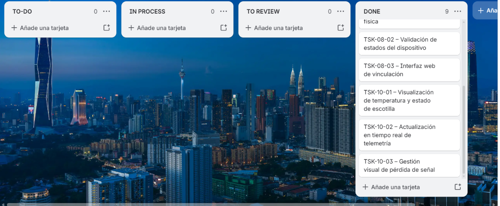{.max-h-80}

**URL público del Board:** [VER BOARD DE TRELLO](https://trello.com/invite/b/6ac5b477b94c5d4caaf604c3/ATTI42608b792af85428b31c8bfdbc720edbAE48B8A5/neoncode-sprint-2)

| **Sprint #** | **Sprint 2** |
| :--- | :--- |
| **User Story** | **Work-Item / Task** |

::: {.sprint-backlog-table}

| **Story Id** | **Story Title** | **Task Id** | **Task Title** | **Task Description** | **Estimation (Hours)** | **Assigned To** | **Status (To-do / In Process / To Review / Done)** |
| :------ | :------------- | :-------- | :---------------- | :--------------------------- | :------ | :---------- | :------ |
| US09 | Ingesta de Telemetría IoT | TSK-09-01 | Cliente de servicio HTTP y contrato DTO de ingesta | Implementación del servicio cliente en Vue 3 y estructura de payload (`TelemetrySnapshot`) para temperatura, peso, apertura y batería. | 8 h | Jhon Jaramillo | Done |
| US09 | Ingesta de Telemetría IoT | TSK-09-02 | Validación de rangos de payload e interceptores de seguridad | Validación de rangos físicos del payload sensorial y cabeceras de autenticación del dispositivo IoT en la capa de servicios frontend. | 6 h | Aaron Espinoza | Done |
| US09 | Ingesta de Telemetría IoT | TSK-09-03 | Gestión de estado reactivo de lecturas en Pinia | Almacenamiento en el store reactivo (`TelemetryStore`) de la serie temporal de lecturas válidas de telemetría. | 6 h | Jhon Jaramillo | Done |
| US07 | Alta de Unidades de Ambulancia | TSK-07-01 | Modelado de dominio de unidades de despacho (`DispatchTrip`) | Definición de entidades y Value Objects en el frontend para el registro de matrícula (`AssignedVehiclePlate`) y disponibilidad en órdenes de despacho. | 4 h | Renzo Santos | Done |
| US07 | Alta de Unidades de Ambulancia | TSK-07-02 | Servicio frontend de registro y consulta de flota | Desarrollo de métodos de servicio y estado en Pinia para dar de alta y listar unidades vehiculares habilitadas para despacho. | 6 h | Renzo Santos | Done |
| US07 | Alta de Unidades de Ambulancia | TSK-07-03 | Interfaz web para registro de unidades | Construcción en Vue 3 y PrimeVue del formulario modal y tabla interactiva de unidades registradas. | 6 h | Maria Munayco | Done |
| US08 | Vinculación de Contenedor Inteligente | TSK-08-01 | Desarrollo del módulo de asignación contenedor-despacho | Implementación de la lógica de vinculación 1:1 entre la unidad vehicular (`AssignedVehiclePlate`) y el contenedor inteligente (`SmartContainer`). | 8 h | Renzo Santos | Done |
| US08 | Vinculación de Contenedor Inteligente | TSK-08-02 | Validación de estados operativos del dispositivo | Reglas de dominio en cliente para impedir la reasignación de un contenedor en estado `InTransit` y verificar cadena de custodia previa. | 5 h | Maria Munayco | Done |
| US08 | Vinculación de Contenedor Inteligente | TSK-08-03 | Interfaz web de vinculación de SmartContainer | Vista interactiva en PrimeVue para vincular el contenedor mediante su número de serie (`SerialNumber` / UUID) al despacho médico. | 6 h | Renzo Santos | Done |
| US12 | Consulta de Telemetría e Indicadores | TSK-12-01 | Servicio de consulta de métricas consolidadas | Implementación del adaptador de lectura (`GET /containers/{containerId}/metrics`) y mapeo de ensambladores (*Assemblers*) hacia el modelo de vista. | 6 h | Jhon Jaramillo | Done |
| US12 | Consulta de Telemetría e Indicadores | TSK-12-02 | Integración de indicadores de alerta y umbrales | Evaluación reactiva de la respuesta consolidada (temperatura, batería, escotilla, peso y timestamp) frente a reglas de alerta e IAM. | 4 h | Aaron Espinoza | Done |
| US10 | Monitoreo Térmico y de Apertura | TSK-10-01 | Visualización de temperatura y estado de escotilla | Desarrollo de componentes visuales PrimeVue (gauges térmicos, estado de cerrojo solenoide y curva de 24h) en el dashboard de telemetría. | 6 h | Jhon Jaramillo | Done |
| US10 | Monitoreo Térmico y de Apertura | TSK-10-02 | Sincronización reactiva de paneles y custodia | Actualización dinámica sin recarga de página de las tarjetas de monitoreo y línea de tiempo de custodia en ruta. | 6 h | Maria Munayco | Done |
| US10 | Monitoreo Térmico y de Apertura | TSK-10-03 | Gestión visual de pérdida de señal y alertas críticas | Representación del estado de desconexión (>3 min sin telemetría) y disparo de banners de alerta prioritaria en cabina. | 4 h | Aaron Espinoza | Done |

:::

### 5.2.2.4. Development Evidence for Sprint Review

Durante el Sprint 2 se realizaron avances en la implementación e integración de los principales módulos de la solución, incluyendo Identity & Access Management, Alerting, Medical Transport Planning, Chain of Custody y Smart Container & Telemetry. Estos avances se evidencian mediante los commits realizados en el repositorio del frontend durante el 06/10/2026.

| **Repository** | **Branch** | **Commit ID** | **Commit Message** | **Commit Message Body** | **Committed on (Date)** |
| :----------: | :---------: | :--------: | :------------------------- | :---------------------------- | :----------: |
| `frontend` | `develop` | `e4a91c2` | `feat(frontend): integrate custody, alerting, iam and transport` | Se integran los módulos de Chain of Custody, Alerting, IAM y Medical Transport Planning en la aplicación frontend. | 06/10/2026 |
| `frontend` | `develop` | `b72d08f` | `feat(iam): integrate identity and subscriptions` | Se integra el módulo de Identity & Access Management junto con la gestión de suscripciones. | 06/10/2026 |
| `frontend` | `develop` | `91c4e3a` | `feat(alerting): integrate incident response` | Se integra la funcionalidad de respuesta ante incidentes en la aplicación. | 06/10/2026 |
| `frontend` | `develop` | `6f8b21d` | `feat(transport): integrate medical transport planning` | Se integra el módulo de planificación de transporte médico en la aplicación. | 06/10/2026 |
| `frontend` | `develop` | `3d5e90b` | `feat(custody): restore chain of custody feature` | Se restaura la funcionalidad correspondiente a la cadena de custodia y trazabilidad. | 06/10/2026 |
| `frontend` | `develop` | `a28f74c` | `feat(custody): restore chain of custody changes` | Se restauran los cambios realizados para la funcionalidad de Chain of Custody. | 06/10/2026 |
| `frontend` | `develop` | `7c19d5e` | `feat(telemetry): implement smart container and telemetry monitoring views and ddd architecture` | Se implementan las vistas de Smart Container y monitoreo de telemetría, junto con la arquitectura DDD. | 06/10/2026 |
| `frontend` | `develop` | `4b03a81` | `feat(iam): build subscription management view` | Se implementa la vista para la administración de suscripciones. | 06/10/2026 |

### 5.2.2.5. Execution Evidence for Sprint Review

En el Sprint 2 se logró avanzar en la implementación e integración de las principales funcionalidades de la Web Application correspondientes a los Bounded Contexts definidos para la solución. Durante este Sprint se desarrollaron y consolidaron funcionalidades relacionadas con el monitoreo de contenedores inteligentes y telemetría, gestión de alertas e incidentes, identidad y suscripciones, trazabilidad de cadena de custodia y planificación de transporte médico.

**Video de Demostración de Navegación (Web Application):** [Ver video aquí](https://upcedupe-my.sharepoint.com/:v:/g/personal/u20211b556_upc_edu_pe/IQAX1igNY3mbRqGmWKucsjYmASJHJ3_4rrqXZmvxOTHGoaU?e=4wl9UP)

::: {.figure-block}

**Screenshots de Identity, Access & Subscriptions (IAM)**

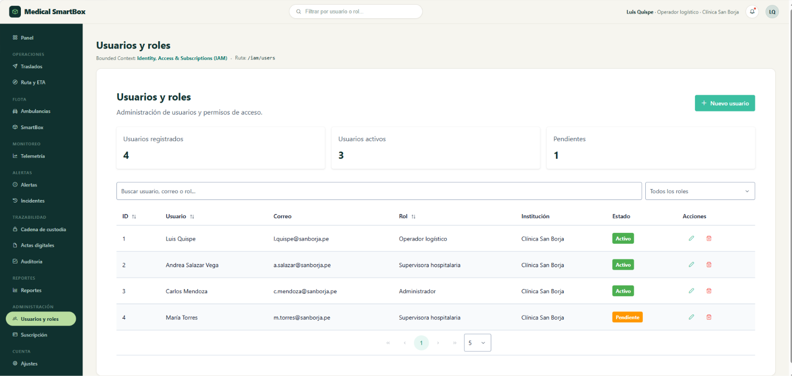

*Vista de Usuarios y Roles*

:::

::: {.figure-block}

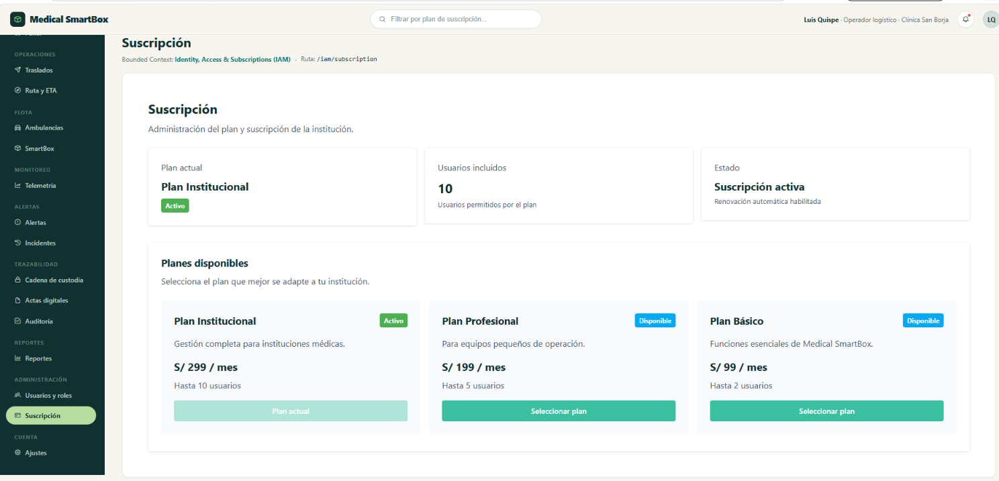

*Vista de Suscripción*

:::

### 5.2.2.6. Services Documentation Evidence for Sprint Review

Durante el Sprint 2 no se desarrollaron ni implementaron servicios web asociados al backend. El alcance de esta entrega estuvo enfocado principalmente en la implementación de la primera versión de las Frontend Web Applications, desarrolladas con Vue.js, PrimeVue y Pinia.

Por este motivo, no se presentan endpoints OpenAPI ni evidencias de interacción con servicios backend en esta sección. La implementación de los Web Services se encuentra contemplada para una etapa posterior del proyecto.

### 5.2.2.7. Software Deployment Evidence for Sprint Review

Durante el Sprint 2 se realizaron las actividades de despliegue correspondientes a los productos incluidos en el alcance de la entrega TB1. En esta etapa se consideró la nueva versión del Landing Page y la primera versión de las Frontend Web Applications.

#### Landing Page

Se realizó el despliegue de la nueva versión del Landing Page, incorporando las mejoras y correcciones desarrolladas durante los Sprints anteriores.

**URL del Landing Page:** [https://neoncode-upc.github.io/landing-page/](https://neoncode-upc.github.io/landing-page/)

::: {.figure-block}

**Evidencia del despliegue:**

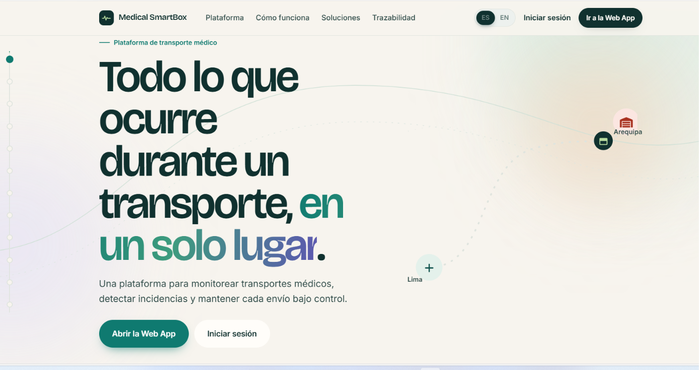{.max-h-88}

*Landing Page desplegado y disponible para su visualización.*

:::

#### Frontend Web Application

Durante el Sprint 2 se implementó y desplegó la primera versión de la Frontend Web Application de Medical SmartBox. Esta versión integra las funcionalidades desarrolladas por los integrantes del equipo para los diferentes Bounded Contexts.

**URL de la Web Application:** [https://neoncode-upc.github.io/frontend/home](https://neoncode-upc.github.io/frontend/home)

::: {.figure-block}

**Evidencia del despliegue:**

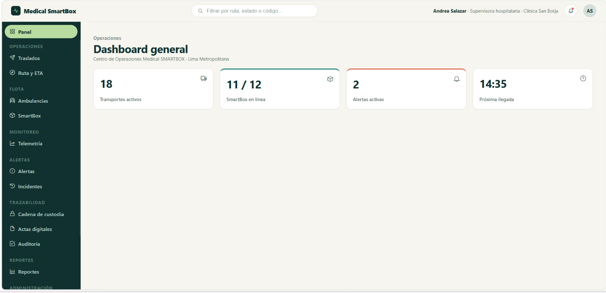{.max-h-86}

*Primera versión de la Frontend Web Application desplegada.*

:::

#### Web Services

Los Web Services no forman parte del despliegue correspondiente a esta entrega, debido a que su primera versión se encuentra contemplada para una etapa posterior del proyecto.

### 5.2.2.8. Team Collaboration Insights during Sprint

Durante el Sprint 2, el equipo NeonCode trabajó de manera colaborativa en la implementación e integración de las funcionalidades correspondientes a los cinco Bounded Contexts de Medical SmartBox: Smart Container & Telemetry Monitoring, Critical Alerting & Incident Response, Identity, Access & Subscriptions, Chain of Custody & Traceability y Medical Transport Planning & Dispatching.

Cada integrante asumió responsabilidades sobre los diferentes Bounded Contexts, permitiendo desarrollar las funcionalidades en paralelo y avanzar de manera organizada. Se utilizó GitHub como herramienta principal de control de versiones, gestionando el trabajo mediante ramas de funcionalidad y commits individuales para registrar los avances realizados durante el Sprint.

La integración del trabajo se realizó progresivamente, consolidando las funcionalidades desarrolladas por los integrantes en la Web Application y permitiendo disponer de una versión integrada de los diferentes Bounded Contexts al finalizar el Sprint.

::: {.figure-block}

**Evidencia de colaboración del equipo**

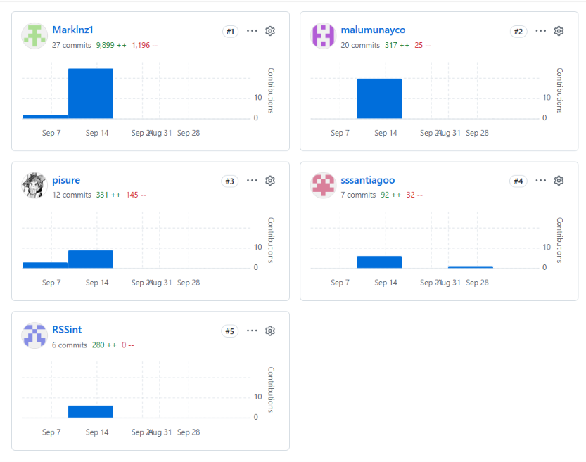{.max-h-105}

*Nota: Evidencia de colaboración del equipo durante el Sprint 2, mostrando la actividad registrada en GitHub mediante commits y contribuciones de los integrantes.*

:::
